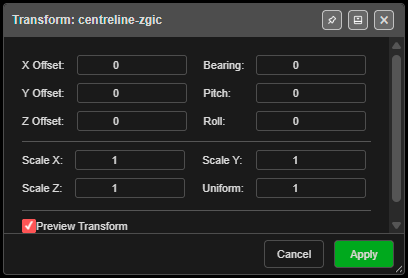

# Transform KAD

Moves, rotates and scales selected drawings — and selected point-cloud points — by exact amounts,
with a live preview.

---

## Transform drawings

1. Select one or more drawings — points, lines, polygons, circles or text (Select toolbar, **K**).
2. Click **Transform KAD** on the **Modify** toolbar. **Transform: …** opens with the drawing's
   name, or the number selected.
3. Type the amounts. With **Preview Transform** on, the drawings move as you type.
4. Click **Apply**. **Cancel**, **×** or **Escape** puts everything back where it was.

With nothing selected Kirra says *"Select KAD objects (points, lines, polygons, circles, text) or
point-cloud points to transform."* Locked drawings are not moved.

**Point clouds.** Select points in a shown, unlocked [point cloud](../surfaces/point-clouds.md#selecting-points)
first. The dialog is then titled, for example, **Transform: 1,240 point-cloud points**, and the
points move with the drawings. Each cloud's change is its own **Ctrl+Z** step, *"Transform
point-cloud points"*.

---

## The fields

| Field | Default | What it does |
|---|---|---|
| **X Offset:**, **Y Offset:**, **Z Offset:** | 0 | Move, in metres |
| **Bearing:** | 0 | Rotate in plan, in degrees — positive is clockwise |
| **Pitch:**, **Roll:** | 0 | Tilt, in degrees |
| **Scale X:**, **Scale Y:**, **Scale Z:** | 1 | Stretch along each axis |
| **Uniform:** | 1 | *"Sets X, Y and Z together"* |
| **Preview Transform** | On | Shows the result live |

Kirra scales first, then rotates, then moves — all about the centre of the selection.

---

## Other ways to use it

| Method | Result |
|---|---|
| **Escape** | Cancels and restores the originals |
| Switch the button off | The same as Cancel |
| Dock the dialog (pin in the title bar) | Keeps it beside the canvas while you work |

---

## Undo

**Apply** is one **Ctrl+Z** step — *"Transform KAD entities"*.

---

## Related

- [Move](move.md) — drag by hand
- [Modify Toolbar](modify-tools.md)
