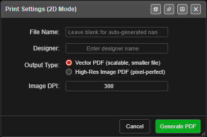

# Print from Template (XLSX)

Kirra can generate formatted reports using custom XLSX spreadsheet templates. The template system reads your active blast data and populates fields, maps, and statistics into a professional layout. Use this when you need company-specific formats, multi-page reports, or data exported for further editing in Excel.

---

## How to Access

Click the **Import Export Print** button (file icon) in the menu bar and choose **Print** — or open the left sidenav (☰) and click **Print** under **Print Management**. Both open the **PDF Print** dialog.

*The PDF Print dialog.*

The dialog's main fields are **Saved Template**, **Paper Size** and **Orientation** (**From Sheet** uses the custom template's own setting), **Print Preview**, **Blast Name**, **Designer**, **Title**, **Comment**, **Entity Filter**, **Output Format**, **Override template DPI setting** and **DPI**. Footer buttons: **Save to Library**, **Formulas**, **Reference Pack**, **Delete**, **Help**, and **Print**.

---

## Template Options

### Kirra Inbuilt

The **Kirra Inbuilt** template is a built-in report format that requires no setup. It provides a title block, map zone, and a footer with north arrow, legend, and statistics, and supports:

- 2D and 3D views
- Voronoi overlays
- Surface clipping to the print boundary
- Paper size and orientation chosen in the dialog (XLSX output is not available)

Choose Kirra Inbuilt when you want a quick, standard report without creating a custom template.

From this dialog, Kirra Inbuilt prints aerial images at 300 DPI. To choose a different resolution, use the **Print to PDF** button instead (below).

#### Image DPI (Print to PDF)

The **Print to PDF** button in **Print Management** (left sidenav ☰) prints the Kirra Inbuilt layout through the **Print Settings** dialog. Its **Image DPI** field sets the resolution of aerial images on the page.

*The Print Settings dialog, with Image DPI at its default of 300.*

| Setting | Value |
|---------|-------|
| Range | 72 to 600 |
| Default | 300 |
| Remembered | Yes, for the next print |

- **ECW imagery** is read again from its file at this resolution, up to the detail the file holds. A higher DPI gives a sharper print.
- **GeoTIFF imagery** cannot gain detail it does not have. A higher DPI only makes a bigger PDF.
- **High-Res Image PDF** pages stop at 300, whatever you enter.
- Higher values take longer to make and give a bigger PDF.

### Custom XLSX Templates

Upload your own XLSX spreadsheet to create fully custom layouts. Your template can include:

- **Placeholder fields** — Cells that reference hole properties, pattern statistics, and project metadata
- **Formula cells** — Expressions that start with `fx:` and are evaluated against blast data
- **Render tokens** — Special placeholders for map views, legends, north arrows, and scale bars
- **Multiple sheets** — Each sheet becomes one page; multi-page templates use multiple sheets
- **Tabular layouts** — Tables of hole data, charge summaries, or timing sequences

---

Kirra print cells use the **`fx:`** print-template engine (not Deck Builder charging formulas). See the [Formula Engine](../formula-help/formula-engine.md) hub and the [Print Formula Reference](pdf-print.md) before mixing syntax from charge decks.

---

## Template Workflow

1. Choose **-- Select or Import --** in **Saved Template**, then click **Import Template (.xlsx)** (or pick a template you saved earlier)
2. Kirra reads cells, merged regions, styles, and images
3. **Evaluate** — Cells with the `fx:` prefix are evaluated against your blast data
4. **Output** — Choose PDF (raster or vector) or a populated XLSX spreadsheet

For large templates, Kirra uses a background process to parse the file. A progress dialog appears so the interface stays responsive.

---

## Paper Size and Orientation

**From Sheet** (the default) prints each sheet at the paper size and orientation set in Excel's Page Setup. Excel sheets set to A2, A5, B4 or B5 print at that size.

Pick a size in **Paper Size** or **Orientation** to print on different paper without editing the template:

- Choices are **A4**, **A3**, **A2**, **A1**, **A0**, **Letter**, **Legal** and **Tabloid**.
- The sheet is enlarged (or reduced) to fit the new page, keeping its proportions, and centred.
- For example, an A3 template printed on **A1** is drawn at twice the size.
- Map views gain resolution with the enlargement, so they stay sharp on the bigger page.

---

## Map View Resolution (DPI)

Each `mapView` formula can carry its own DPI, for example `fx:mapView(r, 300)`. The two DPI controls in the dialog decide whether that number is used.

| Override template DPI setting | What prints |
|------|-------------|
| Unticked (default) | Raster map views use the DPI in their formula, or 200 if it has none. Vector map views draw their aerial images at 200. |
| Ticked | Every map view, raster or vector, uses the **DPI** you enter for its images. |

- **DPI** accepts 72 to 600 and is greyed out while the box is unticked.
- Both settings are remembered for the next print.
- ECW imagery is read from its file at the chosen DPI, up to the detail the file holds. See [ECW Imagery](../importing/ecw-imagery.md).

---

## Text from Excel

Template text follows the cell formatting in your spreadsheet:

- **Font family**: sans-serif fonts such as Calibri and Arial print as Helvetica. Serif fonts such as Times New Roman, Cambria and Georgia print as Times. Fixed-width fonts such as Courier and Consolas print as Courier.
- **Bold, italic, size and colour** carry across as set in Excel.
- **Shrink to fit**: text too wide for its cell is reduced until it fits. It is never enlarged, and wrapped cells are not shrunk, as in Excel.
- **Indent**: each indent level moves the text in from the cell edge, as Excel does.
- **Symbols and other alphabets**: characters such as ▬ ● ▲ ◉ print correctly, as does Russian and Mongolian text.

---

## Reference Template

Click **Reference Pack** in the PDF Print dialog to download `Kirra-DesignPRINTReferenceTemplate.zip` — a starter template, the formula reference and the print skill — with examples of:

- Scalar variables (blast name, designer, date, hole count, drill metres, etc.)
- Iterated fields (hole length, diameter, coordinates per hole)
- Aggregation functions (sum, average, min, max)
- Render tokens for map views, legends, and north arrows

Use it as a starting point for your own custom templates.

---

## Example Templates

Downloadable example templates are available that demonstrate advanced features not covered by the basic reference template:

- **Voronoi Showcase** — All 10 Voronoi metric codes with paired legends across fixed, min-max, and default legend modes
- **Hole Section Grid** — `[+>]` grid pagination with `holeSection()` render tokens, `filter()` directives, and math-wrapped indexed fields
- **Multi-Map Views** — Multiple map views on one page with different display code combinations
- **Charging Report** — `blastSummary()`, `chargeSummary()`, `productList()`, `groupTable()`, and per-hole charging tables
- **Hole Data Table** — Per-row `[++]` tables with footer aggregations, filtered subsets, and measured data

See [Template Examples](template-examples.md) for detailed walkthroughs of each template, and [Print Formula Reference](pdf-print.md) for the complete list of all variables, functions, and display codes.

---

## Output Formats

| Format | Description |
|--------|-------------|
| **PDF Raster (High-Res Image)** | Pixel-based rendering; matches complex visuals exactly |
| **PDF Vector (Scalable)** | Scalable lines and text; smaller file size |
| **XLSX (Populated Spreadsheet)** | Populated spreadsheet; edit further in Excel (custom templates only) |

The XLSX output option is available only when using a custom template. Use it when you need to export data to Excel for further editing or reporting.

Aerial images and full-page pictures are stored in the PDF as JPEG, and everything else is compressed, so a print over imagery stays a manageable size to email.

---

## Related Topics

- [Formula Engine](../formula-help/formula-engine.md) — three engines; print vs charging vs blast group
- [Print Formula Reference](pdf-print.md) — Complete list of all variables, functions, display codes, and render tokens
- [Template Examples](template-examples.md) — Downloadable example templates with detailed walkthroughs
- [Statistics & Voronoi](../analysis/statistics-voronoi.md)
- [Charging Overview](../charging/overview.md)
- [Interface Tour](../getting-started/interface-tour.md)
