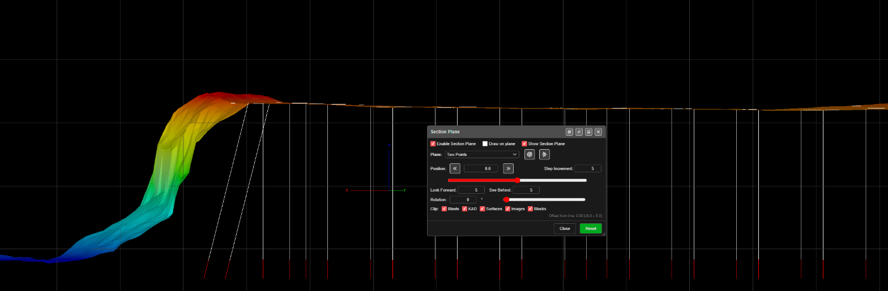
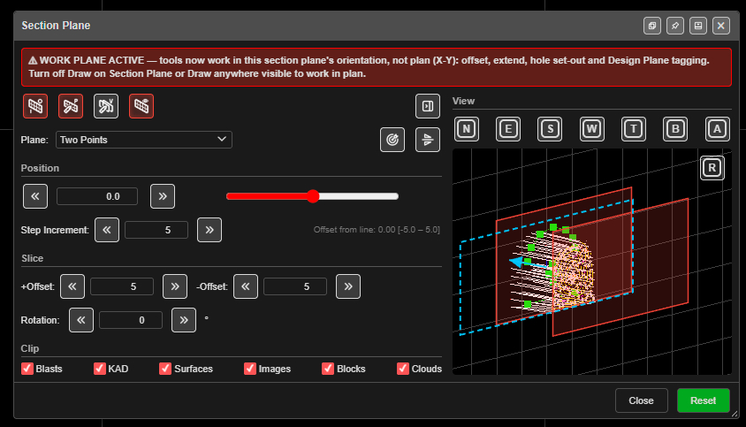
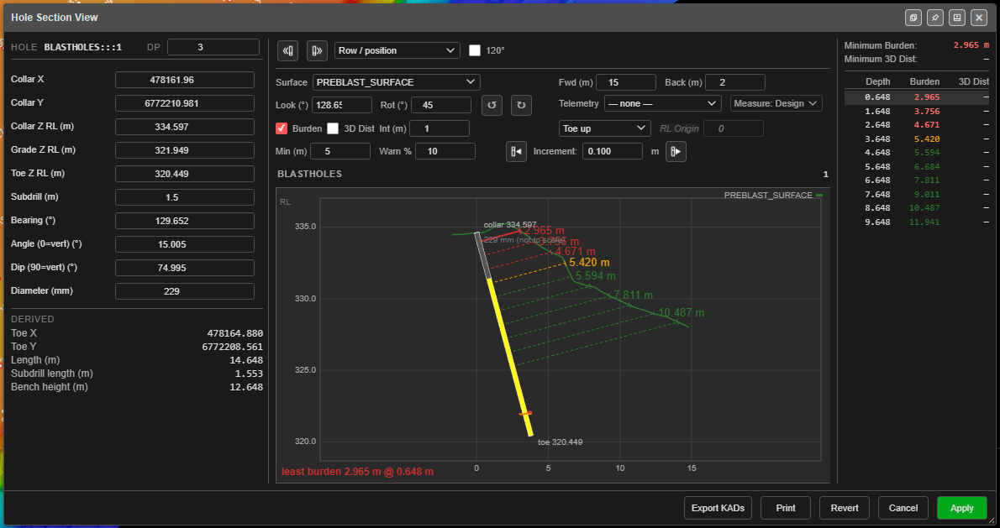

# Section Views

A section shows your design side-on, so you can read what a plan view hides: hole depths
against the bench, burden to the face, the layers a pattern passes through, and the decks
inside a hole. Kirra has three section views, each for a different job.

| Section view | Where | Use it to |
|---|---|---|
| [**Section Plane**](#section-plane) | **Select** toolbar | Slice the whole 3D scene — holes, drawings, surfaces, images, block models and point clouds — and step the slice through the pattern |
| [**Hole Section View**](#hole-section-view) | **Analyse** toolbar → **Hole Section Tool** | Check one hole's burden to the face, and adjust the hole while you watch |
| [**Deck Builder section**](#deck-builder-section) | Charging → **Deck Builder** | See and edit the decks inside a hole, collar to toe |

---

## Section Plane

The Section Plane cuts a **slice** through everything loaded and hides what is outside
it. You choose where the slice sits and how thick it is, then step it through the
pattern.

*A Two Points section across the front of a blast: the face profile, the angled front-row holes and the vertical holes behind them. The grid is **Show Section Plane**.*

### The dialog

*A Two Points section across a drive face, with **Enable Section Plane**, **Draw on Section Plane** and **Show Section Plane** lit and the *WORK PLANE ACTIVE* warning across the top.*

The dialog has two panels. The left panel holds the section: the switches, **Plane**,
**Position**, **Slice** and **Clip**. The right panel is **View**: the view keys and the
overview. The button at the right end of the switch row shows or hides the **View** panel,
and Kirra remembers which you chose. Drag the dialog's corner to make it larger, and the
overview grows with it.

The switches along the top are toggle icons, lit while they are on. Hover over one to read
its name.

| Switch | What it does |
|---|---|
| **Enable Section Plane** | Cuts the 3D view at the plane. Switches to the 3D view. |
| **Draw on Section Plane** | Tools draw on the section, and every point lands exactly on the plane — see [Draw on the section](#draw-on-the-section). |
| **Draw anywhere visible** | Tools draw on the section, and a snapped point keeps its true position inside the slice. |
| **Show Section Plane** | Draws a grid on the section. The grid spacing is the **Step Increment**. |

### Take a section

1. Click **Section Plane** on the **Select** toolbar.
2. Click **Enable Section Plane**. The view switches to 3D — a section is a 3D view.
3. Choose the **Plane**:

   | Plane | The slice |
   |---|---|
   | **Two Points** | Runs vertically through two points you click |
   | **Segment** | Runs vertically along a line you click |
   | **XY (Elevation)** | Horizontal, stepping up and down |
   | **YZ (East-West)** | Vertical, stepping east and west |
   | **XZ (North-South)** | Vertical, stepping north and south |

4. For **Two Points**, click the start point, then the end point. For **Segment**, click
   a line you have drawn. Press **Esc** or right-click to cancel a pick.

The view turns to look along the section. The direction you clicked or drew the line in
sets which way the view faces. The two buttons at the end of the **Plane** row pick the
line again and look the other way along it.

### Set the thickness and step through

- **Position** moves the slice off the section line; **0** sits on it.
- **Step Increment** is how far each step moves. Step the slice with the double-chevron
  buttons either side of **Position**, or **Page Up** / **Page Down**. Hold **Shift** to land
  on exact multiples of the step. The double-chevron buttons beside **Step Increment** itself
  move it up and down a 1-2-5 ladder, from 0.01 to 100.
- **Look Forward** and **See Behind**, under **Slice**, set how far either side of the plane
  stays visible. Both default to **1**, a 2 m slice. They read the same for every plane:
  **Look Forward** is the way the **A** view key looks, so for **XY (Elevation)** it is
  downward. Their double-chevron buttons change them by one step and never go below 0.
- **Rotation** tilts the slice away from vertical. Its double-chevron buttons turn it 1° at
  a time.

> When the dialog first opens on a **Two Points** or **Segment** section, the two **Slice**
> boxes can read **+Offset** and **-Offset** instead of **Look Forward** and **See Behind**.
> They are the same two boxes.

### Choose what is cut

**Clip** sets which kinds of data the section applies to: **Blasts**, **KAD**,
**Surfaces**, **Images**, **Blocks** (block models) and **Clouds** ([point clouds](../surfaces/point-clouds.md)). Untick one to keep it whole while
the rest is sliced — for example, keep the topography whole while slicing the holes.

Snapping follows the clip: a point the section has hidden is never snapped to, so
**Measure** and the drawing tools only pick up what you can see.

### Draw on the section

By default a section is for **looking**: tools still work in plan. Turn on one of the two
draw switches to make the section the plane the tools work in — offset, extend, hole
set-out, move, Design Plane tagging, triangulation and
[electronic timing lines](../blast-design/electronic-timing-constructs.md#timing-an-underground-face).
Both need **Enable Section Plane** and the 3D view. They differ only in where a **snapped**
point lands:

| Switch | A snapped point |
|---|---|
| **Draw on Section Plane** | Is dropped square onto the plane, so everything you draw is flat on the section |
| **Draw anywhere visible** | Keeps its true position, anywhere inside the slice (**Look Forward** / **See Behind**) |

Only one can be on at a time: clicking the other switches to it, and clicking the lit one
turns drawing off. Turning either on also turns on **Show Section Plane**, so you can see
the plane you are drawing on; turn the grid off again if it is in the way.

While a draw switch is on, a warning across the top of the dialog reads *WORK PLANE
ACTIVE*. Neither is remembered between sessions.

This is how underground design works in Kirra — see
[Design Underground Rings and Drives on a Section Plane](../tasks/underground-design.md).

### Look at the section — the View panel

The view keys turn the camera only; the section does not move.

| Key | The view |
|---|---|
| **N** / **E** / **S** / **W** | From that side, looking across — **N** stands at the north and looks south |
| **T** | From the top, looking down (plan) |
| **B** | From the bottom, looking up |
| **A** | Square to the active section. It needs **Enable Section Plane**, and for **Two Points** or **Segment** a picked line |

The letters follow the language Kirra is set to.

Below the keys, the **overview** shows the whole scene, uncut. The red outlines are where
the section cuts through the data, and the blue dashed rectangle with its arrow is what the
main 3D view is showing. Drag the overview to turn it, use the wheel to zoom, and click
**R** or double-click to reset it. The overview never moves the main view.

### Finish

**Close** leaves the dialog; the section stays on while **Enable Section Plane** is lit.
**Reset** returns the slice, tilt and clip settings to their defaults.

Full reference: [3D View — Section Plane](3d-tools.md#section-plane).

---

## Hole Section View

The Hole Section View is a section through **one hole**, measured against a surface —
usually the face. It shows the burden in front of the hole all the way down, and lets you
edit the hole and see the effect before you commit it.

*A front-row hole measured against the pre-blast surface with **Burden** on and **Min (m)** set to 5: red below the minimum, amber within the warning band, green beyond. The table on the right lists the burden at each depth.*

### Check a hole's burden

1. Select a hole, or a group of holes.
2. Click **Hole Section Tool** on the **Analyse** toolbar.
3. Choose the **Surface** that is the face.
4. Tick **Burden**, **3D Dist**, or both.

The section shows the hole and the surface profile, with the burden measured at
intervals down the hole. The panel on the right reports the **Minimum Burden** and
**Minimum 3D Dist**.

### The section

| Control | What it does |
|---|---|
| **Surface** | The surface the burden is measured to. |
| **Fwd (m)** / **Back (m)** | How far the section reaches in front of and behind the collar. |
| **Look (°)** | The bearing the section is cut along. It starts at the hole's own bearing — change it when the face is not where the hole points. |
| **Rot (°)** and the rotate buttons | How far each press of the rotate buttons turns the section. Set 180 to flip it in one press. |

### Measuring the burden

| Control | What it does |
|---|---|
| **Burden** | Burden in front of the hole, on the hole's own bearing. |
| **3D Dist** | The shortest distance to the face in any forward direction. Slower than **Burden**. |
| **120°** | Widens the **3D Dist** search from 90° to 120° off the hole bearing, to find a face to the side or slightly behind — a corner hole. |
| **Int (m)** | The sample interval down the hole. A larger interval can step over the tightest point. |
| **Collar down** / **Toe up** / **RL origin** | Where the samples are anchored. **RL origin** samples at fixed elevations, set by **RL Origin**, so every hole is sampled at the same levels. |
| **Min (m)** | The minimum acceptable burden. Burden below it shows **red**, within the warning band **amber**, and above it **green**. Leave at 0 for no colour bands. |
| **Warn %** | The width of the amber band above the minimum. |
| **Telemetry** | A KAD layer of surveyed hole paths. The path nearest this hole's collar is used. |
| **Measure: Design** / **Measure: Telemetry** | Measure from the design hole, or from the surveyed path. A surveyed hole bends, and its burden is measured square to the bend. |

### Adjust the hole

The left panel holds the hole: **Collar X**, **Collar Y**, **Collar Z RL (m)**, **Grade Z
RL (m)**, **Toe Z RL (m)**, **Subdrill (m)**, **Bearing (°)**, **Angle (0=vert) (°)** or
**Dip (90=vert) (°)**, and **Diameter (mm)**. **Derived** shows the toe position, length,
subdrill length and bench height that follow. **DP** sets the decimal places shown.

Edits are **staged**: the section redraws with the change, marked *staged - not applied*,
but the hole itself is not changed yet.

- The move buttons either side of **Increment** nudge the hole **toward** or **away from**
  the face along its bearing, by the increment.
- **Apply** commits the staged changes to the hole. It can be undone.
- **Revert** discards them.

Kirra will not apply a move that puts the collar on top of another hole.

### Step through a group

With a group selected, **Previous hole** and **Next hole** step through it, in the order
chosen beside them: **Row / position**, **Numerical** or **Alphanumerical**. Apply or
revert a hole's staged changes before moving on.

### Print and export

- **Print** builds a PDF of the section.
- **Export KADs** saves the burden paths as KAD drawings.

---

## Deck Builder section

The **Deck Builder** shows the hole being charged as a 2D section, collar at the top and
toe at the bottom, with every deck drawn in place.

- Drag a product from the **Product Palette** onto the section to add a deck.
- Click a deck to select it and edit its properties.
- Drag a boundary between decks to resize them. This overrides any formula on that deck.

Full reference: [Deck Builder](../charging/deck-builder.md).

---

## Which one?

- **"Is this hole too close to the face?"** — Hole Section View, with **Burden** or
  **3D Dist** and a **Min (m)**.
- **"What does the whole pattern look like across this line?"** — Section Plane,
  **Two Points** or **Segment**.
- **"Where are the holes against the geology at this bench?"** — Section Plane with
  **Blocks** clipped, or a [bench slice](../block-models/load-block-model-dialog.md#bench-slices)
  of the block model.
- **"Is the stemming and charge right in this hole?"** — Deck Builder.

---

See also: [Select Toolbar](select-toolbar.md) · [Analyse Toolbar](../analysis/analyse-toolbar.md) ·
[3D View & Orbit Focus](3d-tools.md) · [Deck Builder](../charging/deck-builder.md)
