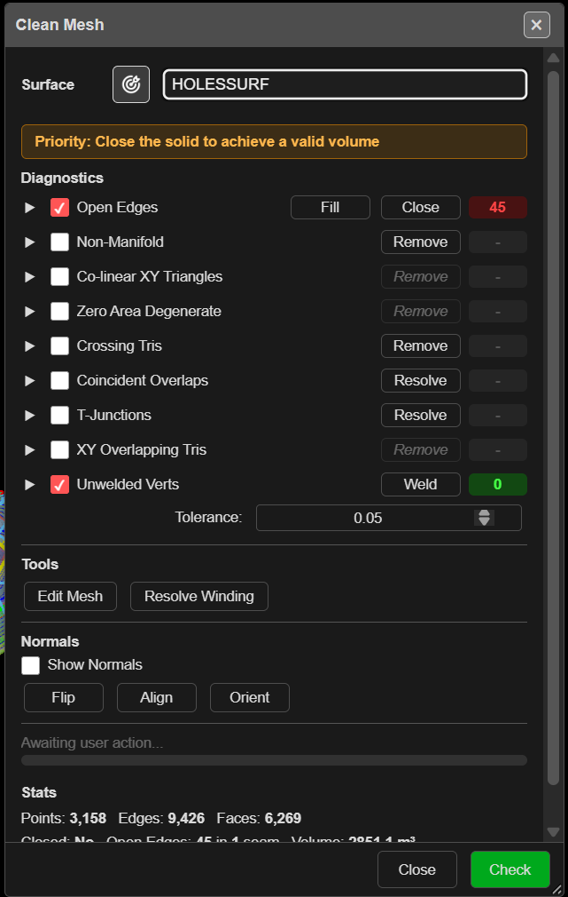

# Clean Mesh

Finds and repairs the faults that stop a surface working as a solid — open edges, crossing and
overlapping triangles, unwelded points and mixed-up normals. Use it before a volume, a boolean, a
clip or a slice, and whenever a surface imported from another package behaves oddly.

---

## Check and repair a surface

1. Click **Clean Mesh** on the **Surface** toolbar. The **Clean Mesh** dialog opens on the first
   visible surface, switches the view to 3D, and runs a check.
2. Choose the surface from the list, or click the target button and click it in the 3D view.
3. Tick the faults you want to look for under **Diagnostics**, then click **Check**. Each row
   shows a count, and the faults are highlighted in 3D.
4. Click the button on a row to repair that fault. Kirra re-checks afterwards.
5. Click **Close** when the counts are where you want them.

Repairs change the surface in place and are saved straight away. Each repair is one step you can
undo with **Ctrl+Z** and redo with **Ctrl+Y**. On a surface of more than 500,000 triangles a repair
**cannot be undone** — the status bar says so — so keep a copy or export it first.

> **Tip:** When the surface is not closed, an orange banner reads *"Priority: Close the solid to
> achieve a valid volume"*. Deal with **Open Edges** first: several remove buttons stay disabled
> until it is fixed, with the tip *"Fix open edges first. Removing triangles may break
> topology."*

---

## Diagnostics

| Row | On by default | Repair | What it finds |
|---|---|---|---|
| **Open Edges** | Yes | **Fill**, **Close** | Edges used by only one triangle — gaps and holes |
| **Non-Manifold** | No | **Remove** | Edges shared by more than two triangles |
| **Co-linear XY Triangles** | No | **Remove** | Triangles with no area in plan (vertical slivers) |
| **Zero Area Degenerate** | No | **Remove** | Triangles with no area at all |
| **Crossing Tris** | No | **Remove** | Triangles that pass through each other |
| **Coincident Overlaps** | No | **Resolve** | Triangles lying on top of each other |
| **T-Junctions** | No | **Resolve** | A point sitting on another triangle's edge without joining it |
| **XY Overlapping Tris** | No | **Remove** | Triangles overlapping in plan |
| **Unwelded Verts** | Yes | **Weld** | Points that should be one point |

**Tolerance:** sets the weld distance — default 0.0012 m. It is remembered in this browser and
used only by Clean Mesh.

Open the arrow on a row to list each fault. Click an item to zoom to it; its own repair button
fixes only that one, after showing a before-and-after with **Apply** or **Cancel**.

### Fill or Close?

- **Fill** patches holes whose edges form a clean loop, and keeps the result only if the open
  edges went down. If it cannot, it suggests a **Weld** at about 0.001–0.002 m first.
- **Close** works harder: it welds, removes bad triangles, stitches nearby edges and caps what is
  left. Use it when **Fill** says *"Fill couldn't close these"*.

Some repairs check first and warn when they would open the mesh or remove a lot —
**Continue** or **Cancel**.

---

## Tools and normals

| Control | What it does |
|---|---|
| **Edit Mesh** | Opens the [Mesh Edit](mesh-editing.md) tool to fix triangles by hand |
| **Resolve Winding** | Re-cuts triangles that fold through each other |
| **Show Normals** | Draws the direction each triangle faces |
| **In** / **Out** | Points every normal into or out of a closed solid |
| **Flip** | Reverses every triangle of an open surface |
| **Align** | Makes the triangles of an open surface face the same way |
| **Orient** | Fixes winding across the whole mesh and reports the volume |

**In** and **Out** appear only for closed solids; **Flip** and **Align** only for open surfaces.

**Stats** at the foot of the dialog lists points, edges and faces, whether the surface is
**Closed**, the open edges and the volume. A volume is only reliable when **Closed** reads **Yes**.

---

## Troubleshooting

| Symptom | Cause | Fix |
|---|---|---|
| *"No editable surfaces loaded."* | No surface, or only textured meshes | Clean Mesh does not edit textured OBJ meshes |
| **Closed** reads **No** | The surface has open edges, so its volume is unreliable | Clear **Open Edges** with **Fill** or **Close** |
| *"Fill couldn't close these — repair by hand"* | The gap edges do not meet cleanly | **Weld** at 0.001–0.002 m, then **Close**, or fill in **Edit Mesh** |
| Lighting looks patchy | Triangles face different ways | **Orient**, or **Align** on an open surface |
| A boolean or slice fails on this surface | Open edges or crossing triangles | Clear every row, then try again |

---

## Other ways to use it

| Method | Result |
|---|---|
| Right-click a surface → **Clean** in its properties | Opens Clean Mesh on that surface |
| The ⚠ volume badge on a solid in the tree → **Clean** | Opens Clean Mesh from the **Unreliable Volume** warning |
| One item's own repair button | Fixes a single fault, with a before-and-after |

---

## Related

- [Mesh Editing](mesh-editing.md) — fix triangles by hand
- [Clip Surface](clip-surface.md)
- [Solid Horizon Slice](solid-horizon-slice.md)
- [Trimesh Boolean](trimesh-boolean.md)
- [Surfaces Toolbar](surfaces-toolbar.md)
