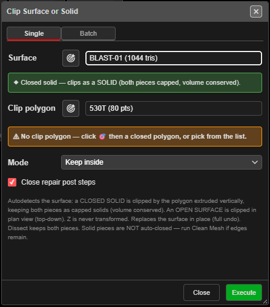

# Clip Surface

Cuts a surface or a solid with a KAD polygon and keeps the part inside, the part outside, or both.
Use it to trim a pickup to a blast boundary, split a design solid at a limit, or break a solid
into blocks with several cutters at once.

---

## Clip with one polygon (Single)

1. Click **Clip Surface** on the **Surface** toolbar. The **Clip Surface or Solid** dialog opens
   on the **Single** tab.
2. Choose the **Surface**, or click its target button and click it in 3D. A banner says how it
   will be clipped:
   - **Closed solid** — cut by the polygon extended straight up and down; both pieces are
     capped, so volume is conserved.
   - **Open surface** — cut in plan view; no caps.
3. Choose the **Clip polygon**: click its target button and then a closed polygon, or choose it
   from the list. The line under it confirms *"✔ Clip by: …"*.
4. Choose the **Mode**: **Keep inside**, **Keep outside** or **Dissect (split, keep both)**.
5. For a solid, leave **Close repair post steps** on — it tidies each piece after the cut.
6. Click **Execute**. A progress window with a timer runs the clip.

> **Note:** The list starts on **Choose a polygon…**. Clicking **Execute** before you choose one
> gives *"Pick the clip polygon first."*

---

## Clip a solid with many cutters (Batch)

1. Open the **Batch** tab and choose the **Solid**. Batch works on **closed solids only**.
2. Under **Add cutter**, choose a polygon or line, or switch the target button on and click
   them on the canvas one after another. Click **＋** to add each to the **Cutters** list.
3. Choose the **Mode**:
   - **Dissect — divide into all pieces (polys + lines)**
   - **Keep inside — one chunk per polygon (closed only)**
   - **Keep outside — one remainder (closed only)**
4. With **Dissect**, tick **Extend lines to fill gaps** if a line stops short of the solid's
   edge.
5. Click **Execute**.

Lines only work with **Dissect**; the keep modes need closed polygons.

---

## What you get

The surface is **replaced** by the pieces, in the same layer, and the whole clip is **one undo
step**.

| Mode | Piece names |
|---|---|
| Keep inside / Keep outside | `Pit (inside)` / `Pit (outside)` |
| Batch, keep inside | `Pit (Cutter1)`, `Pit (Cutter2)` … and `Pit (remainder)` |
| Dissect | `Pit (piece 1)`, `Pit (piece 2)` … |

Open-surface pieces keep the original colouring. Solid pieces are hillshaded — the inside
piece a little lighter and the outside a little darker — and dissected pieces take a colour
each. The status line reports the result, including each solid piece's volume. If it ends with
*"run Clean Mesh to fully close"*, open [Clean Mesh](clean-mesh.md) on that piece.

---

## Troubleshooting

| Symptom | Cause | Fix |
|---|---|---|
| *"Pick the clip polygon first."* | No polygon chosen yet | Pick one, or change the list |
| *"Clip produced no result — the boundary may not overlap the surface."* | The polygon misses the surface | Check both in plan |
| *"Batch clip currently supports CLOSED SOLIDS only."* | The Batch target is an open surface | Use the **Single** tab |
| *"Keep inside / Keep outside need CLOSED polygon cutters."* | A line is in the cutter list | Switch to **Dissect**, or remove the line |
| *"Dissect: no division — the cutters didn't cross the solid"* | The cutters stop short | Extend them, or tick **Extend lines to fill gaps** |

---

## Other ways to use it

| Method | Result |
|---|---|
| **Dissect (split, keep both)** | Both sides kept as separate surfaces |
| Batch target button left on | Click cutter after cutter, then **＋** each |
| A [Surface Intersection](surface-intersection.md) result as the polygon | Clip one surface where it meets another |
| **Ctrl+Z** after a clip | Puts the original surface back |

---

## Related

- [Clean Mesh](clean-mesh.md)
- [Clip KAD](../kad/clip-kad.md) — clip drawings instead
- [Solid Horizon Slice](solid-horizon-slice.md) — cut horizontally
- [Surfaces Toolbar](surfaces-toolbar.md)
