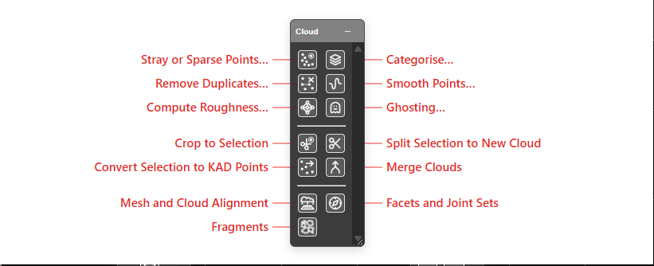

# Cloud Toolbar

The **Cloud** toolbar holds the tools that work on [point clouds](point-clouds.md): cleaning a
scan, working on the points you selected, merging clouds, and aligning or measuring a scan.
It sits in the default toolbar row, between **Analyse** and **Workspace**.

The buttons sit in three groups, split by dividers.

---

## Which cloud a button works on

A toolbar has no right-clicked row, so Kirra picks the cloud for you, in this order:

1. The one cloud that holds a point selection.
2. Otherwise, the cloud selected in the [Data Explorer](../working-in-kirra/data-explorer.md).
3. Otherwise, the only cloud shown.

If none of these settles it, a small dialog asks. Choose the cloud in **Point cloud**, or press
the target button beside it and click a point of the cloud on the canvas. The target turns red
while it is waiting for your click. Then press **OK**.

Only clouds that are shown and unlocked are offered. With none, Kirra says *Load or show a point
cloud first.*

---

## Clean-up tools

Each opens [Cloud Properties](point-clouds.md#cloud-properties) on its **Edit Tools** tab, set
to that tool. They are the same as the cloud's right-click **Cloud Tools** items.

| Button | What it does | Guide |
|---|---|---|
| **Stray or Sparse Points…** | Selects the stray points, or the thinly scattered ones, so you can delete them | [Select Points](point-clouds.md#select-points) |
| **Categorise…** | Gives the selected points a class, such as ground or a class of your own | [Categorise](point-clouds.md#categorise) |
| **Remove Duplicates…** | Makes a new cloud without the points that sit on top of each other | [Remove duplicates](point-clouds.md#remove-duplicates) |
| **Smooth Points…** | Makes a new, smoothed cloud from a noisy scan | [Smooth points](point-clouds.md#smooth-points) |
| **Compute Roughness…** | Measures how rough the cloud is at each point, and colours by it | [Compute roughness](point-clouds.md#compute-roughness) |
| **Ghosting…** | Finds a doubled sheet of points just above or below the surface, and moves it back | [Ghosting](point-clouds.md#ghosting) |

## Selection tools

These work on the points you have selected. With no points selected, Kirra says *Select points
on `<cloud>` first.*

| Button | What it does | Guide |
|---|---|---|
| **Crop to Selection** | Keeps only the selected points | [Working with a selection](point-clouds.md#working-with-a-selection) |
| **Split Selection to New Cloud** | Moves the selected points into a new cloud | [Working with a selection](point-clouds.md#working-with-a-selection) |
| **Convert Selection to KAD Points** | Makes KAD points from the selected points | [Working with a selection](point-clouds.md#working-with-a-selection) |
| **Merge Clouds** | With two or more clouds selected in the Data Explorer, joins them into a new cloud. Otherwise it opens **Merge with…** for the one cloud | [Merging clouds](point-clouds.md#merging-clouds) |

## Alignment and measurement

These three moved here from the [Surface toolbar](surfaces-toolbar.md).

| Button | What it does | Guide |
|---|---|---|
| **Mesh and Cloud Alignment** | Moves a scan or mesh onto the grid, or onto another scan or mesh | [Mesh and Cloud Alignment](mesh-cloud-alignment.md) |
| **Facets and Joint Sets** | Finds the flat facets of a rock wall and groups them into joint sets, on a stereonet | [Facets and Joint Sets](facets-joint-sets.md) |
| **Fragments** | Finds the rocks in a muckpile scan and draws a size curve. Experimental | [Fragments](fragments.md) |

---

## Not on the toolbar

**Delete**, **Clear Point Selection**, **Delete Selected Points** and **Send to Image…** stay on
the cloud's right-click menu in the Data Explorer. See
[The Point Clouds folder](point-clouds.md#the-point-clouds-folder).

## Related

- [Point Clouds](point-clouds.md) — every cloud tool in full
- [Surfaces Toolbar](surfaces-toolbar.md)
- [Select toolbar](../reference/select-toolbar.md) — drawing a shape to select cloud points
