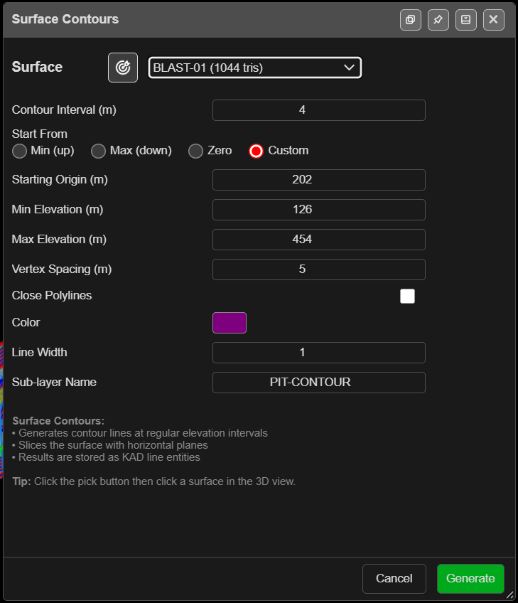

# Contour Surface

Draws contour lines across a surface at a regular elevation interval. Use them to read a
pickup at a glance, to check a design floor, or to export bench and toe strings to CAD.

---

## Contour a surface

1. Click **Contour Surface** on the **Surface** toolbar. The **Surface Contours** dialog opens.
2. Choose the **Surface**, or click the target button and click the surface in the 3D view. The
   picked surface flashes green.
3. Set **Contour Interval (m)** and where the levels start (below).
4. Click **Generate**. The contours are added as KAD lines and Kirra reports how many were made.

With no surfaces loaded, Kirra says *"No surfaces loaded. Import a surface (DTM, STR, OBJ)
first."* The list includes hidden surfaces.

---

## The fields

| Field | Default | What it does |
|---|---|---|
| **Contour Interval (m)** | 5 | Vertical distance between contours |
| **Start From** | **Min (up)** | Where the levels are counted from: **Min (up)**, **Max (down)**, **Zero** or **Custom** |
| **Starting Origin (m)** | The surface's lowest point | The level the interval is counted from. Editable with **Custom** only |
| **Min Elevation (m)** | Lowest point, rounded down | No contours below this |
| **Max Elevation (m)** | Highest point, rounded up | No contours above this |
| **Vertex Spacing (m)** | 0 | Simplifies the lines: vertices closer than this are dropped. 0 keeps every vertex |
| **Close Polylines** | Off | Closes each contour into a polygon |
| **Color** | Yellow | Colour of the contours |
| **Line Width** | 2 | Line width (1–10) |
| **Sub-layer Name** | **Contours** | The sub-layer the contours are filed in |

Levels are the **Starting Origin (m)** plus whole multiples of the interval, between the min and
max. With **Zero** and a 2 m interval, contours fall on even RLs — 616, 618, 620 and so on.

The dialog remembers your settings in this browser. Choosing a different surface refills the min
and max from that surface.

> **Tip:** To contour your bench RLs exactly, choose **Custom**, type one bench RL as the
> **Starting Origin (m)** and use the bench height as the interval.

---

## What you get

KAD lines — or polygons, with **Close Polylines** — in the **Analysis** layer under the
**Sub-layer Name**, or in your active layer if you have chosen one. Each is named after the
surface and its RL, for example `Pit_Contour_RL640_001_a4zz`, so sorting by name groups each
level together. The surface itself is not changed. The whole set is one undo step.

The result message lists the count, the elevation range, the interval and the time taken.

---

## Troubleshooting

| Symptom | Cause | Fix |
|---|---|---|
| *"Contour interval must be greater than 0."* | Interval is 0 or blank | Enter an interval |
| *"Too many contour levels (…)"* | Over 5,000 levels in the range | Raise the interval or narrow the range |
| *"No contour lines generated."* | The range misses the surface | Reselect the surface to refill **Min** and **Max** |
| Min and max belong to the last surface | The dialog remembers them | Choose the surface again to refill them |
| A **Large Surface** warning | The surface is over the 3D triangle limit | **Generate** anyway, **Adjust Settings**, or **Cancel** |

---

## Other ways to use it

| Method | Result |
|---|---|
| **Start From** → **Custom** | Contours on your own datum, such as bench RLs |
| **Sub-layer Name** | A separate folder per run — for example `PitShell` |
| **Close Polylines** | Closed rings, ready for clipping or extruding |
| **Vertex Spacing (m)** above 0 | Lighter lines for export |

---

## Related

- [Solid Horizon Slice](solid-horizon-slice.md) — cut a solid at the same levels
- [Surface Gradients](gradients.md)
- [Layer Organisation](../kad/layer-organisation.md)
- [DXF Export](../exporting/dxf-export.md)
- [Surfaces Toolbar](surfaces-toolbar.md)
