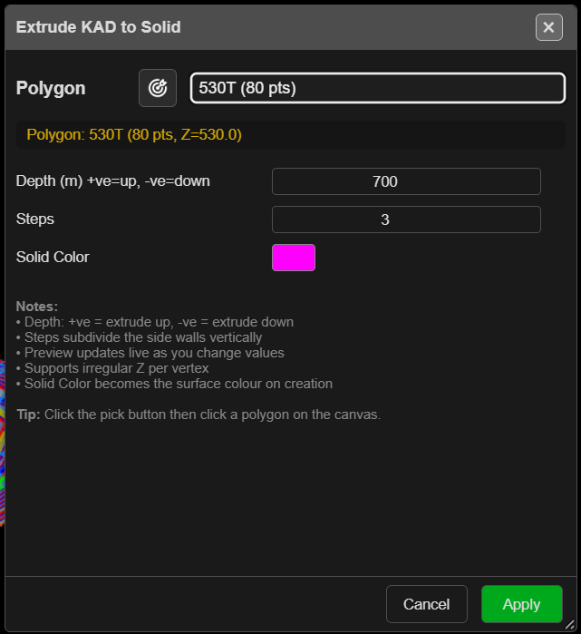
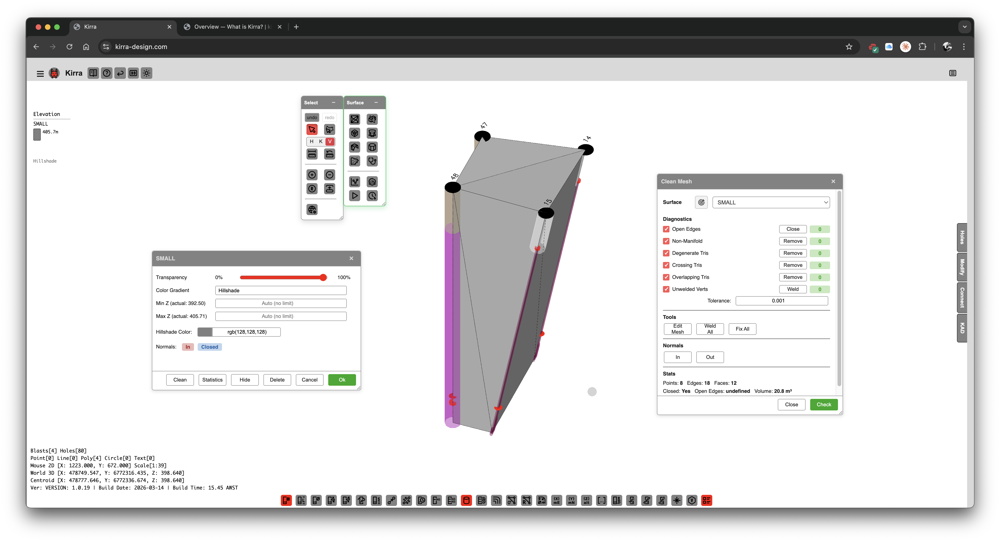

# Extrude KAD to Solid

Turns a closed KAD polygon into a solid by pushing it up or down a set distance. Use it for bench
solids, design volumes and stockpile envelopes, and as the input to booleans, clipping and
horizon slicing.

---

## Extrude a polygon

1. Click **Extrude KAD to Solid** on the **Surface** toolbar. The **Extrude KAD to Solid** dialog
   opens.
2. Choose the **Polygon** from the list, or click the target button and click it on the canvas.
   A polygon you selected before opening the dialog is filled in for you.
3. Set **Depth (m) +ve=up, -ve=down**, **Steps** and **Solid Color**. A see-through preview in the
   3D view follows each change.
4. Click **Apply**.

You need at least one closed polygon with three or more points. With none, Kirra says *"No closed
KAD polygons found. Create a polygon first, then use this tool."* The list includes hidden
polygons.

---

## The fields

| Field | Default | What it does |
|---|---|---|
| **Depth (m) +ve=up, -ve=down** | −10 | How far to push the polygon. Negative goes down (−1000 to 1000) |
| **Steps** | 1 | Splits the side walls into this many bands (1–50) |
| **Solid Color** | Blue | Colour of the new solid |

The line under the polygon shows its name, point count and the height of its first point. The
dialog remembers your settings in this browser.

> **Note:** Each vertex keeps its own height. The base is the polygon moved by **Depth**, so it
> follows the shape of the top rather than sitting flat. Draw the polygon at one elevation if you
> want flat top and bottom faces.

---

## What you get

A closed solid named `EXTRUDED_` and the polygon name, in the **Extruded** layer of the tree,
hillshaded in the **Solid Color**. It can be undone. A **Depth** of 0 gives a flat open surface —
just the polygon filled in.

---

## Troubleshooting

| Symptom | Cause | Fix |
|---|---|---|
| *"No closed KAD polygons found."* | No polygon is closed | Close the line, or draw a polygon |
| The target button will not take a closed line | Picking accepts polygons only | Choose the closed line from the list |
| *"Nothing was created. The polygon needs at least three distinct points, and must not cross itself."* | Repeated points, or the polygon crosses itself | Remove the repeated points or fix the crossing, then try again |

---

## Other ways to use it

| Method | Result |
|---|---|
| Select the polygon first | It is filled in when the dialog opens |
| **Steps** above 1 | Extra rings on the walls, useful before clipping or slicing |
| **Depth (m)** = 0 | A flat surface filling the polygon |

---

## Related

- [Solid Horizon Slice](solid-horizon-slice.md) — cut the solid into benches
- [Solid Boolean](solid-boolean.md)
- [Clip Surface](clip-surface.md)
- [Surfaces Toolbar](surfaces-toolbar.md)
