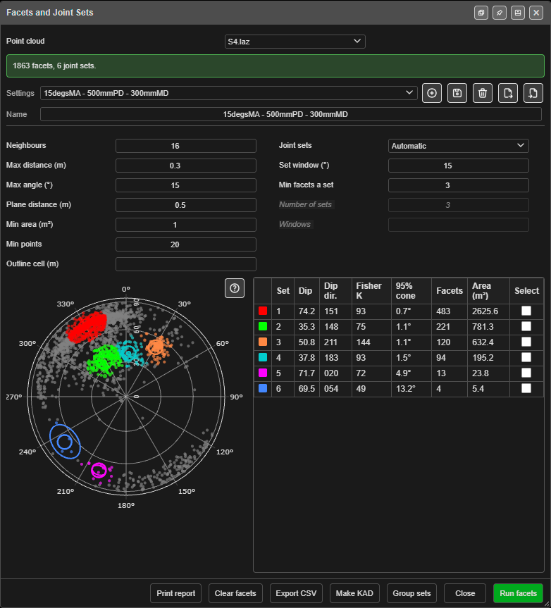
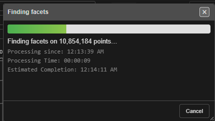
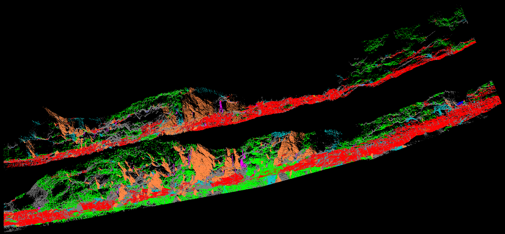
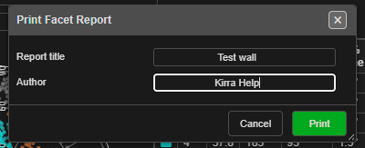
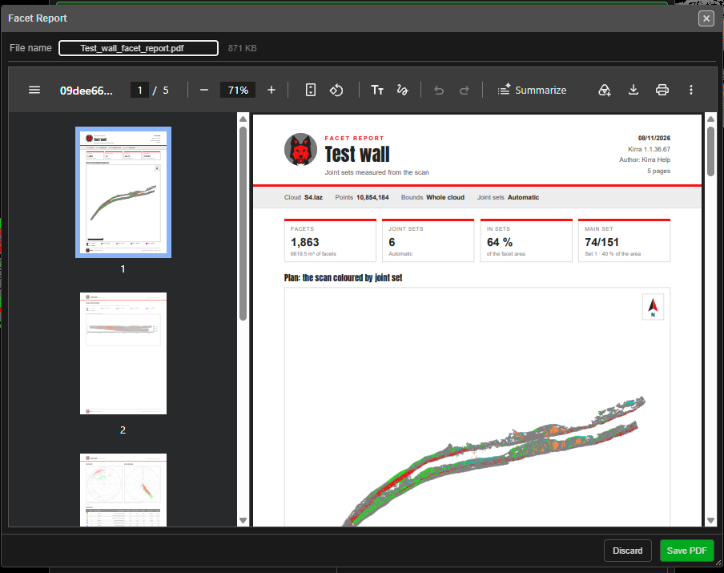
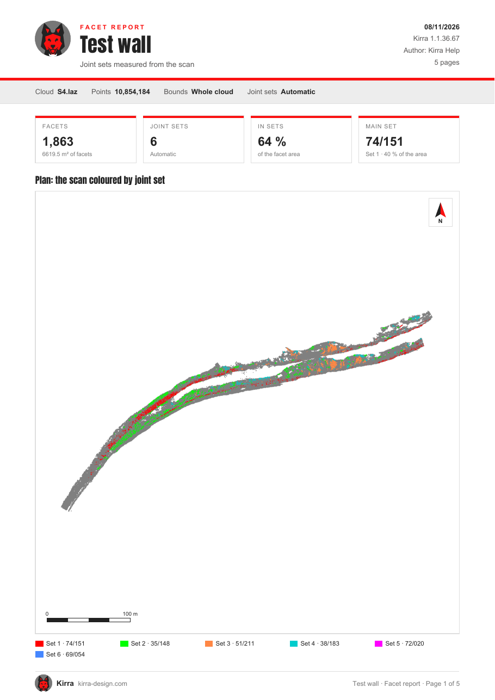
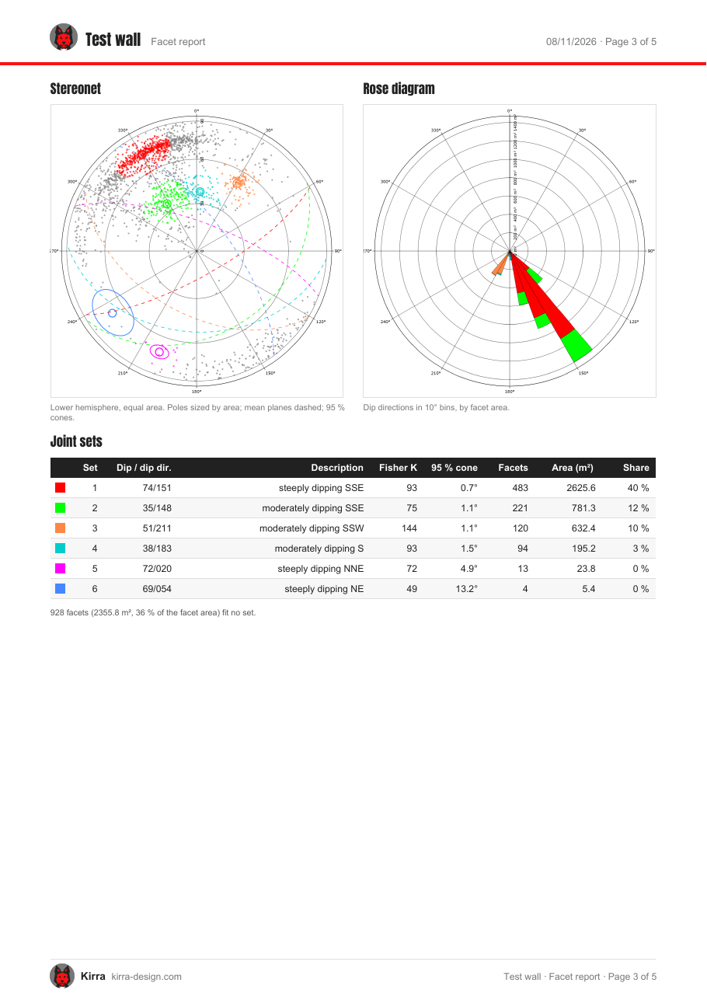
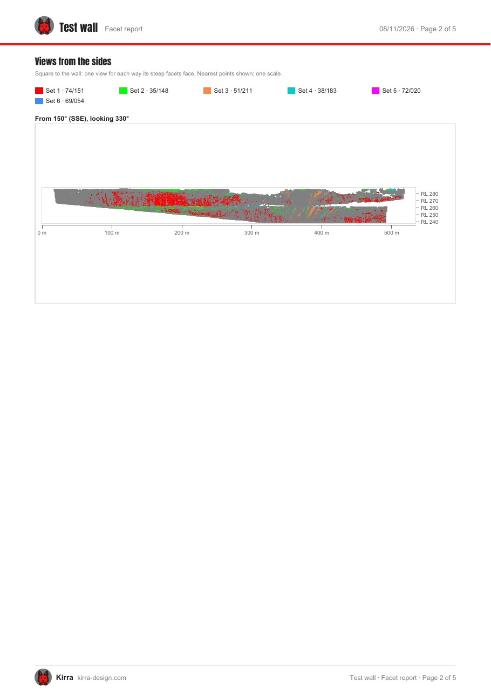
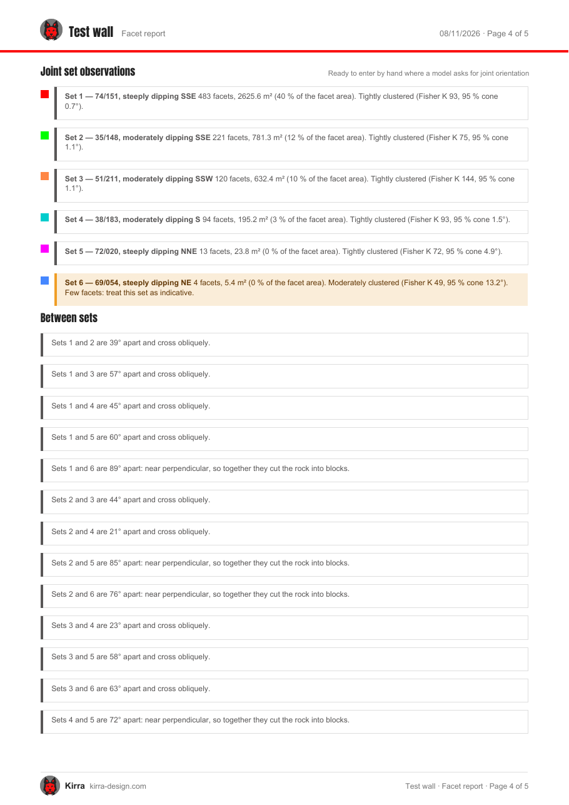

# Facets and Joint Sets

> **Experimental.** Facets and Joint Sets is new and its settings and results may change between versions.
> Check a run against a compass-clinometer reading of a few planes before you rely on it.

Finds the flat faces — **facets** — in a [point cloud](point-clouds.md) of a rock wall or face,
measures the dip and dip direction of each, and groups them into **joint sets**. The results show
on a stereonet and in a table, colour the cloud, and can be drawn as KAD polygons or exported as
CSV.

Use it to read the structure of a blasted wall, a pre-split face or a cut from a scan, without
measuring each plane by hand.

*A run on a 10.8 million point scan of a pit wall, with a saved preset (Max angle 15°, Plane
distance 0.5 m, Max distance 0.3 m) rather than the defaults: 1,863 facets in six joint sets.*

---

## Open it

Either:

- click **Facets and Joint Sets** on the **Surface** toolbar (below the second divider, with the
  point-cloud tools), or
- right-click a cloud in the [Data Explorer](../working-in-kirra/data-explorer.md) and choose
  **Cloud Tools** ▸ **Facets and Joint Sets…**.

The dialog works on one cloud at a time, chosen in **Point cloud**. The list holds the clouds that
are shown and unlocked. From the toolbar it opens on the cloud that holds a point selection, or the
first one; from the menu, on the cloud you right-clicked. If no cloud is shown, Kirra says *"Load
or show a point cloud first. Facets are found on a point cloud's points."*

The dialog can be docked to the edge of the window or opened in a window of its own, with the
buttons in its title bar.

---

## Find facets and joint sets

1. **Select the wall first** on a big scan — see [Selecting points](point-clouds.md#selecting-points).
   The banner under **Point cloud** says what will be used: *"Runs on n selected points."*, or
   *"Runs on the whole cloud (n points). Select the wall first to keep a big scan quick."*
2. Check the facet settings and the joint-set settings (below).
3. Click **Run facets**. A **Finding facets** progress window shows the work, with **Cancel**.

   

4. The banner reports the result, for example *"2109 facets, 8 joint sets."* The stereonet and the
   table fill in, and the cloud is coloured by joint set.

Every button except **Close** keeps the dialog open, so you can change a setting and run again.

---

## Facet settings

| Field | Default | What it does |
|---|---|---|
| **Neighbours** | 16 | How many nearest points fit each point's plane. More gives smoother directions on rough rock, and is slower |
| **Max distance (m)** | 0.3 | Neighbours farther than this are ignored. Larger fits over patches the size of a joint face: fewer, bigger facets on rough rock (0.6 suits a blasted wall), and slower |
| **Max angle (°)** | 10 | A point joins a facet when its direction is within this angle of the facet's. Larger lets facets grow over rougher, curving rock (20–30 on a blasted wall) |
| **Plane distance (m)** | Blank | A point joins a facet only within this distance of its plane. Blank uses 3 × the measured noise |
| **Min area (m²)** | 1 | Facets smaller than this are dropped. Smaller gives more, smaller facets on the stereonet |
| **Min points** | 20 | Facets with fewer points are dropped |
| **Outline cell (m)** | Blank | The grid size for a facet's area and outline. Blank uses 2 × the point spacing. Set it above the line spacing of a tripod scan, or areas shrink to strips |

Hover over a field for its tip. A second run that changes only **Max angle**, **Plane distance**,
**Min area**, **Min points** or **Outline cell** is quicker: Kirra keeps the slowest step from the
last run while the dialog is open.

## Joint-set settings

**Joint sets** chooses how facets are grouped. The fields a mode does not use are greyed out.

| Joint sets | Fields | Groups the facets |
|---|---|---|
| **Automatic** | **Set window (°)** (15), **Min facets a set** (3) | Finds the sets itself. The window is about 2.5 × a set's spread: wider gives fewer, broader sets. A set needs at least **Min facets a set** facets |
| **Number of sets** | **Number of sets** (3) | Every facet joins the nearest of this many sets |
| **My windows** | **Windows** | Your own sets, typed as *dip/dip direction/angle*, separated by **;** — for example `70/200/15; 30/045/15`. A facet joins the first window it falls in |

Click **Group sets** to group the facets again with new joint-set settings. It is instant, and does
not find the facets again. A window that is not three numbers is named in the banner, for example
*Set window 2 "70/200" is not dip/dip direction/angle*.

### Settings presets

**Settings** at the top saves both groups of settings as a named preset, so the next scan of the
same rock runs with the same settings.

| Control | What it does |
|---|---|
| **Settings** dropdown | Applies a saved preset. |
| **Name** | Type a name, then press **+** to save it. Edit it while a preset is selected to rename that preset. |
| **+** | Saves the current settings as a new preset. |
| **Save** | Updates the selected preset from the current settings. |
| **Bin** | Deletes the selected preset. |
| **Export** / **Import** | Saves presets to a JSON file, or loads them from one. |

A name that records the settings, such as *15degsMA - 500mmPD - 300mmMD* (Max angle, Plane distance,
Max distance), makes the list easy to read. Presets are kept in Kirra for the workspace you are in;
use **Export** and **Import** to take them to another workspace or computer.

---

## The results

### The stereonet

A lower-hemisphere, equal-area (Schmidt) net, north up. Each dot is the **pole** of one facet —
the line square to the plane.

- The centre is a flat plane (dip 0) and the rim a vertical one (dip 90); the rings are labelled
  with dip.
- Round the rim, a pole sits opposite the dip direction: a plane dipping east (090) plots on the
  west side (270). A near-vertical set can show at both edges, for example near 0 and 180.
- Each joint set has its own colour; grey dots belong to no set. A bigger dot is a bigger facet.
- The ring marker is a set's mean pole; the circle round it is its 95% cone.

Hover over a dot for that facet's dip, dip direction and area. Click a set's ring to tick it in
**Select**. Hover over the **?** at the corner of the net for a short guide, or click it for the
full one, **Reading the stereonet**.

Dip is 0 for flat and 90 for vertical; dip direction is a bearing, clockwise from north.

### The joint-sets table

One row per set:

| Column | What it shows |
|---|---|
| (swatch) | The set's colour, the same as on the net and the cloud |
| **Set** | The set number |
| **Dip** / **Dip dir.** | The set's mean orientation |
| **Fisher K** | How tightly the set's poles cluster: higher is tighter. It needs at least two facets, and shows *—* otherwise |
| **95% cone** | The true mean lies inside this cone 19 times in 20. Small is a well-defined set |
| **Facets** / **Area (m²)** | How many facets the set holds, and their total area |
| **Select** | Tick to select that set's points in the cloud |

Ticking **Select** makes the ticked sets' points the cloud's selection, ready for
[Working with a selection](point-clouds.md#working-with-a-selection) — delete them, crop to them,
split them off. Untick them all to clear the selection.

The table grows when you make the dialog taller.

### The cloud

After a run the cloud is coloured by **Joint set** — each set in its colour, every other point grey
— and the result is saved with the cloud.

 In [Cloud Properties](point-clouds.md#colour-by),
**Colour by** gains **Facet** (each facet its own colour) and **Joint set**.

If the cloud changes after a run, the banner says so: *"The cloud has changed since these facets
were found (… points then, … now). Run facets again to update them."*

| Kept by | Dropped by |
|---|---|
| Crop, delete, split and remove duplicates | Smooth points, Move, Transform, Mesh and Cloud Alignment and Merge Clouds — anything that moves points or mixes clouds |

---

## Make KAD, Export CSV, Clear facets and Print report

| Button | What it does |
|---|---|
| **Print report** | Prints a [Facet Report](#print-a-facet-report) PDF of this run |
| **Make KAD** | Draws each facet that is in a joint set as one closed 3D KAD polygon, in the set's colour, with a sub-layer per set (*\<cloud\> Set 1*, *\<cloud\> Set 2* …) under the **Analysis** layer — or on the active layer when one is set. Above 2,000 polygons Kirra asks first. The banner says *"Made n facet polygons, a layer per joint set."* |
| **Export CSV** | Saves two files: `<cloud>_facets.csv` (one row per facet: id, x, y, z, dip, dipDirection, area, rms, set, points) and `<cloud>_joint_sets.csv` (one row per set: id, dip, dipDirection, fisherK, cone95, facets, area). Facet centres are in world coordinates |
| **Clear facets** | Removes the facets and joint sets from the cloud. A cloud coloured by facet or joint set goes back to its usual colouring |
| **Close** | Closes the dialog |

> **Make KAD needs this session's run.** Facet outlines are kept only while the dialog is open. If
> you close it and come back, **Make KAD** says *"Run facets first: facet outlines are kept only
> until the dialog closes."* Click **Run facets** again.

---

## Print a Facet Report

**Print report** turns the run into an A4 PDF to hand on: the joint sets, where they are on the
wall, and what they mean, in the same style as the [Fragmentation Report](fragments.md).

1. Run facets, and check the joint sets look right.
2. Click **Print report**.
3. In **Print Facet Report**, type a **Report title** — a wall, a bench or a pit — and an
   **Author**. A blank title uses the cloud's name. Click **Print**.
4. Kirra builds the report under the busy indicator, then shows it in a preview with its
   **File name** and size. Read through the pages there.
5. Click **Save PDF** to save it, or **Discard** to throw it away.

*The preview before saving. Kirra names the file from the title, here `Test_wall_facet_report.pdf`.*

### What the report holds

| Page | What is on it |
|---|---|
| **1** | The title, date, Kirra version and author; the cloud, its point count and what the run covered; four summary cards (**Facets**, **Joint sets**, **In sets**, **Main set**); and a plan of the scan coloured by joint set, with a north arrow, a scale bar and a legend of each set's dip/dip direction |
| **Views from the sides** | The scan seen from the side, square to the wall, coloured by joint set, with RL and distance scales. Kirra picks one view for each way the wall's steep facets face, three to a page. When no wall direction stands out it shows the four compass sides instead |
| **Stereonet and joint sets** | The stereonet (lower hemisphere, equal area, poles sized by area, mean planes dashed, 95 % cones), a rose diagram of dip directions in 10° bins by facet area, and the joint-set table with a plain-words description of each set (for example *steeply dipping SSE*) and its share of the facet area |
| **Observations** | A line per set — its orientation, size, how tightly it clusters, and a warning when it has only a few facets — then **Between sets**: the angle between each pair of sets, and whether they cross obliquely or are near perpendicular and cut the rock into blocks. The facets that fit no set are counted |
| **Last page** | **Run settings**, every setting the run used, and **Limits**: what the method cannot see |

| Page 1 | Stereonet and joint sets |
|---|---|
|  |  |

| Views from the sides | Observations |
|---|---|
|  |  |

*The five-page report from the run above.*

> **Read the limits.** The report says so on its last page: facets are fitted to the scanned
> surface, so joints that face the scanner show as large facets, and joints that meet the wall
> nearly edge-on show only as traces and are under-counted. The results describe a wall, crest or
> face scan — facets on broken rock, such as a muckpile, are not joints. Joint spacing and
> persistence are not measured. Orientations are dip/dip direction from grid north, in the cloud's
> coordinate system.

Each set's dip/dip direction can be typed in wherever a model asks for joint orientation, such as
a Kuz-Ram rock factor.

---

## Troubleshooting

| Message or symptom | Cause | Fix |
|---|---|---|
| *"No facets found. Try a larger Max distance or Max angle, or a smaller Min area."* | The settings are too strict for this rock | Do as it says, one setting at a time |
| *"No joint sets: widen the set window or choose Number of sets."* | Facets were found, but none formed a set | Raise **Set window (°)**, lower **Min facets a set**, or choose **Number of sets** |
| Many tiny facets on rough rock | **Max distance** and **Max angle** are small for the roughness | Raise **Max distance (m)** (0.6 suits a blasted wall) and **Max angle (°)** (20–30) |
| Facet areas look like thin strips on a tripod scan | **Outline cell** is smaller than the scan's line spacing | Set **Outline cell (m)** above the line spacing |
| The run is slow | It is running on the whole cloud | Select the wall first |
| *"No facet is in a joint set, so there is nothing to draw."* | **Make KAD** draws only facets that are in a set | Group the facets into sets first |

---

## Related

- [Point Clouds](point-clouds.md) — import, selection, Cloud Properties
- [Mesh and Cloud Alignment](mesh-cloud-alignment.md) — put the scan on the grid first
- [Surfaces Toolbar](surfaces-toolbar.md)
