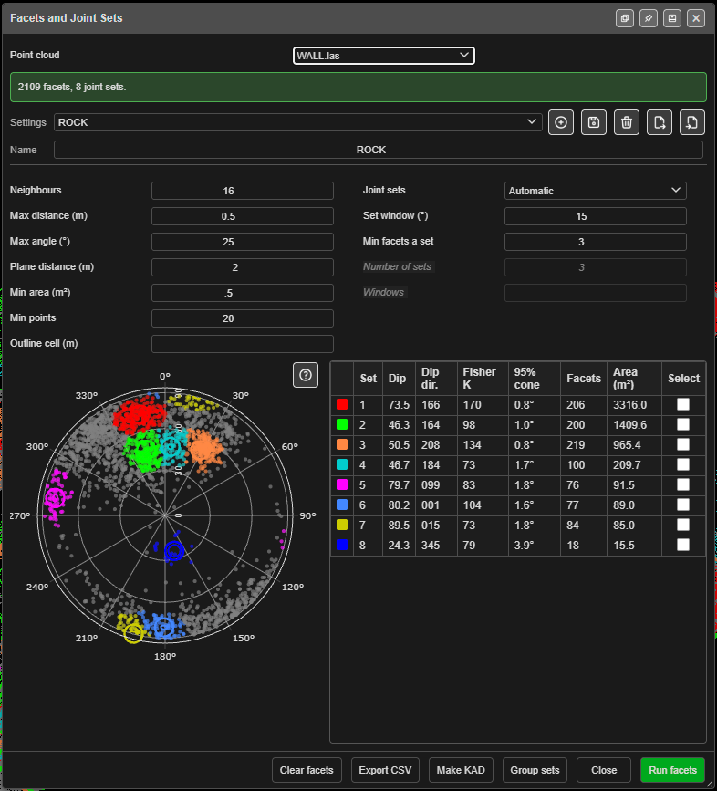
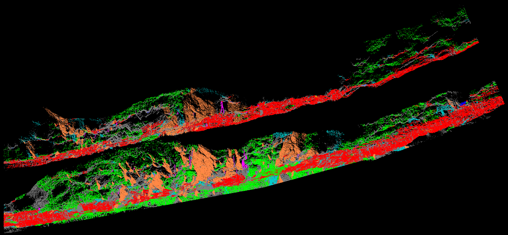

# Facets and Joint Sets

Finds the flat faces — **facets** — in a [point cloud](point-clouds.md) of a rock wall or face,
measures the dip and dip direction of each, and groups them into **joint sets**. The results show
on a stereonet and in a table, colour the cloud, and can be drawn as KAD polygons or exported as
CSV.

Use it to read the structure of a blasted wall, a pre-split face or a cut from a scan, without
measuring each plane by hand.

*A run on a 1.8 million point scan of a pit wall, with a saved preset (**ROCK**: Max distance 0.5 m,
Max angle 25°) rather than the defaults.*

---

## Open it

Either:

- click **Facets and Joint Sets** on the **Surface** toolbar (below the second divider, with the
  point-cloud tools), or
- right-click a cloud in the [Data Explorer](../working-in-kirra/data-explorer.md) and choose
  **Cloud Tools** ▸ **Facets and Joint Sets…**.

The dialog works on one cloud at a time, chosen in **Point cloud**. The list holds the clouds that
are shown and unlocked. From the toolbar it opens on the cloud that holds a point selection, or the
first one; from the menu, on the cloud you right-clicked. If no cloud is shown, Kirra says *"Load
or show a point cloud first. Facets are found on a point cloud's points."*

The dialog can be docked to the edge of the window or opened in a window of its own, with the
buttons in its title bar.

---

## Find facets and joint sets

1. **Select the wall first** on a big scan — see [Selecting points](point-clouds.md#selecting-points).
   The banner under **Point cloud** says what will be used: *"Runs on n selected points."*, or
   *"Runs on the whole cloud (n points). Select the wall first to keep a big scan quick."*
2. Check the facet settings and the joint-set settings (below).
3. Click **Run facets**. A **Finding facets** progress window shows the work, with **Cancel**.
4. The banner reports the result, for example *"2109 facets, 8 joint sets."* The stereonet and the
   table fill in, and the cloud is coloured by joint set.

Every button except **Close** keeps the dialog open, so you can change a setting and run again.

---

## Facet settings

| Field | Default | What it does |
|---|---|---|
| **Neighbours** | 16 | How many nearest points fit each point's plane. More gives smoother directions on rough rock, and is slower |
| **Max distance (m)** | 0.3 | Neighbours farther than this are ignored. Larger fits over patches the size of a joint face: fewer, bigger facets on rough rock (0.6 suits a blasted wall), and slower |
| **Max angle (°)** | 10 | A point joins a facet when its direction is within this angle of the facet's. Larger lets facets grow over rougher, curving rock (20–30 on a blasted wall) |
| **Plane distance (m)** | Blank | A point joins a facet only within this distance of its plane. Blank uses 3 × the measured noise |
| **Min area (m²)** | 1 | Facets smaller than this are dropped. Smaller gives more, smaller facets on the stereonet |
| **Min points** | 20 | Facets with fewer points are dropped |
| **Outline cell (m)** | Blank | The grid size for a facet's area and outline. Blank uses 2 × the point spacing. Set it above the line spacing of a tripod scan, or areas shrink to strips |

Hover over a field for its tip. A second run that changes only **Max angle**, **Plane distance**,
**Min area**, **Min points** or **Outline cell** is quicker: Kirra keeps the slowest step from the
last run while the dialog is open.

## Joint-set settings

**Joint sets** chooses how facets are grouped. The fields a mode does not use are greyed out.

| Joint sets | Fields | Groups the facets |
|---|---|---|
| **Automatic** | **Set window (°)** (15), **Min facets a set** (3) | Finds the sets itself. The window is about 2.5 × a set's spread: wider gives fewer, broader sets. A set needs at least **Min facets a set** facets |
| **Number of sets** | **Number of sets** (3) | Every facet joins the nearest of this many sets |
| **My windows** | **Windows** | Your own sets, typed as *dip/dip direction/angle*, separated by **;** — for example `70/200/15; 30/045/15`. A facet joins the first window it falls in |

Click **Group sets** to group the facets again with new joint-set settings. It is instant, and does
not find the facets again. A window that is not three numbers is named in the banner, for example
*Set window 2 "70/200" is not dip/dip direction/angle*.

**Settings** at the top saves both groups of settings as a named preset, so you can use the same
settings on the next scan.

---

## The results

### The stereonet

A lower-hemisphere, equal-area (Schmidt) net, north up. Each dot is the **pole** of one facet —
the line square to the plane.

- The centre is a flat plane (dip 0) and the rim a vertical one (dip 90); the rings are labelled
  with dip.
- Round the rim, a pole sits opposite the dip direction: a plane dipping east (090) plots on the
  west side (270). A near-vertical set can show at both edges, for example near 0 and 180.
- Each joint set has its own colour; grey dots belong to no set. A bigger dot is a bigger facet.
- The ring marker is a set's mean pole; the circle round it is its 95% cone.

Hover over a dot for that facet's dip, dip direction and area. Click a set's ring to tick it in
**Select**. Hover over the **?** at the corner of the net for a short guide, or click it for the
full one, **Reading the stereonet**.

Dip is 0 for flat and 90 for vertical; dip direction is a bearing, clockwise from north.

### The joint-sets table

One row per set:

| Column | What it shows |
|---|---|
| (swatch) | The set's colour, the same as on the net and the cloud |
| **Set** | The set number |
| **Dip** / **Dip dir.** | The set's mean orientation |
| **Fisher K** | How tightly the set's poles cluster: higher is tighter. It needs at least two facets, and shows *—* otherwise |
| **95% cone** | The true mean lies inside this cone 19 times in 20. Small is a well-defined set |
| **Facets** / **Area (m²)** | How many facets the set holds, and their total area |
| **Select** | Tick to select that set's points in the cloud |

Ticking **Select** makes the ticked sets' points the cloud's selection, ready for
[Working with a selection](point-clouds.md#working-with-a-selection) — delete them, crop to them,
split them off. Untick them all to clear the selection.

The table grows when you make the dialog taller.

### The cloud

After a run the cloud is coloured by **Joint set** — each set in its colour, every other point grey
— and the result is saved with the cloud.

 In [Cloud Properties](point-clouds.md#colour-by),
**Colour by** gains **Facet** (each facet its own colour) and **Joint set**.

If the cloud changes after a run, the banner says so: *"The cloud has changed since these facets
were found (… points then, … now). Run facets again to update them."*

| Kept by | Dropped by |
|---|---|
| Crop, delete, split and remove duplicates | Smooth points, Move, Transform, Mesh and Cloud Alignment and Merge Clouds — anything that moves points or mixes clouds |

---

## Make KAD, Export CSV and Clear facets

| Button | What it does |
|---|---|
| **Make KAD** | Draws each facet that is in a joint set as one closed 3D KAD polygon, in the set's colour, with a sub-layer per set (*\<cloud\> Set 1*, *\<cloud\> Set 2* …) under the **Analysis** layer — or on the active layer when one is set. Above 2,000 polygons Kirra asks first. The banner says *"Made n facet polygons, a layer per joint set."* |
| **Export CSV** | Saves two files: `<cloud>_facets.csv` (one row per facet: id, x, y, z, dip, dipDirection, area, rms, set, points) and `<cloud>_joint_sets.csv` (one row per set: id, dip, dipDirection, fisherK, cone95, facets, area). Facet centres are in world coordinates |
| **Clear facets** | Removes the facets and joint sets from the cloud. A cloud coloured by facet or joint set goes back to its usual colouring |
| **Close** | Closes the dialog |

> **Make KAD needs this session's run.** Facet outlines are kept only while the dialog is open. If
> you close it and come back, **Make KAD** says *"Run facets first: facet outlines are kept only
> until the dialog closes."* Click **Run facets** again.

---

## Troubleshooting

| Message or symptom | Cause | Fix |
|---|---|---|
| *"No facets found. Try a larger Max distance or Max angle, or a smaller Min area."* | The settings are too strict for this rock | Do as it says, one setting at a time |
| *"No joint sets: widen the set window or choose Number of sets."* | Facets were found, but none formed a set | Raise **Set window (°)**, lower **Min facets a set**, or choose **Number of sets** |
| Many tiny facets on rough rock | **Max distance** and **Max angle** are small for the roughness | Raise **Max distance (m)** (0.6 suits a blasted wall) and **Max angle (°)** (20–30) |
| Facet areas look like thin strips on a tripod scan | **Outline cell** is smaller than the scan's line spacing | Set **Outline cell (m)** above the line spacing |
| The run is slow | It is running on the whole cloud | Select the wall first |
| *"No facet is in a joint set, so there is nothing to draw."* | **Make KAD** draws only facets that are in a set | Group the facets into sets first |

---

## Related

- [Point Clouds](point-clouds.md) — import, selection, Cloud Properties
- [Mesh and Cloud Alignment](mesh-cloud-alignment.md) — put the scan on the grid first
- [Surfaces Toolbar](surfaces-toolbar.md)
