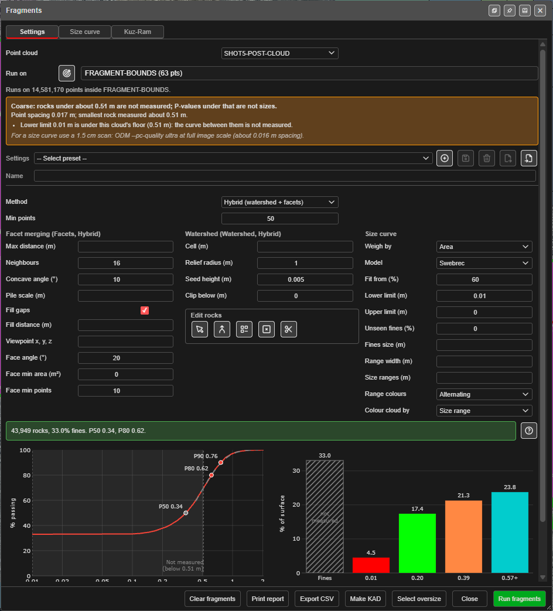
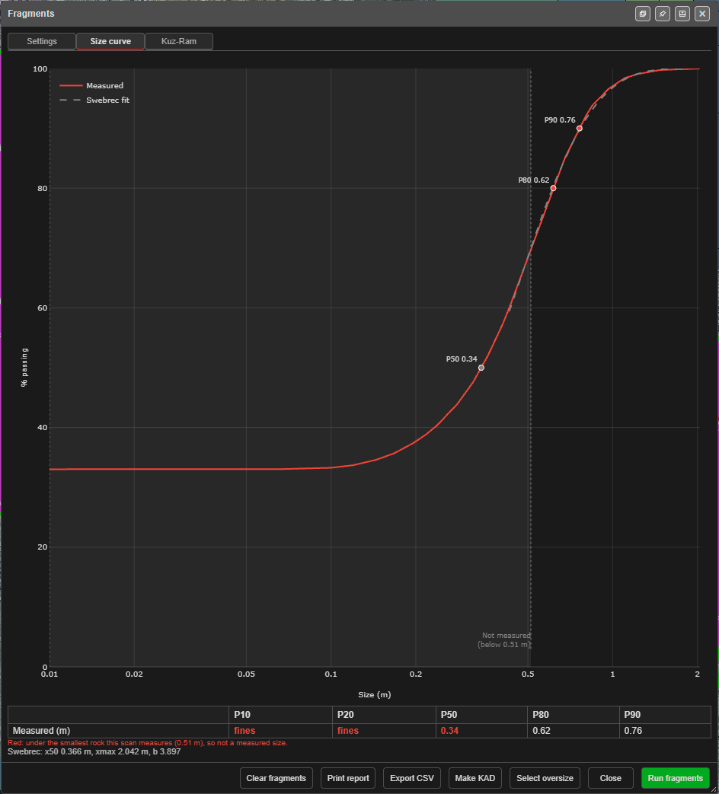
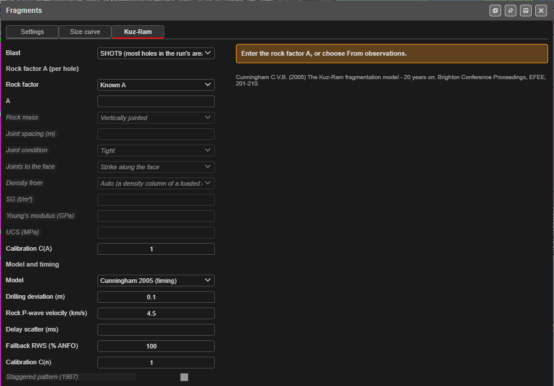
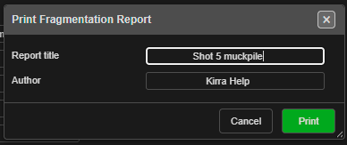
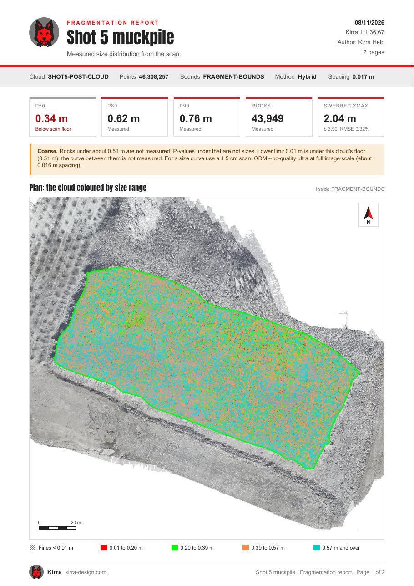
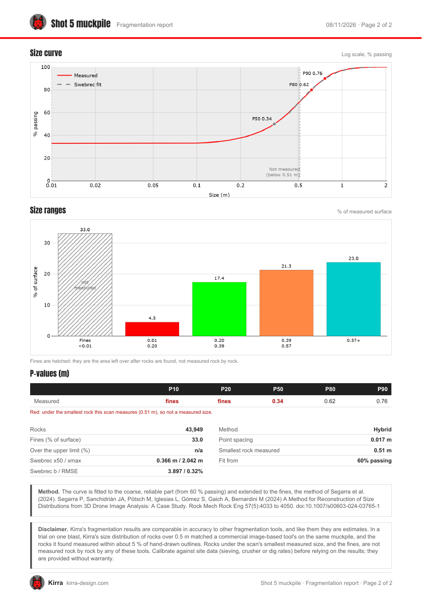

# Fragments

> **Experimental.** Fragments is new and its settings and results may change between versions. Check
> a run against a hand measurement of a few rocks before you rely on the size curve.

Finds the **rocks** in a point cloud of a muckpile, measures each one, and builds a **size curve**
(a fragmentation distribution) with P-values such as P50 and P80. The result colours the cloud by
rock size, can be drawn as KAD outlines, and can be exported as CSV or printed as a report.

Use it on a drone or ground scan of a muckpile, a face or a drawpoint to see how well the blast
broke the rock, without sieving.

*The **Settings** tab after a run with the default settings, on the 14.6 million points of a drone
scan inside a KAD polygon: 43,949 rocks, 33 % fines, P50 0.34 m, P80 0.62 m.*

The dialog has three tabs: **Settings** (the run and the size curve), **Size curve** (the curve at
full size with its P-values) and **Kuz-Ram** (a Kuz-Ram prediction from the blast, to compare with
the measured curve).

---

## Open it

Either:

- click **Fragments** on the Cloud toolbar (the button with the tooltip *"Fragments - rock sizes from
  a point cloud"*, beside **Facets and Joint Sets** and **Mesh and Cloud Alignment**), or
- right-click a cloud in the [Data Explorer](../working-in-kirra/data-explorer.md) and choose
  **Cloud Tools** ▸ **Fragments…**.

The dialog works on one cloud at a time, chosen in **Point cloud**. If no cloud is shown, Kirra says
*"Load or show a point cloud first. Fragments are found on a point cloud's points."*

The dialog can be docked or opened in a window of its own, with the buttons in its title bar.

---

## Find the fragments

1. **Choose the area in Run on.** The choices are:
    - **Selected points**: select part of the cloud first (**Select by Polygon** or **Rectangle**,
      in Vertices mode). See [Selecting points](point-clouds.md#selecting-points).
    - **A KAD polygon**: the list names each closed polygon with its point count, for example
      **FRAGMENT-BOUNDS (63 pts)**. Or click the pick button beside the list and click the polygon
      on the canvas. The line under the list says how many points it holds, for example *"Runs on
      14,581,170 points inside FRAGMENT-BOUNDS."*
    - **Whole cloud**: every point. This is slow on a big scan.
2. **Choose a Method** (below). Leave the other settings at their defaults for the first run.
3. Look at the scan-density banner above **Settings**. It says the point spacing and how coarse the
   scan is, for example *"Coarse: rocks under about 0.51 m are not measured; P-values under that are
   not sizes."*, and warns when the **Lower limit** is under that floor. Then click **Run fragments**. A progress dialog shows if the run takes more than a moment, with
   elapsed time and **Cancel**. The run uses every core of your computer.
4. Read the banner and the **Size curve**. A good run says how many rocks it found, the fines share
   and the P50 and P80, for example *"1,240 rocks, 18% fines. P50 0.42, P80 0.91."*

If nothing is found, Kirra says *"No fragments found. Check the scan density above, or try the
Watershed method with a larger Relief radius."*

A cloud that is **only partly in memory** (a very large scan) cannot use a selection as the area.
Kirra says so and asks you to draw a KAD polygon round the area, or run on the whole cloud. A KAD
polygon holding more points than can be processed at once is refused with its limit; draw a smaller
one.

### Method

| Method | Use it for |
|---|---|
| **Hybrid (watershed + facets)** | A muckpile seen from above. Finds the most rocks and is the slowest. |
| **Watershed (from above)** | A muckpile seen from above (a drone scan). |
| **Facets (faces, walls)** | Faces, walls and drawpoints. |

### Settings

Every field has a tooltip in the dialog. The defaults are the values in brackets.

**All methods**

| Field | What it does |
|---|---|
| **Min points** (50) | Rocks with fewer points are dropped. Smaller keeps smaller rocks on a sparse cloud. |
| **Max distance (m)** | Leave blank: Kirra uses about 4 times the point spacing. Larger gives smoother normals and rocks merge; smaller is noisier and rocks split. |

Do not set **Max distance** below the point spacing. Kirra refuses such a value, because the facets
step then finds no rocks and most of the surface reads as fines.

**Facet merging (Facets, Hybrid)**

| Field | What it does |
|---|---|
| **Neighbours** (16) | Points fitted for each normal. More is smoother on rough rock and slower. |
| **Concave angle (°)** (10) | Two faces within this angle on one plane are one face. Larger joins more faces into fewer, bigger rocks. |
| **Pile scale (m)** | How widely the outward side of the pile is judged. Blank is a quarter of the cloud's longest side. Must be more than Max distance. |
| **Fill gaps** | A point in no face joins the nearest rock within Fill distance. Off leaves those points as fines. |
| **Fill distance (m)** | Blank is Max distance. Larger lets rocks take more of the gaps between them. |
| **Viewpoint x, y, z** | A point on the open side (the scanner), in world coordinates, for a face or a drawpoint. Blank is judged from the pile. |
| **Face angle (°)** (20) | A point joins a face when its normal is within this angle. Larger lets faces grow over rougher rock. |
| **Face min area (m²)** (0) | Faces smaller than this are dropped. 0 keeps every face. |
| **Face min points** (10) | Faces with fewer points are dropped. |

**Watershed (Watershed, Hybrid)**

| Field | What it does |
|---|---|
| **Cell (m)** | Height-grid cell. Blank is 1.5 times the point spacing. Larger is faster and coarser. |
| **Relief radius (m)** (1) | About the largest rock. A slab wider than this splits at its corners; larger keeps big rocks whole. |
| **Seed height (m)** (0.005) | A relief peak standing this far proud seeds a rock. Larger gives fewer seeds and fewer rocks. |
| **Clip below (m)** (0) | Cells this far under the mean surface are gaps between rocks. Without the clip every rock takes its fines and reads about 30 % large. |

### Edit rocks

After a run, the five **Edit rocks** buttons correct the result by hand. Every edit is one Undo
step, and the rocks it touches are measured again.

| Button | What it does |
|---|---|
| **Pick rocks** | A mode: while it is on, click a rock to select all of it. Shift-click adds a rock, Ctrl-click removes one. Click the button again, or press Escape, to stop. |
| **Make rock** | The selected points become one rock. |
| **Make fines** | The selected points become fines. |
| **Remove from analysis** | The selected points count as neither rock nor fines: a truck, a bench face. |
| **Split** | Click a line across a rock, double-click to end it, then tick the rocks to cut in **Split rocks**. |

Select the points first for **Make rock**, **Make fines** and **Remove from analysis**: turn on
**Select KAD Vertices** (V), then use **Select by Polygon**, **Rectangle**, **Ellipse** or **Select
Points**, or use **Pick rocks**. A rock left under **Min points** after an edit becomes fines.

### Presets

The **Settings** list holds saved presets. To save one, type a **Name** and press **+**
(*Save current settings as a new preset*). The icon buttons beside the list then update the
selected preset from the current settings, delete it, export the presets to a JSON file, or import
presets from one.

---

## The size curve

The curve is instant to change: it does not need a new run. The settings below re-draw the curve,
the P-value table and the colours.

| Field | What it does |
|---|---|
| **Weigh by** | **Area** (the default), **Volume** or **Count**. Volume lets a few big rocks carry the curve. |
| **Model** | **Swebrec** (the default) or **Rosin–Rammler**. The curve fitted to the coarse, reliable part and extended to the fines, after Segarra et al. (2024). It changes the fit, not the measured P-values. |
| **Fit from (%)** (60) | The fit uses the measured curve from this % passing up. Lower fits more of the curve. |
| **Lower limit (m)** (0.01) | Rocks under this are fines. Blank or 0 is no limit. Use your site's fines size, for example 0.115 for 115 mm. |
| **Upper limit (m)** | Everything larger is one **Over** share, for example the crusher gap. 0 is none. |
| **Unseen fines (%)** | Fines the scan cannot see (under the rocks), added on top of the curve. 0 is none. |
| **Fines size (m)** | Where the unseen fines sit on the curve, for example 0.115. Blank is under the smallest size. |
| **Range width (m)** | One size range every this many metres, for example 0.25. Wins over **Size ranges**. |
| **Size ranges (m)** | Edges between the limits, for example `0.5, 0.75, 1.0`. Blank is 4 even ranges. |
| **Range colours** | The colours of the size ranges on the cloud, the bars and the legend. **Alternating** gives every range its own colour; the others are Kirra's colour ramps. |
| **Colour cloud by** | **Size range**, **Fragment** (each rock its own colour) or **Leave as is**. |

### The Size curve tab

*The curve at full size. The shaded region on the left is under the scan's floor, so it is not
measured; P50 sits inside it here and shows in red.*

The **Size curve** tab shows the measured curve and the fitted model on a log scale, with P50, P80
and P90 marked with their sizes. Below the scan's smallest measured rock the chart is shaded **Not
measured**. On the **Settings** tab the size-range bars sit beside the curve with each bar's value on
top. The **Fines** bar is hatched: fines are the area left over after the rocks are found, not rocks
measured one by one.

In the P-value table, *fines* means under the **Lower limit**, *over* means above the **Upper limit**
and a star (*) means extrapolated from the fitted curve. The table's note reads *"* extrapolated from
the fit; fines = under the lower limit; over = over the upper limit."* A value in **red** is under the
smallest rock the scan measures, so it is not a measured size.

The density line under the settings says the point spacing and the smallest rock that can be measured,
for example *"Point spacing 0.015 m; smallest rock measured about 0.45 m."* A coarser scan sees only
bigger rocks. Click the **?** button (*"Reading the result"*) for the guide to fines, Max distance, Lower
limit and scan density.

---

## Kuz-Ram

The **Kuz-Ram** tab predicts the size curve from the blast design, so you can set the prediction
beside what the scan measured.

*The Kuz-Ram tab before a result: it asks for the rock factor A first.*

| Field | What it does |
|---|---|
| **Blast** | The blast the muckpile came from. Auto takes the blast with the most collars in the run's area; the list shows how many of each blast's holes are inside. |
| **Rock factor** | **Known A**: type Cunningham's rock factor **A** (0.8 to 22: about 7 for medium rock, 10 to 13 for hard, blocky rock). **From observations**: work A out from **Rock mass**, **Joint spacing**, **Joint condition**, **Joints to the face**, the density, and the rock's stiffness or strength. |
| **Density from** | A density column of a loaded block model, sampled at each hole's charge, or **None: the SG below**. |
| **Calibration C(A)** / **C(n)** | Scale the prediction to match site results. 1 is none. |
| **Model** | **Cunningham 2005 (timing)**, which adds the in-row delay and its scatter, or **Cunningham 1987**. |
| **Drilling deviation (m)**, **Rock P-wave velocity (km/s)**, **Delay scatter (ms)**, **Fallback RWS (% ANFO)** | The blast inputs the model needs beyond the holes and their charging. |

The prediction is worked out from the blast's holes and their charging; each hole's rock volume is
its burden × spacing × bench. When there is a result, the report gains a Kuz-Ram page.

The orientation of a joint set from [Facets and Joint Sets](facets-joint-sets.md) helps choose
**Joints to the face**.

---

## The buttons

| Button | What it does |
|---|---|
| **Run fragments** | Finds the rocks. |
| **Select oversize** | Selects the points of the rocks over the **Upper limit**. Needs an Upper limit and a run first. |
| **Make KAD** | Draws every rock's outline as a KAD polygon, **a layer per size range**. Flat sheets are not drawn. Kirra asks first if there are many. |
| **Export CSV** | Saves two files: `<cloud name>_fragments.csv` (the rocks) and `<cloud name>_size_curve.csv` (the curve). |
| **Print report** | Prints a [Fragmentation Report](#print-a-fragmentation-report) PDF of this run. |
| **Clear fragments** | Removes the run's results and colours from the cloud. |
| **Close** | Closes the dialog. The curve settings are saved with the cloud. |

If the cloud's points change after a run (a delete, a crop), Kirra warns *"The cloud has changed since
these fragments were found. Run again to update them."*

---

## Print a Fragmentation Report

1. Run fragments.
2. Click **Print report**.
3. In **Print Fragmentation Report**, type a **Report title** (a blast, a muckpile, a bench) and an
   **Author**. A blank title uses the blast or cloud name; a blank author leaves the line out. Click
   **Print**.
4. Kirra shows the report in a preview with its file name and size. Click **Save PDF**, or
   **Discard**.

| Page | What is on it |
|---|---|
| **1** | The title, date, Kirra version and author; the cloud, its points, the area, the method and the point spacing; five summary cards (**P50**, **P80**, **P90**, **Rocks** and the fit); the scan-density note; and a plan of the cloud coloured by size range inside the area, in the scan's own colours outside it, with a north arrow, a scale bar and the size-range legend |
| **2** | The size curve, the size-range bars (fines hatched), the P-values with those under the scan floor in red, the run's numbers, the method and its reference, and a disclaimer |
| **3** | Only when the **Kuz-Ram** tab has a result: the Kuz-Ram prediction beside the measured curve |

| Page 1 | Page 2 |
|---|---|
|  |  |

*The two-page report from the run above. A card in red, like P50 here, is under the scan's floor.*

---

## Tips

- On a **drone scan of a muckpile**, start with **Hybrid** and the defaults, and leave **Max distance**
  blank.
- Put your **site's fines size** in **Lower limit** before you read the fines share.
- A high fines share on a fine scan usually points at a setting (Max distance or Lower limit), not the
  rock.
- A 1.5 cm scan sizes rocks from about 0.5 m. Below that the fit is an extension of the curve (starred
  values), not a measurement.
- On a very large scan, draw a **KAD polygon** round the muckpile and run on that.

## See also

- [Facets and Joint Sets](facets-joint-sets.md) (the planes of a rock wall, on a stereonet)
- [Point clouds](point-clouds.md), and [Big clouds](point-clouds.md#big-clouds) for how a scan too large for memory is kept and edited
- [Cloud toolbar](cloud-toolbar.md)
