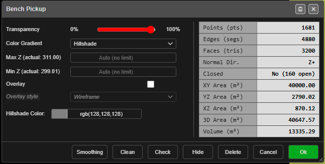
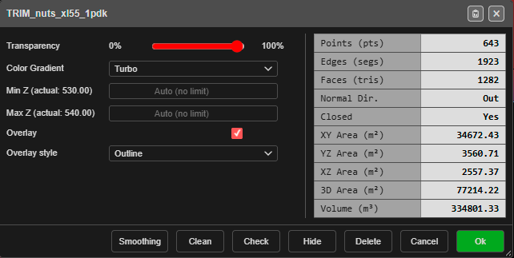
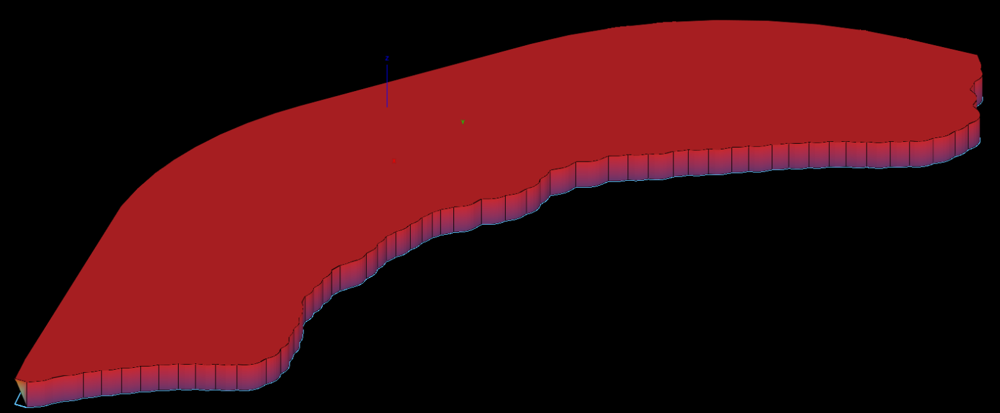
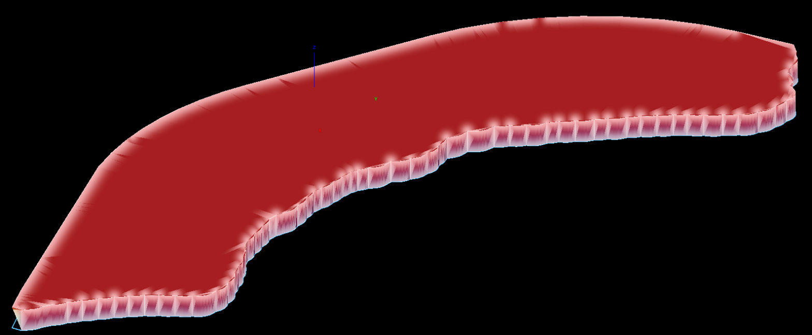

# Surface Gradients

Each surface is coloured by its own **Color Gradient** — by elevation, by hillshade, or by a
result such as a vibration analysis or a comparison with another surface. You set it, with the
surface's transparency and elevation limits, in the surface's properties. The colours show in
both 2D and 3D.

*The properties dialog for a surface named Bench Pickup, with **Hillshade** chosen — the
**Hillshade Color** row appears only then. The table on the right is the surface's statistics.*

---

## Change a surface's colours

1. Open the surface's properties:
   - right-click the surface on the canvas, in 2D or 3D, or
   - right-click it in the [Data Explorer](../working-in-kirra/data-explorer.md) and choose
     **Properties**.

   The dialog is titled with the surface's name.
2. Choose the **Color Gradient**.
3. Set **Transparency**, and **Max Z** / **Min Z** if you want to narrow the colour range
   (below).
4. Click **Ok**. The change is saved with the surface. **Cancel** closes without changing
   anything.

---

## The gradients

| Gradient | Colours, low to high | Good for |
|---|---|---|
| **Default** | Blue, cyan, green, yellow, red | Reading elevation at a glance |
| **Hillshade** | One colour, shaded by slope as if lit from one direction | Crests, toes, ramps and benches; checking a pickup |
| **Viridis** | Dark purple, teal, green, yellow | Even steps of colour; prints well |
| **Turbo** | A full rainbow | The most contrast between close elevations |
| **Parula** | Blue, green, yellow | An alternative to Viridis |
| **Cividis** | Blue to yellow | Easier to read for colour-blind viewers |
| **Terrain** | Dark green, pale green, brown, grey, white | A natural, map-like look |

Three more appear in the list only when they apply to that surface:

| Gradient | Shown when | Colours by |
|---|---|---|
| **Texture (Original)** | The surface is a textured OBJ | Its own photo texture — see [3D Mesh Import](../importing/3d-mesh.md) |
| **Analysis (…)** | The surface carries a [Blast Analysis Shader](../analysis/overview.md) result | That model's values, for example **Analysis (PPV)** |
| **Deviation (vs …)** | The surface has been compared with another in [Compare Surfaces](compare-surfaces.md) | Its distance from the reference surface named in brackets |

---

## The fields

| Field | What it does |
|---|---|
| **Transparency** | **0%** is invisible, **100%** is solid |
| **Color Gradient** | The colours, from the tables above |
| **Max Z (actual: …)** | The top of the colour range. The bracket shows the surface's highest point. Blank — **Auto (no limit)** — uses that highest point |
| **Min Z (actual: …)** | The bottom of the colour range. The bracket shows the lowest point. Blank uses that lowest point |
| **Overlay** / **Overlay style** | Lines drawn over the surface — see [Edge Overlay](#edge-overlay) |
| **Hillshade Color** | The colour that **Hillshade** shades. Shown only when **Hillshade** is chosen. Grey unless you change it |
| **Specular** / **Shininess** | Textured OBJ surfaces only: how glossy the surface looks in 3D |

The buttons along the bottom:

| Button | What it does |
|---|---|
| **Smoothing** | Opens the smoothing tool for this surface |
| **Clean** | Opens [Clean Mesh](clean-mesh.md) on this surface |
| **Check** | Runs a quick mesh check and reports the result in the dialog |
| **Hide** / **Show** | Hides or shows the surface |
| **Delete** | Removes the surface from the workspace |
| **Cancel** / **Ok** | Close without changes / save the changes |

> **Warning:** **Delete** removes the surface straight away — it does not ask first.

---

## Elevation limits

By default the colours run from the surface's lowest point to its highest. Narrow the range with
**Min Z** and **Max Z** to spread all the colours over the elevations you care about — one bench,
for example.

- Points **below Min Z** take the lowest colour; points **above Max Z** take the highest.
- Leave a field blank to go back to the surface's own lowest or highest point.
- A completely flat surface — or limits closer than a millimetre — is drawn orange.

---

## Hillshade

**Hillshade** shades the surface as if lit by a single light, so slopes facing the light are
bright and slopes facing away are dark. Choose the base colour in **Hillshade Color**.

The light's direction is set for all surfaces, in **Settings** — see the
[2D tab](../working-in-kirra/settings.md#2d-tab):

| Setting | Default | What it sets |
|---|---|---|
| **Hillshade Light Bearing (deg)** | 135 | The direction the light comes from (0 = north, clockwise) |
| **Hillshade Light Elevation (deg)** | 15 | How high the light is above the horizon. Lower gives longer, stronger shadows |

---

## Edge Overlay

Draw lines over a surface to show its shape. Tick **Overlay** in the surface's properties, then
pick a style:

| Style | What it draws |
|---|---|
| **Outline** | Black lines only where the surface changes angle — crests, toes and the outer edge. Flat areas stay clean. |
| **Wireframe** | Every triangle edge, 30% darker than the surface. |
| **Inner glow** | A soft light glow along the same lines as Outline. |

### How to use

1. Right-click the surface to open its properties.
2. Tick **Overlay** — **Overlay style** becomes available. It starts on **Wireframe**.
3. Choose **Outline**, **Wireframe** or **Inner glow**.
4. Click **Ok** — the overlay shows in both 2D and 3D.

### Good to know

- Lines are 1 pixel wide at any zoom.
- In 3D, lines on the far side of a ridge are hidden.
- The overlay follows the surface's transparency.
- The setting is saved with the surface and travels in project files.
- Inner glow works best on surfaces with evenly sized triangles. Very thin triangles can make it slightly uneven.
- The overlay is not printed, and is not included in **Send to Image**.
- **Overlay** is not offered on an analysis surface.

---

## Send to Image

**Send to Image** turns a surface into a picture of how it looks right now — gradient, limits, hillshade, texture, or analysis colours — and adds it to the **Images** folder. The image is saved with the project and is still there when you reopen it.

It appears only on surfaces. Right-click a surface, a surface layer, or the **Surfaces** folder; a layer or folder makes one image per surface.

### How to use

1. Right-click a surface in the tree and choose **Send to Image…**
2. Choose **Resolution by** — **Pixels per metre**, or **DPI** at a nominal 1:1000 plot
3. Enter the **Value**, and a **Max dimension (px)** for the longest side
4. Check the live readout: ground resolution, image size and memory
5. Click **Create Image**

A render larger than **Max dimension** is scaled down to fit rather than refused.

### Image sizes in the tree

Each image row in the **Images** folder shows its size, for example **4093×3681 px, 0.22 m/px, 57.5 MB**:

- **px** — width × height in pixels
- **m/px** — ground resolution: how many metres one pixel covers
- **MB** — the memory the image takes while open

---

## Troubleshooting

| Problem | Cause and fix |
|---|---|
| Every part of the surface is one colour | **Min Z** and **Max Z** are set outside the surface's heights. Clear them |
| The surface is orange | It is flat, or **Min Z** and **Max Z** are almost equal |
| **Texture (Original)**, **Analysis** or **Deviation** is not in the list | That surface has no texture, analysis result or comparison |
| The hillshade looks flat | The light is high. Lower **Hillshade Light Elevation** in Settings |

---

## Related Topics

- [Importing Surfaces](importing-surfaces.md)
- [Surfaces Toolbar](surfaces-toolbar.md)
- [Compare Surfaces](compare-surfaces.md)
- [Settings](../working-in-kirra/settings.md)
- [GeoTIFF Export](../exporting/geotiff-export.md)
- [Blast Analysis Shader](../analysis/overview.md)
