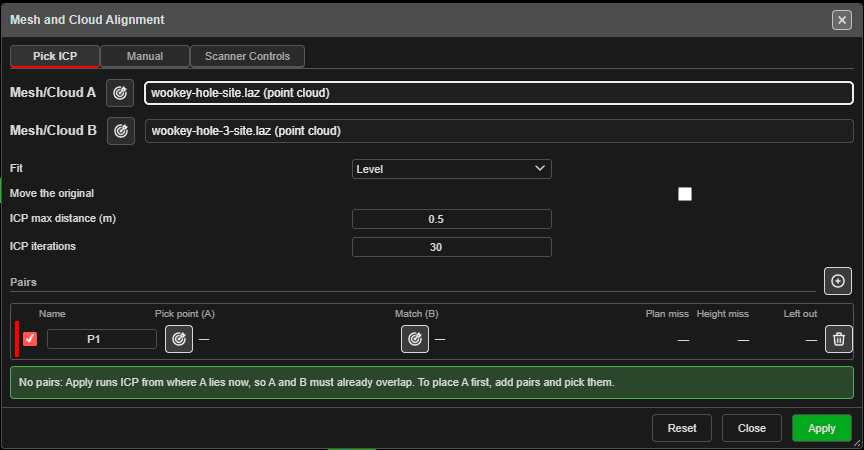

# Mesh and Cloud Alignment

Moves a scan or mesh onto the grid, or onto another scan or mesh. Use it to bring a scan taken in
its own scanner frame onto your site grid, to line up two scans of the same wall, or to fit a mesh
from another package onto your survey.

You choose two things: **A**, the scan or mesh to move, and **B**, the reference it is moved onto.
Either can be a [point cloud](point-clouds.md) or a mesh (a surface). Kirra fits the move from pairs
of matching points, and can then refine it over every point where the two overlap.

---

## Open it

Click **Mesh and Cloud Alignment** on the **Surface** toolbar (below the second divider, with the
point-cloud tools). **A** and **B** list the point clouds that are shown and unlocked, and the
meshes that are visible and unlocked. If there are none, Kirra says *"Show a point cloud or a mesh
first: this tool moves a shown, unlocked cloud or mesh."*

The dialog has three tabs — three ways to tell Kirra how A and B match:

| Tab | Use it when |
|---|---|
| **Pick ICP** | A and B overlap, or you can pick a few matching points on both. Kirra fits the pairs, then refines the fit over the whole overlap (ICP) |
| **Manual** | You can pick matching points, and want the fit from those pairs alone. B can be any point the cursor snaps to — a surveyed KAD point or a hole collar |
| **Scanner Controls** | You have the scanner's target file and the grid control file. The points pair up by name |

---

## The controls

| Control | What it does |
|---|---|
| **Mesh/Cloud A** | The scan or mesh to move. Choose it from the list, or click the button beside it and then click a point of it on the canvas |
| **Mesh/Cloud B** | The reference. On **Manual** it can be **Any snapped point (Manual)**. Not shown on **Scanner Controls**, where the grid control file is the reference |
| **Fit** | **Level** — turn about the vertical and shift, for a levelled scanner; needs 2 pairs. **Rigid** — any rotation and shift; needs 3 pairs. **Rigid + scale** — also one scale; needs 3 pairs |
| **Move the original** | Unticked (the default): A stays where it is and a moved copy is added. Ticked: A itself moves, and **Ctrl+Z** puts it back |
| **ICP max distance (m)** | **Pick ICP** only, default 0.5. Points farther than this from B are left out of each ICP step. Set it a little more than the pairs' miss |
| **ICP iterations** | **Pick ICP** only, default 30. Most fits settle in 10 to 30 steps |

### Pairs

Click **+** to add a pair, then click the pick button in **Pick point (A)** and click the point on
A, and the pick button in **Match (B)** and click the same point on B. A pick on A only takes a
point of A, and a pick on B only a point of B, even where something else is in front. **Escape**
cancels a pick.

| Column | What it shows |
|---|---|
| (tick) | Untick to leave the pair out of the fit. Its miss is still shown |
| **Name** | The pair's name — P1, P2 … — which you can change |
| **Pick point (A)** / **Match (B)** | The picked coordinates. On **Scanner Controls** these are **Scanner target** and **Control point** |
| **Plan miss** / **Height miss** | How far the moved point lands from its match, in plan and in height (m) |
| **Left out** | How far it misses when the fit is made without it. A large value marks a bad pick |
| (bin) | Removes the pair |

Each pair has its own colour: a stripe on its row and a dot on each of its two points on the canvas.
The worst pair's row is in bold.

The fit runs as you go. The banner under the pairs reads, for example, *"Level fit from 3 pairs:
RMS … m. Worst: P2, … m when left out."* — or says what is missing, for example *"Level
needs at least 2 ticked pairs with both points (0 now)."*

### Scanner Controls

On this tab two load buttons appear beside **+**:

- **Load the scanner targets** — a CSV or TXT of *name, x, y, z* in the scan's own coordinates.
- **Load the grid control** — a CSV or TXT of *name, x, y, z* (or *Name, E, N, RL*) in grid
  coordinates.

Targets and control points with the same name become a pair.

---

## Apply

Click **Apply**.

- **Pick ICP** fits the pairs, then runs ICP of A onto B, with a progress window and **Cancel**. With
  **no pairs**, ICP starts from where A lies now, so A and B must already overlap — the banner says
  so. A and B must be two different things.
- **Manual** and **Scanner Controls** apply the fit from the pairs.

Unless **Move the original** is ticked, Kirra adds the moved copy as **\<A\> (registered)** — a new
cloud or a new surface — and says *"Added "…". … is unchanged."* With it ticked, Kirra says
*"Moved …. Ctrl+Z puts it back."* After ICP the message adds the result, for example *"ICP: RMS
… m → … m over … of … sample points."*

**Reset** clears every pair. **Close** closes the dialog and removes the pair dots.

---

## Things to know

- **A textured mesh cannot be moved yet.** It can be B, the reference.
- **Facets are dropped.** Moving a cloud removes its [facets and joint sets](facets-joint-sets.md);
  run them again on the moved cloud.
- **A very large cloud** moved with **Move the original** may be too large to undo; the message
  after the move says so.
- If ICP's message says *"It had not settled"*, run it again or raise **ICP iterations**. If it says
  the shapes fix only some directions, the overlap has too little shape to pin those directions
  down; they stay where the pairs put them.

---

## Related

- [Point Clouds](point-clouds.md) — including [Coordinates and scans that start at 0, 0](point-clouds.md#coordinates-and-scans-that-start-at-0-0)
- [Move](../kad/move.md) and [Transform KAD](../kad/transform.md) — move selected cloud points by hand or by exact amounts
- [Selection & Snapping](../working-in-kirra/selection-and-snapping.md)
- [Surfaces Toolbar](surfaces-toolbar.md)
