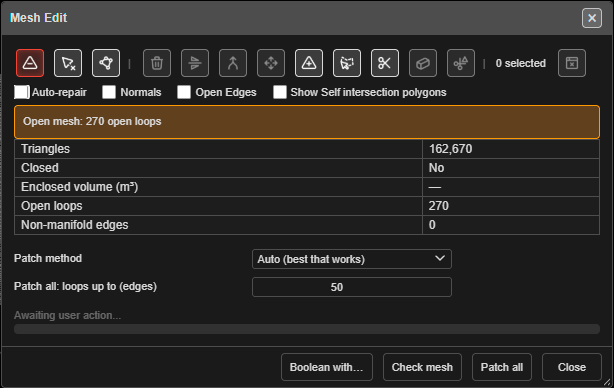
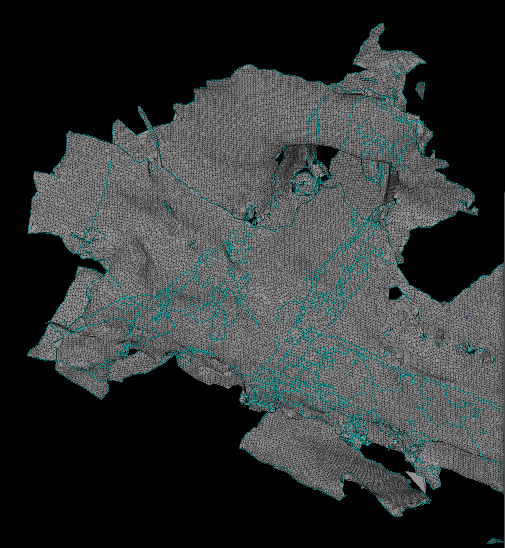

# Mesh Editing (Edit Mesh)

Edit Mesh is where you edit and repair a surface by hand in the 3D view: select triangles or
vertices, delete, flip, weld, move and insert them, and find and patch the holes (open loops) in a
mesh. It works on any triangulated surface — a 2.5D surface, an imported mesh or a 3D mesh from
[3D Triangulate](triangulate-3d.md).

---

## Start Edit Mesh

Click **Edit and Repair Mesh** on the **Surface** toolbar (beside **Clean Mesh**, below the first
divider).

- With one visible surface that can be edited, Edit Mesh opens on it.
- With several, [Clean Mesh](clean-mesh.md) opens instead and the status line reads *"Several
  surfaces are shown: pick one here, then Edit Mesh."* Choose the surface there and click its
  **Edit Mesh** button.
- With none, Kirra says *"No editable surfaces loaded."*

Edit Mesh needs the 3D view — otherwise Kirra says *"Switch to 3D view to use mesh editing."* It
does not edit textured OBJ meshes (*"Mesh editing is not supported for textured OBJ meshes."*) or
a surface with no triangles. The mesh is drawn as a wireframe as soon as Edit Mesh opens.

The **Mesh Edit** dialog stays open until you click **Close** or its **×**. **Escape** never closes
it — see [Escape](#escape).

---

## The tool row

From left to right:

| Button | Key | What it does |
|---|---|---|
| **Face mode** | **F** | Click to select triangles |
| **Vertex mode** | **V** | Click to select vertices |
| **Loop Select** | **L** | Click an open loop or a self-intersection to select it, then **Fill** or **Clip by Fold** |
| **Delete selected** | **Del** | Face mode: removes the selected triangles. Vertex mode: removes every triangle that uses a selected vertex |
| **Invert normal** | | Flips the winding of the selected triangles |
| **Weld** | **W** | Vertex mode, two or more vertices: merges them at their centre |
| **Move vertex** | **M** | Vertex mode: pick up a vertex and drop it somewhere else — see [Move a vertex](#move-a-vertex) |
| **Insert triangle** | **I** | Pick three vertices; **Enter** adds the triangle |
| **Polygon select** | **P** | Draw a polygon on screen to select many faces or vertices at once |
| **Clean orphan vertices** | | Removes points no triangle uses |
| **Fill** | | Patches the loop selected with **Loop Select**, using the **Patch method** below (a fold loop is fan-filled) |
| **Clip by Fold** | | Clips the solid by the selected self-intersection loop |
| (count) | | `0 selected`, or the number of faces or vertices selected |
| **Clear selection** | | Clears the selection |

Buttons that need a selection, or vertex mode, are greyed out until you have one.

**Selecting:** click to select; **Shift+click** adds, **Ctrl+click** (**Cmd** on a Mac) removes.
**Ctrl+A** selects every face, or every vertex. With **Polygon select**, click the corners and
double-click to finish; **Shift+double-click** adds and **Ctrl+double-click** removes. Right-click
the **Polygon select** button to choose **Select Touching Tris** or **Select fully inside**.
Polygon select stays on for the next polygon until you press **P** or click the button again.

### The tick boxes

| Tick box | What it does |
|---|---|
| **Auto-repair** | After a delete, fills only the hole the delete made |
| **Normals** | Draws the direction each triangle faces |
| **Open Edges** | Draws the edges used by only one triangle, in magenta |
| **Show Self intersection polygons** | Draws each coincident, coplanar fold as a red loop — the self-intersections that open edges and non-manifold checks cannot see |

---

## Move a vertex

1. Choose **Vertex mode** (**V**), then **Move vertex** (**M**). The status line reads *"Move:
   click a vertex to pick it up."*
2. Click a vertex. It follows the cursor — you do not hold the mouse button down.
3. Move it. The status line says where it will land:
   - on a snap target — the points of any surface, KAD points and lines, holes — using Kirra's
     [snapping](../working-in-kirra/selection-and-snapping.md) and the **Snap** toggle,
   - *"Move: on an edge - click to drop."* — on an edge of the triangle under the cursor,
   - *"Move: on the surface - click to drop."* — sliding over the surface,
   - *"Move: off the mesh, on its triangle's plane - click to drop."*
4. Click to drop it.

**Escape** while you carry a vertex puts it back where it was — *"Move: point put back - click a
vertex to pick it up."* A second **Escape** leaves **Move vertex**.

### Weld on drop

If you drop the vertex within the weld tolerance of another vertex, **Weld points?** asks:
*"These 2 points are … m apart. Weld them into one point?"*

| Control | What it does |
|---|---|
| **Weld tolerance (m)** | Edit Mesh's own weld tolerance, default 0.0012 m. A change here is saved for next time. Clean Mesh has its own |
| **Weld** | Welds the two into one point — *"Welded into one point (n triangles removed)."* |
| **Keep separate** | Leaves them as two points. **×** and **Escape** do the same |

The move and the weld are one **Ctrl+Z** step.

---

## Find and patch open loops

The lower half of the dialog reports on the mesh:

| Row | What it shows |
|---|---|
| (banner) | *"Open mesh: n open loops"*, or *"Closed void: … m³"* |
| **Triangles** | The number of triangles |
| **Closed** | **Yes** when the mesh has no open edges |
| **Enclosed volume (m³)** | The volume, when the mesh is closed |
| **Open loops** | Holes in the mesh, each a ring of open edges |
| **Non-manifold edges** | Edges shared by three or more triangles |

| Setting or button | What it does |
|---|---|
| **Patch method** | **Auto (best that works)**, **Fair (smooth, follows the wall)**, **Fan (flat, loop points only)**, **Centroid (one centre point)** or **Vertex fan (from one corner)**. Auto tries Fair, then Fan, Centroid and Vertex fan, and uses the first that works. Fair suits holes in cave or rock walls; Fan suits flat cuts such as drive ends or section cuts |
| **Patch all: loops up to (edges)** | Default 50. **Patch all** fills every open loop with at most this many edges. A drive end or portal is usually larger — leave those open unless the void must close |
| **Check mesh** | Reads the mesh again and refreshes the report |
| **Patch all** | Patches every loop up to the limit. If none is small enough, it says so |
| **Boolean with…** | Opens [Trimesh Boolean](trimesh-boolean.md) with this surface as the first surface |
| **Close** | Ends Edit Mesh |

To patch one hole:

1. Click **Loop Select** (**L**). The open loops are drawn cyan, and self-intersections orange.
2. Click a loop. It turns yellow.
3. Choose the **Patch method**, then click **Fill**.

The report and the loops are read again after every edit, undo and redo — you do not need to press
**Check mesh**. On a large mesh (more than 500,000 triangles) the mesh is read only when you press
**Check mesh**: the banner reads *"Large mesh (n triangles): press Check mesh to read it - this
uses a lot of memory."*

---

## Escape

Edit Mesh is a set of tools, so **Escape** steps out one level at a time and never closes the
dialog:

1. It ends what the current tool is doing — puts back a carried vertex, clears the corners picked
   for **Insert triangle**, or drops the selected loop.
2. A second **Escape** leaves the tool (**Move vertex**, **Insert triangle**, **Loop Select**,
   **Polygon select**).
3. With no tool on, **Escape** clears the selection.

Click **Close** or **×** to end Edit Mesh.

---

## Undo

Each edit, weld, move, insert and patch is one **Ctrl+Z** step; **Ctrl+Y** redoes it. The surface
is saved as you go.

---

## Keys

| Key | Action |
|---|---|
| **F** / **V** | Face / Vertex mode |
| **L** | Loop Select on or off |
| **Del** / **Backspace** | Delete selected faces, or the triangles of the selected vertices |
| **Ctrl+A** | Select all faces or vertices |
| **W** | Weld (vertex mode, 2+ vertices) |
| **M** | Move vertex on or off (vertex mode) |
| **I** | Insert triangle on or off |
| **P** | Polygon select on or off |
| **Enter** | Add the inserted triangle once three corners are picked |
| **Escape** | Step out one level — see [Escape](#escape) |
| **Ctrl+Z** / **Ctrl+Y** | Undo / redo |

---

## Troubleshooting

| Message or symptom | Cause | Fix |
|---|---|---|
| *"Several surfaces are shown: pick one here, then Edit Mesh."* | More than one surface is visible | Pick the surface in Clean Mesh and click **Edit Mesh**, or hide the others |
| *"Surface replaced"* | Another tool replaced the mesh you were editing | Open Edit Mesh again on the new surface |
| *"No open loops of up to n edges to patch - patch bigger loops one by one."* | Every hole is larger than the **Patch all** limit | Raise the limit, or select a loop and **Fill** it |
| *"The mesh has changed since this check - Check mesh to refresh."* | The report is out of date | Click **Check mesh** |

For automatic checks and repairs across the whole surface, use [Clean Mesh](clean-mesh.md).

---

## Related

- [Clean Mesh](clean-mesh.md)
- [3D Triangulate (Void Mesh)](triangulate-3d.md)
- [Trimesh Boolean](trimesh-boolean.md)
- [Surfaces Toolbar](surfaces-toolbar.md)
- [Importing Surfaces](importing-surfaces.md)
