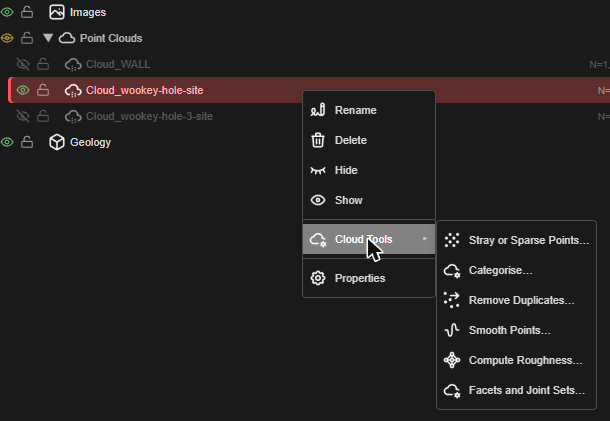
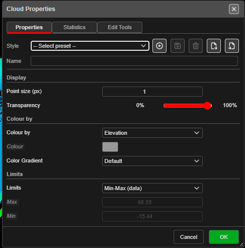
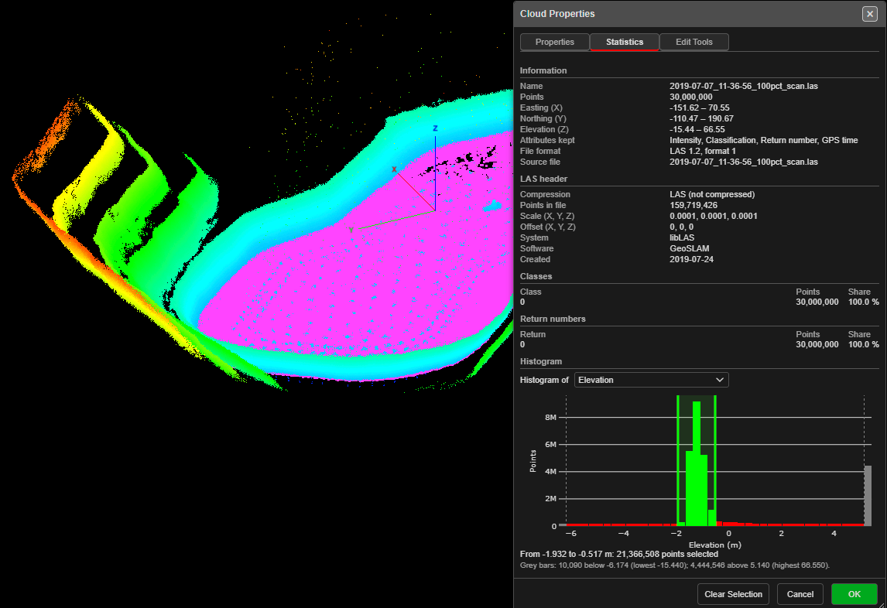
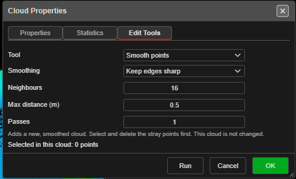

# Point Clouds

A **point cloud** is a scan or survey kept as millions of plain points: no triangles, no
drawing objects, just each point's position and whatever the scanner recorded about it
(colour, intensity, classification, return number and, if you asked for it, GPS time).

Kirra keeps a point cloud as its own kind of data, labelled **Point Cloud (KAD Cloud Entity - Increased Point Capability)** on the
import dialogs. It draws in 2D and 3D, prints, saves with your project and can be exported to
LAS. You can select its points — by drawing a shape, by class and height, from a histogram, or
the stray and sparse points a scan picks up — and delete, crop or split them. You can also remove
duplicate points, smooth a noisy scan, measure its roughness, merge clouds, make KAD points from
them, and triangulate them into a surface. LAS and LAZ files import this way by default, so a survey of tens of millions of points
opens without being thinned to a drawing-object limit.

---

## Bring a point cloud in

Use the import row for your file, or drag the file onto Kirra:

| File | Row | Opens |
|------|-----|-------|
| `.las` / `.laz` | **LAS Point Cloud** (Surfaces / Mesh tab) | **Import LAS Point Cloud** |
| `.xyz` / `.txt` / `.csv` / `.pts` / `.ptx` / text `.ply` | **Point Cloud** (Surfaces / Mesh tab) | **Import Point Cloud** |

In both dialogs, set **Import As:** to **Point Cloud (KAD Cloud Entity - Increased Point Capability)**. It is the default for every
LAS and LAZ file, and for a text cloud with more than 1,000,000 points. A smaller text cloud
still defaults to **Surface (triangulated mesh)**, as it always has, so choose
**Point Cloud (KAD Cloud Entity - Increased Point Capability)** yourself if you want a cloud.

The full list of options is on [Surfaces and Point Clouds](../importing/surfaces-and-point-clouds.md#las-point-cloud).
The ones that matter for a cloud:

- **Max Points:** (LAS) keeps this many points, spread evenly over the file. **0** keeps as many
  as the draw budget allows.
- **Tolerance (3D):** removes points closer than this, in 3D, to one already kept. **0** keeps
  every point.
- **Keep GPS time** (LAS) stores each point's GPS time so you can colour by time later. It costs
  8 bytes a point and is greyed out when the file's point format has no GPS time.

When the import finishes, Kirra says how many points it imported, and zooms to fit all your
data. If the file held more points than the draw budget, the message says so and that the points
were thinned evenly.

The cloud is named after the file, starting **Cloud_** (for example `Cloud_pit_scan`), with
`_2`, `_3` and so on added if the name is taken.

> **A cloud is saved with your work.** It comes back after a reload. If the browser has no room
> to store it, Kirra says **Point Cloud Not Saved**: the cloud stays open for that session but
> will not return after a reload.

### The draw budget

The most points Kirra reads and draws for one import is set on the **Performance** tab of
**Settings**: **Max Point-Cloud Points**, 30,000,000 by default. It uses about 24 bytes of memory
a point, so 30,000,000 points is roughly 720 MB. Lower it on a computer with little memory.
See [Settings](../working-in-kirra/settings.md#performance-tab).

A file with more points than the budget is thinned evenly across the whole file, not cut off.

---

## The Point Clouds folder

Each cloud is listed in the [Data Explorer](../working-in-kirra/data-explorer.md) under the
**Point Clouds** group, which sits between **Images** and **Geology**. Clouds are not on a
drawing layer, so layer controls do not touch them. The grey text on a row is the number of
points, for example `N=10,040,120`.

| Control | What it does |
|---------|--------------|
| **Eye** | Shows or hides the cloud. The eye on the **Point Clouds** group shows or hides every cloud |
| **Lock** | Locks the cloud. The lock on the **Point Clouds** group locks every cloud. A locked cloud cannot be deleted until you unlock it |

Right-click a cloud row:

| Item | What it does |
|------|--------------|
| **Rename** | Renames the cloud |
| **Properties** | Opens [Cloud Properties](#cloud-properties) |
| **Hide** / **Show** | Hides or shows the cloud |
| **Delete** | Deletes the cloud. Kirra asks first: **Delete Point Cloud** — *Delete 1 point cloud(s)? This cannot be undone.* |
| **Cloud Tools** ▸ **Stray or Sparse Points…** / **Remove Duplicates…** / **Smooth Points…** / **Compute Roughness…** | Opens [Cloud Properties](#cloud-properties) on its **Edit Tools** tab, set to that tool (shown when one cloud row is selected) |
| **Clear Point Selection** | Clears the cloud's selected points (shown when the cloud has a selection) |
| **Delete Selected Points** | Removes the selected points (shown when the cloud has a selection) |
| **Crop to Selection** | Keeps only the selected points (shown when the cloud has a selection) |
| **Split Selection to New Cloud** | Moves the selected points into a new cloud (shown when the cloud has a selection) |
| **Convert Selection to KAD Points** | Makes KAD points from the selection (shown when the cloud has a selection) |
| **Merge Clouds** | Joins two or more clouds into a new one (shown when two or more cloud rows are selected) |

> **Warning:** Deleting a point cloud cannot be undone with **Undo**. Export a
> [KAP project](../exporting/other-formats.md#kap-kirra-app-project) first if you may want it
> back.

**Sort…** on the **Point Clouds** group orders the rows in the tree only; your data does not
change.

A hidden cloud is not drawn in 2D or 3D, does not print and is not written to a LAS export.

---

## Cloud Properties

Right-click a cloud in the Data Explorer and choose **Properties**, or choose one of the
**Cloud Tools** items to open it straight on that tool. **Cloud Properties** has three tabs:

| Tab | What it holds |
|-----|---------------|
| [**Properties**](#properties-tab) | How the cloud looks: point size, colouring, limits and classes |
| [**Statistics**](#statistics-tab) | Facts about the cloud, its LAS header, class and return counts, and a histogram you can select points from |
| [**Edit Tools**](#edit-tools-tab) | Select points, remove duplicates, smooth points and compute roughness |

The footer has **OK**, **Cancel** and a third button that changes with the tab: none on
**Properties**, **Clear Selection** on **Statistics**, and **Run** on **Edit Tools**. **Clear
Selection** and **Run** keep the dialog open.

- **OK** keeps the **Properties** tab's changes and saves them with the cloud.
- **Cancel**, the close button or **Escape** puts back the **Properties** settings the cloud had
  when you opened the dialog.

What a tool on **Edit Tools** makes does not wait for **OK**: a new cloud is added when the tool
finishes, and **Compute roughness** is saved with the cloud straight away. **Cancel** does not
take either back.

### Properties tab

The cloud opens with its current look. Every change shows on the canvas straight away.

The **Style** row at the top saves the dialog's settings as a named preset, so you can apply the
same look to another cloud. Use the buttons beside it to save a new preset, update the selected
one, delete it, or export and import presets as a file. Hidden classes are not part of a preset;
they belong to each cloud.

#### Display

| Setting | Default | What it does |
|---------|---------|--------------|
| **Point size (px)** | 1 | The size of each point on screen, 1 to 10 pixels. Larger points are easier to see and slower to draw. 1 is the fastest |
| **Transparency** | 100% | A slider from 0% to 100% |

#### Colour by

**Colour by** decides what colours each point. The list holds only the choices the cloud has data
for.

**Classification**, **Return number** and **GPS time** are listed only when the cloud holds that
column, and they are shown greyed out, with a short note, when every point has the same value
and so nothing could be told apart. The note reads, for example, *GPS time (all values are 0)*
or *Classification (all the same)*. **Intensity** is not checked this way. If a cloud's saved
choice has become unavailable, it stays selected, greyed out.

| Choice | Needs |
|--------|-------|
| **RGB (colour from the file)** | Colour in the file. The default for a cloud that has it |
| **Elevation** | Nothing. The default for a cloud without colour |
| **Intensity** | Intensity in the file |
| **Classification** | Classification in the file, with more than one value (otherwise greyed out with a note) |
| **Return number** | Return numbers in the file, with more than one value (otherwise greyed out with a note) |
| **GPS time** | **Keep GPS time** ticked at import. Greyed out with a note when every time is the same |
| **Roughness** | [Compute roughness](#compute-roughness) run on the cloud. Points with no roughness value are grey |
| **Single colour** | Nothing |

| Setting | When it is available | What it does |
|---------|----------------------|--------------|
| **Colour** | **Single colour** | The colour of every point |
| **Color Gradient** | Elevation, Intensity, Return number, GPS time, Roughness | The colour ramp: **Default**, **Viridis**, **Turbo**, **Parula**, **Cividis** or **Terrain**. The same ramps as [surfaces](gradients.md) |

A setting that does not apply to the chosen **Colour by** is greyed out.

#### Limits

| Setting | What it does |
|---------|--------------|
| **Limits** | **Min-Max (data)** stretches the ramp over the cloud's own values. **Fixed** uses your **Min** and **Max**, so several clouds can share one scale |
| **Max** | The top of the ramp when **Limits** is **Fixed**. Blank uses the highest value in the data |
| **Min** | The bottom of the ramp when **Limits** is **Fixed**. Blank uses the lowest value in the data |

**Limits**, **Max** and **Min** apply to the ramp choices only. **Max** and **Min** are active
only when **Limits** is **Fixed**; the blank box shows the data's own value.

#### Classes

Shown for a cloud that holds more than one class; a cloud with a single class has nothing to
tell apart and no **Classes** group (unless that one class has been hidden, so it can be shown
again). One row for each class in the cloud, with:

- a tick box: untick it to hide that class (a hidden class is also left out of the
  LAS / LAZ export),
- the class number (**Class 2**) and how many points it holds,
- a colour swatch: click it to change that class's colour. Classes start with a standard colour.

### Statistics tab

Read-only facts about the cloud, and a histogram you can select points from.

#### Information

**Name**, **Points**, **Easting (X)**, **Northing (Y)**, **Elevation (Z)** (each as a minimum to
maximum), and **Attributes kept** (RGB, Intensity, Classification, Return number, GPS time). A
cloud read from a LAS file also lists the **File format** (for example `LAS 1.2, format 3`), the
**File CRS** when the file names one, and the **Source file**.

#### LAS header

For a cloud read from a LAS or LAZ file, the header fields Kirra kept:

| Row | What it shows |
|-----|---------------|
| **Compression** | **LAZ (compressed)** or **LAS (not compressed)** |
| **Points in file** | How many points the file held, before any thinning on import |
| **Points by return (file)** | The file's own count of points for each return number |
| **Scale (X, Y, Z)** / **Offset (X, Y, Z)** | The file's coordinate scale and offset |
| **System** / **Software** | What the file says made it |
| **Created** | The file's creation date |

A row is left out when the file did not fill it in. A cloud imported with an earlier version of
Kirra shows only **Points in file**; import the file again to see every row.

#### Classes and Return numbers

One row for each class, and for each return number, in the cloud: the value, how many
**Points** hold it, and their **Share** of the cloud.

#### Histogram

**Histogram of** chooses what the histogram counts: **Elevation**, and **Intensity**, **GPS time**
or **Roughness** when the cloud holds them. It opens on the cloud's **Colour by** when that is one
of these.

- The red bars split the values into 40 equal steps. Hover over a bar to see its value and count.
- A **grey bar** at either end holds the points far outside the rest — a few stray points high
  above a pit, for example — so they do not squash the other bars into one. The line under the
  chart says how many there are and how far they go, for example *Grey bars: 12 above 412.500
  (highest 690.204).*
- When the cloud is coloured by the same value, dashed grey lines mark the **Properties** tab's
  colour limits.

The chart grows with the dialog: drag the dialog wider and the histogram gets wider and taller.

**Select points from the histogram**

1. Drag either lime line along the chart, or click a bar (a grey one too).
2. The bars inside the range turn lime, and the points they hold are selected on the canvas,
   drawn in the selection colour.
3. The line under the chart reads, for example, *From 402.500 to 405.000 m: 1,500 points selected*.

The range replaces the cloud's selection. Points in hidden classes are never selected. Click
**Clear Selection** to clear it. Then use the cloud's right-click menu to delete, crop or split
the selection — see [Working with a selection](#working-with-a-selection).

### Edit Tools tab

Choose a **Tool**, set it up, then press **Run**. Only the chosen tool's fields are shown, and
the dialog stays open, so you can run another tool straight after. The line at the foot reads
*Selected in this cloud: n points*.

| Tool | What it does |
|------|--------------|
| [**Select Points**](#select-points) | Selects points in this cloud by class and elevation, or the stray or sparse points |
| [**Remove duplicates**](#remove-duplicates) | Adds a new cloud without the duplicate points |
| [**Smooth points**](#smooth-points) | Adds a new, smoothed cloud |
| [**Compute roughness**](#compute-roughness) | Measures how rough the cloud is at each point, and colours by it |

A run that takes more than a moment shows its progress, with **Cancel**. The cloud you started from is
never changed by **Remove duplicates** or **Smooth points**.

#### Select Points

**Select by** chooses how points are picked:

| Select by | Fields | Picks |
|-----------|--------|-------|
| **Class and elevation** | **Class n (count points)** ticks, **Min Z (m)**, **Max Z (m)** | The points in the ticked classes and the height band. Leave Min Z or Max Z blank for no limit |
| **Stray points** | **Neighbours** (8), **Spread** (2) | Points much farther from their nearest neighbours than the cloud's average. Best on clouds of even density |
| **Sparse points** | **Radius (m)** (0.5), **Min neighbours** (1) | Points with fewer than **Min neighbours** other points within **Radius**, in 3D. Best on handheld scans and for dust |

- **Neighbours**: how many nearest neighbours to average over.
- **Spread**: how many standard deviations above the average distance a point must be to count
  as stray. **Lower** selects more points.
- **Min neighbours** of 1 keeps thin features, such as scanned blastholes.

**Selection** chooses **Replace**, **Add** or **Remove**. Press **Run**. The status bar says how
many points are selected, for example *1,240 point-cloud points selected*. Delete, Crop and Split
are on the cloud's right-click menu.

#### Remove duplicates

| Field | Default | What it does |
|-------|---------|--------------|
| **Tolerance (m, 3D)** | 0.01 | Keeps the first point and drops any point closer than this, in 3D, to one already kept. **Lower** removes fewer points |

The result is a **new** cloud named `<name> (deduped)`. Kirra says how many points it removed,
or that no points were within the tolerance and nothing was removed.

#### Smooth points

Smoothing takes the jitter out of a noisy scan, such as a handheld or drone scan of a face.
Select and delete the stray points first, so they are not smoothed into the surface.

| Field | Default | What it does |
|-------|---------|--------------|
| **Smoothing** | Keep edges sharp | **Keep edges sharp** moves each point along its surface normal, so crests and edges stay sharp. **Plane fit** moves each point onto its neighbours' best-fit plane |
| **Neighbours** | 16 | How many nearest points to look at around each point |
| **Max distance (m)** | 0.5 | Only neighbours within this distance count. Make it larger than the point spacing and smaller than the features you want to keep |
| **Passes** | 1 | How many times to smooth, 1 to 5. More passes are smoother, and slower |

The result is a **new** cloud named `<name> (smoothed)`. Kirra reports the noise before and
after, for example *Smoothed 2,400,000 points. Noise 1.85 cm → 0.62 cm.*

#### Compute roughness

| Field | Default | What it does |
|-------|---------|--------------|
| **Neighbours** | 16 | How many nearest points to look at around each point |
| **Max distance (m)** | 0.5 | Only neighbours within this distance count |

Roughness is each point's distance from its neighbours' best-fit plane, in metres: near 0 on a
smooth face, larger on broken ground. It is saved with this cloud, and the cloud is coloured by
**Roughness** with **Min-Max (data)** limits. **Roughness** is then a choice in **Colour by** and
in **Histogram of**. Points with too few neighbours within **Max distance** have no plane, and
are drawn grey.

---

## Legend

With the **Legend** display option on, a visible cloud coloured by **Elevation** gets a legend
entry like a surface, over the same range its points are coloured with.

---

## Printing

A visible point cloud prints with the rest of the plan, on the Kirra Inbuilt plot and in the map
cell of a template, in raster and vector PDF alike. It prints as one picture of the cloud seen
from above, in the same colours and point size as the screen.

On a very large page at a high resolution, Kirra lowers the cloud picture's resolution rather
than crop it. Everything else on the page keeps its own resolution.

---

## Coordinates and scans that start at 0, 0

**Kirra never moves a point cloud.** The cloud holds exactly the coordinates in the file.

A scan taken in its own scanner frame, with coordinates near 0, 0, brought into a project in
UTM therefore stays near 0, 0, a very long way from your design. When a new cloud lands
**100 km or more** from the data you already have, **Coordinate System Mismatch** asks what to do:

| Button | Result |
|--------|--------|
| **Ignore & Import** | Import the cloud where the file puts it |
| **Clean & Replace** | Clear the existing data, then import |
| **Cancel** | Stop. Nothing is added |

See [Checks on import](../importing/import-dialog.md#coordinate-check). The check runs only when
there is already data to compare with. To bring a scan onto your site grid, georeference it
before you import it.

---

## Taking a point cloud out of Kirra

| To | Do this |
|----|---------|
| Write a LAS or LAZ file | Visible clouds are included in the [LAS export](../exporting/other-formats.md#las-lidar) |
| Write XYZ, TXT, CSV, PLY, PTS or PTX | Visible clouds are included in the [Point Cloud export](../exporting/other-formats.md#point-cloud-xyz-txt-csv-ply-pts-ptx) |
| Use it in another format | Other exports, such as DXF, leave point clouds out. Select the points and use **Convert Selection to KAD Points** first |
| Keep it in a project | A [KAP project](../exporting/other-formats.md#kap-kirra-app-project) carries point clouds, and asks first because they can be large. A KAT template never does |

---

## Selecting points

You work on a point cloud by selecting a region of it and acting on the whole selection. Single
points cannot be dragged; to edit single points, [convert a small selection to KAD
points](#working-with-a-selection) and edit those.

**With Polygon Select (2D or 3D)**

1. On the [Select toolbar](../reference/select-toolbar.md), choose **V** (*Select KAD Vertices*).
2. Click **Polygon Select**. Right-click it to choose **Polygon**, **Rectangle** or **Ellipse**.
3. Draw the shape over the points. Hold **Shift** when you finish to add to the selection, or
   **Ctrl** to take points out of it.

Selected points are drawn in the selection colour, slightly larger than the rest. In 2D the shape
selects what lies inside it in plan view; in 3D it selects what you see inside it on screen, and
points cut away by the Section Plane are not selected. The status bar says how many points are
selected, for example *121 point-cloud points selected*.

**With Edit Tools**

Right-click the cloud row and choose **Cloud Tools** ▸ **Stray or Sparse Points…**, or open
**Properties** and go to the **Edit Tools** tab. Choose **Select Points** in **Tool**, then
select by class and elevation, or the stray or sparse points. See [Select Points](#select-points).

**With the histogram**

On the **Statistics** tab, drag the lime lines or click a bar: the points in that range of
elevation, intensity, GPS time or roughness are selected. See [Histogram](#histogram).

Only what is drawn can be selected: hidden clouds, locked clouds and classes hidden in
[Cloud Properties](#classes) are left out. A selection is not saved; it is cleared when the cloud
changes.

---

## Working with a selection

Right-click the cloud row. Each item asks first and says how many points it affects.

| Item | What happens |
|------|--------------|
| **Delete Selected Points** | The selected points are removed. With every point selected, Kirra offers to delete the cloud instead. The **Delete** key does the same when only cloud points are selected |
| **Crop to Selection** | Only the selected points are kept |
| **Split Selection to New Cloud** | The selected points move to a new cloud named after this one with *(selection)* added, for example `Cloud_scan (selection)` |
| **Convert Selection to KAD Points** | The selected points become one KAD points entity, `<cloud> points`, in the colours they are drawn in. KAD points are limited to 1,000,000; above that Kirra asks to thin the selection evenly |

To build a surface from a cloud, use the **Triangulate** tool. It uses every visible cloud: the
selection when the cloud has one, otherwise every drawn point. It uses up to half of **Max triangles
per surface (3D)** in [Settings > Performance](../working-in-kirra/settings.md#performance-tab)
points (a surface has about two triangles per point), spread evenly; the status bar says so when it
thins. **Estimated points** in its dialog includes the cloud points.

**Undo** (Ctrl+Z) reverses Delete, Crop and Split. A cloud larger than 256 MB cannot be undone;
Kirra says so in the question before it changes anything.

---

## Merging clouds

1. In the Data Explorer, select two or more cloud rows (Ctrl+click).
2. Right-click one of them and choose **Merge Clouds**.

Kirra makes a new cloud, **Merged cloud**, holding every point; the original clouds stay. The new
cloud takes the first cloud's colouring and point size. If some clouds have no colour (or no GPS
time, classification and so on), their points hold 0 there and the message says which — points
with no colour show black until you colour the cloud another way. If the merged cloud would hold
more points than the [draw budget](#the-draw-budget), Kirra asks to thin it evenly first.
**Undo** removes the merged cloud.

---

## Troubleshooting

**My text point cloud became a surface.**
A text cloud with 1,000,000 points or fewer defaults to **Surface (triangulated mesh)**. Choose
**Point Cloud (KAD Cloud Entity - Increased Point Capability)** in **Import As:**.

**I chose KAD points and got Too Many Points for KAD Points.**
KAD points carry more data per point and are limited to 1,000,000. Click **Use KAD Cloud** to
import the whole file as a point cloud, **Thin to 1,000,000 KAD points** to keep KAD points, or
**Cancel**. See
[Surfaces and Point Clouds](../importing/surfaces-and-point-clouds.md#too-many-points-for-kad-points).

**Colour by has no RGB, Intensity or GPS time.**
The file did not hold it. For GPS time, **Keep GPS time** may not have been ticked when you
imported; import the file again with it ticked.

**Classification, Return number or GPS time is greyed out in Colour by.**
Every point in the cloud has the same value (the note says *all values are 0* or *all the same*),
so colouring by it would show one colour. Choose another **Colour by**.

**The cloud is not on the screen after import.**
Check the eye on its row and on the **Point Clouds** group. If the cloud is 100 km or more from
your design, Kirra zooms out to take in both after the import, so your design looks small; see
[Coordinates and scans that start at 0, 0](#coordinates-and-scans-that-start-at-0-0).

**Point Cloud Not Saved.**
The browser has no room to store the cloud. It stays open for this session but will not return
after a reload. Export a KAP project, or free browser storage.

**Smooth points added nothing.**
Kirra says *No point has enough neighbours within 0.5 m to smooth*. The points are farther apart
than **Max distance (m)**. Make **Max distance** larger than the point spacing and run it again.

**Stray points selects too much, or too little, of a handheld scan.**
**Stray points** compares each point with the cloud's average spacing, so it works best when the
density is even. A handheld scan is dense near the scanner and thin far away: use **Sparse
points** instead, with a **Radius (m)** a few times the point spacing.

**Some points are grey after Compute roughness.**
Those points had too few neighbours within **Max distance (m)** to fit a plane, so they have no
roughness. Make **Max distance** larger, or remove the stray points first.

**The LAS header shows only Points in file.**
The cloud was imported with an earlier version of Kirra, which kept less of the header. Import the
LAS or LAZ file again to see it all. A cloud from a text file has no LAS header.

---

## Related

- [Surfaces and Point Clouds](../importing/surfaces-and-point-clouds.md) — the import dialogs
- [Data Explorer](../working-in-kirra/data-explorer.md)
- [Surface Gradients](gradients.md) — the colour ramps
- [Other Export Formats](../exporting/other-formats.md) — LAS and KAP
- [Settings](../working-in-kirra/settings.md#performance-tab) — Max Point-Cloud Points
