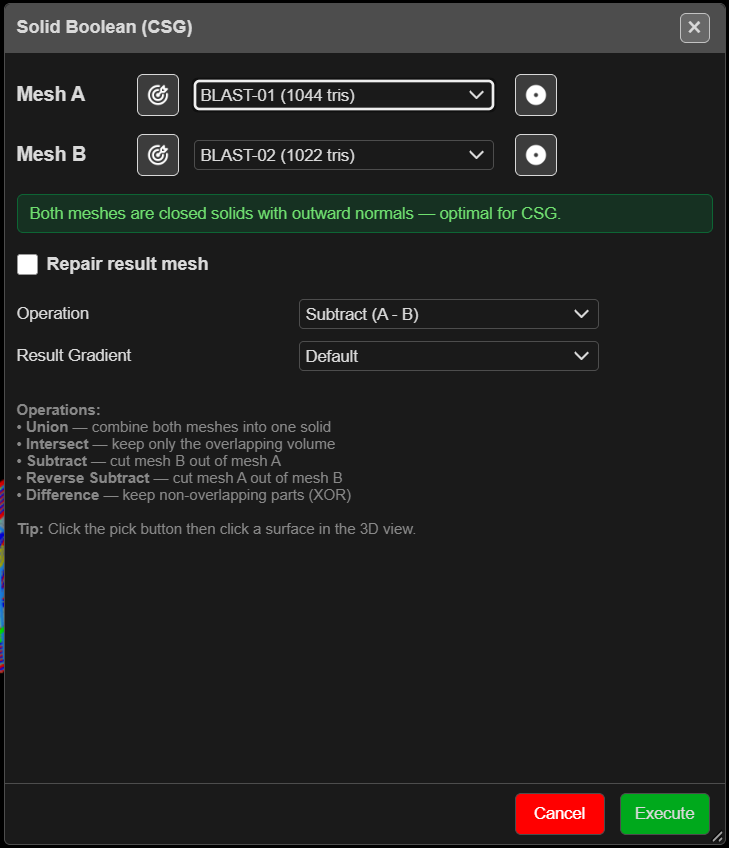

# Solid Boolean

Combines two closed solids — join them, keep the overlap, or cut one out of the other. Use it on
clean, watertight solids such as extruded design volumes and pit shells. For open surfaces or
large meshes, use [Trimesh Boolean](trimesh-boolean.md).

---

## Run a boolean

1. Click **Solid Boolean** on the **Surface** toolbar. The **Solid Boolean (CSG)** dialog opens.
2. Choose **Mesh A** and **Mesh B**, or click the target button beside each and click the solid in
   the 3D view.
3. Read the status box. Green means both are closed solids with outward normals. Amber lists the
   problems — an open surface, or normals facing in.
4. Choose the **Operation** and the **Result Gradient**.
5. Click **Execute**. A busy indicator shows while it runs.

You need at least two surfaces. The run happens in the foreground, so a large pair can hold up
the window — Kirra asks first when the two total more than 60,000 triangles.

---

## The fields

| Field | Default | What it does |
|---|---|---|
| **Mesh A** / **Mesh B** | First and second surfaces | The two inputs |
| Normals button (beside each mesh) | — | Turns that mesh's normals out or in. **This changes and saves the input surface** — **Ctrl+Z** undoes it |
| **Repair result mesh** | Off — ticked for you when a mesh is open | Tidies the result |
| **Close Mode** | **Weld Only** | Or **Close by Stitching** |
| **Snap Tol.** | 0 | Weld distance for the repair |
| **Stitch Tol.** | 1.0 | Gap the stitch will close (Close by Stitching only) |
| **Operation** | **Subtract (A - B)** | See below |
| **Result Gradient** | **Default** | Colouring of the result |

| Operation | Keeps |
|---|---|
| **Union (A + B)** | Both, joined into one solid |
| **Intersect (A ∩ B)** | Only the overlap |
| **Subtract (A - B)** | A with B cut out |
| **Reverse Subtract (B - A)** | B with A cut out |
| **Difference (A △ B / XOR)** | Everything except the overlap |

---

## What you get

A new surface named after the operation — for example `SUBTRACT_k3f9` — in the **Booleans**
layer. The inputs are left as they were. It can be undone.

---

## Troubleshooting

| Symptom | Cause | Fix |
|---|---|---|
| **Not a Closed Solid** warning | One mesh has open edges | **Run anyway**, or close it in [Clean Mesh](clean-mesh.md) first |
| **Large Meshes — CSG May Freeze** | Over 60,000 triangles between them | **Cancel** and use [Trimesh Boolean](trimesh-boolean.md) |
| *"CSG operation failed or produced no result."* | The solids do not overlap, or are not valid | Check both in 3D; clean them; try Trimesh Boolean |
| **Choose Two Surfaces** — *"Mesh A and Mesh B must be different surfaces."* | The same surface twice | Click **OK** and choose another surface — the dialog stays open |

> **Tip:** Mesh booleans are hard. The cleaner and more watertight the inputs, the better the
> result. If one engine fails, try the other on the same pair.

---

## Other ways to use it

| Method | Result |
|---|---|
| Normals button | Fixes an inward-facing solid without leaving the dialog |
| **Difference (A △ B / XOR)** | The parts of each solid the other does not cover |

---

## Related

- [Trimesh Boolean](trimesh-boolean.md)
- [Which boolean?](boolean-csg.md)
- [Extrude KAD to Solid](extrude-kad-to-solid.md)
- [Surfaces Toolbar](surfaces-toolbar.md)
