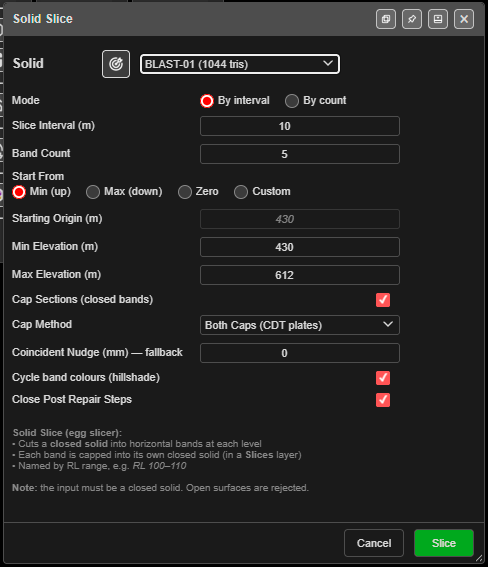

# Solid Horizon Slice

Cuts a closed solid into horizontal bands — one solid per bench or horizon — each capped and named
by its RL range. Use it to split a design or a pit-shell volume into benches for scheduling,
volumes and tonnes.

---

## Slice a solid

1. Click **Solid Horizon Slice** on the **Surface** toolbar. The **Solid Slice** dialog opens.
2. Choose the **Solid**, or click the target button and click it in the 3D view.
3. Choose the **Mode**:
   - **By interval** — cut every **Slice Interval (m)**.
   - **By count** — cut into **Band Count** equal bands.
4. Set where the levels start and the range (below).
5. Click **Slice**. A progress window reports each band as it closes, then a summary.

The solid must be closed. An open surface stops with **Not a Closed Solid** — close it with
[Clean Mesh](clean-mesh.md) first.

---

## The fields

| Field | Default | What it does |
|---|---|---|
| **Mode** | **By interval** | **By interval** or **By count** |
| **Slice Interval (m)** | 10 | Distance between cuts (By interval) |
| **Band Count** | 5 | Number of equal bands (By count) |
| **Start From** | **Min (up)** | **Min (up)**, **Max (down)**, **Zero** or **Custom** |
| **Starting Origin (m)** | The solid's lowest point | The level cuts are counted from. Editable with **Custom** only |
| **Min Elevation (m)** / **Max Elevation (m)** | The solid's bottom and top | Where the cuts may fall |
| **Cap Sections (closed bands)** | On | Caps each band into a closed solid |
| **Cap Method** | **Nudge (section — default)** | Or **Both Caps (CDT plates)**, **Top Cap only (CDT)**, **Bottom Cap only (CDT)** |
| **Coincident Nudge (mm) — fallback** | −0.1 | How far a cut moves when it lands exactly on a flat berm |
| **Cycle band colours (hillshade)** | On | A different colour per band. Off keeps the solid's colour |
| **Close Post Repair Steps** | On | Tidies each band after the cut; a band is never made worse |

**Min** and **Max** only decide where the inner cuts fall — the top and bottom bands still run
to the solid's real top and bottom. The dialog remembers your settings in this browser.

> **Tip:** For bench solids, choose **Custom**, enter one bench floor RL as the **Starting
> Origin (m)**, and set **Slice Interval (m)** to the bench height.

---

## What you get

New solids in the **Slices** layer, named by RL range — for example `Pit RL 100–110`. The
original solid is kept. A band that would not close is marked ` (open)`.

The summary says whether every band closed, how many cuts were made, and whether any cut landed
on a bench or berm and was adjusted.

---

## Troubleshooting

| Symptom | Cause | Fix |
|---|---|---|
| **Not a Closed Solid** | The surface has open edges | Close it in [Clean Mesh](clean-mesh.md) |
| A **Large Solid** warning | The solid is over the 3D triangle limit | Raise the limit in Settings, or decimate the surface |
| *"Too many bands (…)"* | Over 2,000 bands | Raise the interval or lower the count |
| A band ends in ` (open)` | A gap in the solid at that level | Repair the solid and slice again |

---

## Other ways to use it

| Method | Result |
|---|---|
| **By count** | Equal bands without working out an interval |
| **Start From** → **Custom** | Cuts on your bench RLs |
| **Cycle band colours (hillshade)** off | Bands keep the solid's colour |

---

## Related

- [Extrude KAD to Solid](extrude-kad-to-solid.md) — make a solid to slice
- [Contour Surface](contours.md) — lines at the same levels
- [Clean Mesh](clean-mesh.md)
- [Surfaces Toolbar](surfaces-toolbar.md)
