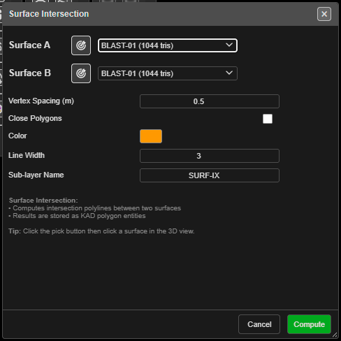

# Surface Intersection

Draws the line where two surfaces cross — a design against topography, a pit shell against the
current pickup, a bench floor against a wall. The result is a set of KAD lines or polygons you can
offset, export or use as a clip boundary.

---

## Intersect two surfaces

1. Click **Surface Intersection** on the **Surface** toolbar. The **Surface Intersection** dialog
   opens.
2. Choose **Surface A** and **Surface B** from the lists, or click the target button beside each
   and click the surface in the 3D view. The picked surface flashes green.
3. Set the fields (below).
4. Click **Compute**. A progress window reports each step and closes itself when done.

You need at least two loaded surfaces. With fewer, Kirra says *"At least 2 loaded surfaces are
required for intersection."* The lists include hidden surfaces; the pick button only finds
visible ones.

---

## The fields

| Field | Default | What it does |
|---|---|---|
| **Vertex Spacing (m)** | 1.0 | Simplifies the result: vertices closer than this are dropped. 0 keeps every vertex |
| **Close Polygons** | On | Closes each result into a polygon. Off gives open lines |
| **Color** | Yellow | Colour of the result |
| **Line Width** | 3 | Line width of the result (1–10) |
| **Sub-layer Name** | **Intersections** | The sub-layer the result is filed in |

The dialog remembers your last surfaces and settings in this browser.

---

## What you get

One KAD entity per intersection line, named after both surfaces — for example
`Topo_PitDesign_Intersect_a1b2`. They are filed in the **Analysis** layer, under the
**Sub-layer Name** — or in your active layer, if you have chosen one. The whole set is one undo
step.

---

## Troubleshooting

| Symptom | Cause | Fix |
|---|---|---|
| *"Surface A and Surface B must be different."* | The same surface is in both lists | Choose a second surface |
| *"No intersections found between the selected surfaces."* | The surfaces do not touch | Check them together in 3D |
| *"Intersections found but all polylines were too short after simplification."* | **Vertex Spacing (m)** is larger than the pieces | Lower it, or set it to 0 |
| A closed polygon cuts across where you expected an open line | **Close Polygons** is on | Turn it off for crest or toe lines that run off the edge |

---

## Other ways to use it

| Method | Result |
|---|---|
| Target button, then click in 3D | Picks a surface without searching the list |
| **Vertex Spacing (m)** = 0 | Keeps every crossing point, for the most exact line |
| **Close Polygons** off | Open strings, for crest and toe lines |

---

## Related

- [Clip Surface](clip-surface.md) — clip with the result
- [Offset KAD](../kad/offset.md)
- [Compare Surfaces](compare-surfaces.md) — measure the gap instead of finding the crossing
- [Surfaces Toolbar](surfaces-toolbar.md)
