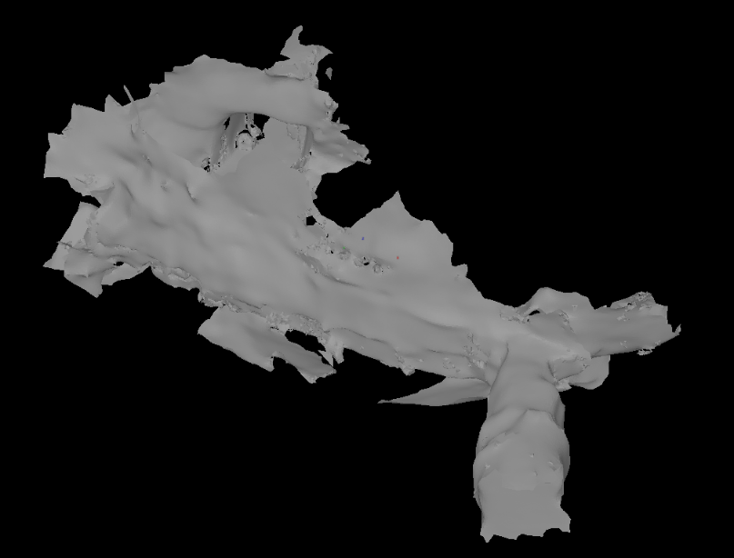
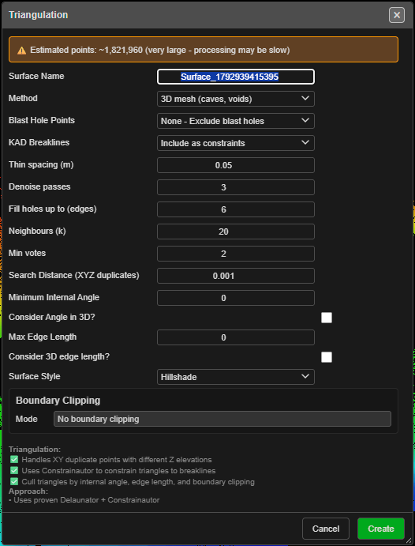

# 3D Triangulate (Void Mesh)

Builds a true 3D mesh from what you can see — a cave, drive, stope, void or overhang, where the
walls run in any direction and one plan position can have a floor, a wall and a roof above it.
It is the **3D mesh (caves, voids)** method of the [Triangulate](triangulate.md) tool.

*Wookey Hole cave survey by CaveSurveys, freely distributable.*

---

## When to use it

| Your data | Method |
|---|---|
| Benches, pit surfaces, topography — one height for each plan position | **Delaunay 2.5D** ([Triangulate](triangulate.md)) |
| A face or a wall, on a section plane | **Delaunay 2.5D** with **Triangulate In** → **Section plane** |
| Caves, drives, stopes, voids, overhangs — walls in any direction | **3D mesh (caves, voids)** — this page |

The **3D mesh** method is made for scans: a [point cloud](point-clouds.md) of thousands to millions
of points. It needs at least 100 points.

---

## Build a 3D mesh

1. Show the data you want in the mesh and hide everything else. Like Delaunay 2.5D, it uses only
   **visible** point clouds, KAD points, lines and polygons, and (if you ask for them) blast holes.
   On a cloud with a selection, only the selected points are used.
2. Click **Void Mesh** on the **Surface** toolbar (it sits below the second divider, with the
   point-cloud tools). The **Triangulation** dialog opens with **Method** set to **3D mesh (caves,
   voids)**.
   - Or click **Triangulate** and change **Method** yourself. Triangulate always opens on
     **Delaunay 2.5D**.
3. Type a **Surface Name**, or keep the one suggested.
4. Check the 3D fields (below). The defaults suit most cave and drive scans.
5. Click **Create**. A **Triangulation Progress** window shows each step and the elapsed time.
   **Cancel** stops the build.

The progress window steps through **Thinning points**, **Smoothing scan noise**, **Preparing
points**, **Fitting surface directions**, **Triangulating in 3D**, **Welding the mesh**,
**Orienting triangles** and **Mesh built**, then reads *Complete!* and the number of triangles.

---

## The 3D fields

These fields are used only by the **3D mesh** method. With **Delaunay 2.5D** chosen they are greyed
out.

| Field | Default | What it does |
|---|---|---|
| **Thin spacing (m)** | 0.05 | Points closer than this are merged before meshing. **0** turns it off. Larger is faster and coarser. Scans sample very densely along their scan lines; keep this well above the scan noise |
| **Denoise passes** | 3 | Smooths scan noise before meshing. **0** turns it off. More passes give smoother walls and fewer holes, but round off small edges. Use **0** for KAD-only data |
| **Fill holes up to (edges)** | 6 | Small gaps left by the build are filled when their edge loop has this many edges or fewer. **0** turns it off. Real openings (portals, drive ends) are larger and stay open |
| **Neighbours (k)** | 20 | How many points each local triangulation looks at, 6 to 64. More is smoother and slower, and can bridge two walls closer together than the point spacing |
| **Min votes** | 2 | How many local triangulations must agree on a triangle, 1 to 10. Higher is cleaner but leaves more holes; lower leaves fewer holes but more stray triangles |

Kirra remembers the 3D fields you last pressed **Create** with, so a build that fails does not cost
you your settings. Reloading Kirra puts the defaults back.

### The shared fields

The rest of the dialog works as it does for Delaunay 2.5D — see [Triangulate](triangulate.md#the-fields):

| Field | With the 3D mesh method |
|---|---|
| **Blast Hole Points** | Adds one point per visible hole, as for 2.5D |
| **KAD Breaklines** | **Include as constraints**: every visible KAD line is an open break line and every polygon a closed one, welded into the mesh. **Points only (no constraints)**: their vertices are loose points |
| **Search Distance (XYZ duplicates)** | Also sets how close points must be to weld. With **Thin spacing** on, Kirra welds at the larger of this and a quarter of the thin spacing. With it off, the default 0.001 lets the mesher choose; a larger value is used as typed |
| **Minimum Internal Angle**, **Max Edge Length** | Remove triangles after the build, as for 2.5D. They are measured in plan unless you tick **Consider Angle in 3D?** or **Consider 3D edge length?** |
| **Boundary Clipping** | Removes triangles outside (or inside) a closed polygon, in plan |
| **Surface Style** | The colouring of the new surface |

**Triangulate In** (shown when a section plane is the work plane) is a Delaunay 2.5D field. The 3D
method ignores it, and it is greyed out.

---

## What you get

A new surface, named as you typed it, in the **Triangulated** layer of the
[Data Explorer](../working-in-kirra/data-explorer.md), coloured with the **Surface Style** you
chose. It is saved with the project, and you can use it like any other surface — contour it, clip
it, check it, export it.

The status line reports *"Surface '…' created with … triangles (… filtered)"*.

### Open loops and patching

A scan rarely sees every surface of a void, and a partial scan has open ends, so a 3D mesh usually
has **open loops**: holes in the mesh, bounded by a ring of edges. The build fills the small ones
(up to **Fill holes up to (edges)**) and leaves the rest open — Triangulate's job ends when the mesh
is built.

To find and patch the rest, open the mesh in **Edit Mesh** (the **Edit and Repair Mesh** button on
the **Surface** toolbar). Its repair section:

- **Check mesh** reports the **Triangles**, whether the mesh is **Closed**, its **Enclosed volume
  (m³)**, the **Open loops** and the **Non-manifold edges**. The open loops are drawn red in the 3D
  view.
- **Patch method** chooses how a hole is filled: **Auto (best that works)**, **Fair (smooth,
  follows the wall)**, **Fan (flat, loop points only)**, **Centroid (one centre point)** or
  **Vertex fan (from one corner)**. Fair suits holes in cave or rock walls; Fan suits flat cuts such
  as drive ends or section cuts.
- **Patch all** fills every open loop with at most **Patch all: loops up to (edges)** edges. Larger
  openings, such as a drive end or a portal, are left open unless you raise the limit.

See [Mesh Editing](mesh-editing.md) and [Clean Mesh](clean-mesh.md). A mesh must be closed before
it has a volume or can be used as a solid.

---

## How it differs from Delaunay 2.5D

| | Delaunay 2.5D | 3D mesh (caves, voids) |
|---|---|---|
| Shape it can make | One height for each plan position (or each spot on a section plane) | Walls, roofs and floors in any direction |
| How it works | One Delaunay triangulation in plan, constrained to the break lines | Many small local triangulations round the points, kept where enough of them agree, then welded and oriented |
| Points | Every point is used | Thinned and smoothed first, by the 3D fields |
| Small gaps | None — every plan gap is spanned by a triangle | Filled up to **Fill holes up to (edges)**; larger ones stay open |
| Crossing break lines | Kirra asks whether to keep the surface without the break lines that could not be applied | The build stops, with a message — see Troubleshooting |
| Large data | **Triangulate** asks first above 100,000 points (**Very Large Dataset Warning**) | **Void Mesh** opens without that warning: the build runs in a background worker and thins its own input |

Both methods take the same inputs, use the same filters and clipping, and make the same kind of
surface.

---

## Troubleshooting

| Message or symptom | Cause | Fix |
|---|---|---|
| *"Too few points for a 3D mesh (n). Show a point cloud, or use Delaunay 2.5D."* | Fewer than 100 points to mesh | Show a point cloud, or use **Delaunay 2.5D** |
| *"Too many points for one 3D mesh. Set Thin spacing to … m or more."* | More points than one mesh can hold | Raise **Thin spacing (m)** to the value given, or select part of the cloud |
| *"Break lines cross, or one ends part-way along another. Add a vertex where they meet, or choose Points only."* | Two KAD lines cross, or one ends on the middle of another | Add a vertex where they meet, or set **KAD Breaklines** to **Points only (no constraints)** |
| *"Not enough memory for this triangulation. Thin the points, or select part of the cloud, and try again."* | The browser ran out of memory | Raise **Thin spacing (m)**, or select part of the cloud |
| Many holes in the walls | The scan is sparse there, or **Min votes** is high | Lower **Min votes**, raise **Denoise passes**, or patch them in Edit Mesh |
| Stray triangles, or two walls joined across a narrow gap | **Neighbours (k)** is large for the point spacing, or **Min votes** is low | Lower **Neighbours (k)**, or raise **Min votes** |
| The walls look lumpy | Scan noise | Raise **Denoise passes**, or smooth the cloud first with [Smooth points](point-clouds.md#smooth-points) |
| Small edges and corners are rounded off | Too much smoothing | Lower **Denoise passes** |

---

## Related

- [Triangulate](triangulate.md) — the Delaunay 2.5D method and the shared fields
- [Point Clouds](point-clouds.md) — bring in a scan, select and clean its points
- [Mesh Editing](mesh-editing.md) — patch open loops by hand
- [Clean Mesh](clean-mesh.md)
- [Surfaces Toolbar](surfaces-toolbar.md)
