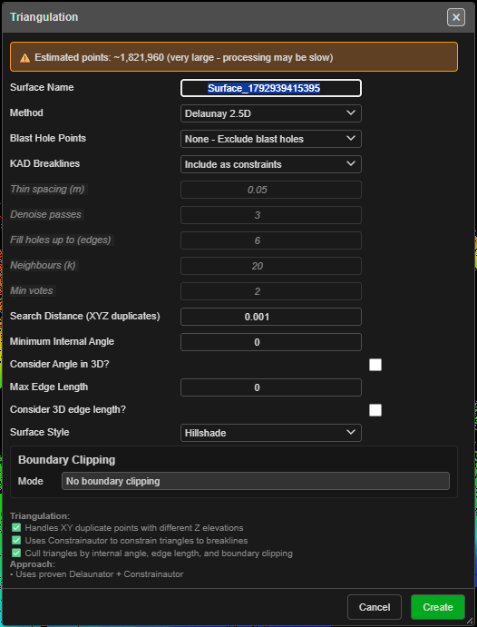

# Triangulate

Builds a triangulated surface from what you can see — point clouds, KAD points, lines and
polygons, and blast hole points. Use it to turn survey pickup, design strings, a scan or a drilled
pattern into a surface for contouring, volumes, snapping and analysis.

The tool has two methods. **Delaunay 2.5D**, described on this page, makes one height for each plan
position — benches, pit surfaces and topography. **3D mesh (caves, voids)** makes walls in any
direction; see [3D Triangulate (Void Mesh)](triangulate-3d.md).

---

## Build a surface

1. Show the data you want in the surface and hide everything else. Triangulate uses only
   **visible** point clouds, KAD entities and blast holes.
2. Click **Triangulate** on the **Surface** toolbar. The **Triangulation** dialog opens, with
   **Method** set to **Delaunay 2.5D**. If nothing is visible, the status line reads *"No visible
   data found for triangulation"* and no dialog opens.
3. Type a **Surface Name**, or keep the one suggested.
4. Choose the inputs and filters (below).
5. Click **Create**. A **Triangulation Progress** window shows each step and the elapsed time.
   Its **Cancel** button stops the run.

The button does not stay on — each click opens the dialog once.

> **Tip:** Every point of every visible KAD entity goes in, but only **lines** and **polygons**
> become breaklines. Hide the layers you do not want before you click the button.

---

## The fields

| Field | Default | What it does |
|---|---|---|
| **Surface Name** | `Surface_` and a number | Name of the new surface. Must be unique |
| **Method** | **Delaunay 2.5D** | **Delaunay 2.5D**, or **3D mesh (caves, voids)** — see [3D Triangulate](triangulate-3d.md) |
| **Blast Hole Points** | **None - Exclude blast holes** | Adds one point per visible hole: **Collar points (surface)**, **Grade points (mid-hole)**, **Toe points (bottom)** or **Measured length points (along hole)** |
| **KAD Breaklines** | **Include as constraints** | Lines and polygons become edges the triangles must follow. **Points only (no constraints)** uses their vertices as loose points |
| **Search Distance (XYZ duplicates)** | 0.001 | Points closer than this are treated as one point |
| **Minimum Internal Angle** | 0 | Removes slivers with an angle below this (0–60°). 0 keeps everything |
| **Consider Angle in 3D?** | Off | Measures that angle on the sloping triangle instead of in plan |
| **Max Edge Length** | 0 | Removes triangles with an edge longer than this. 0 keeps everything |
| **Consider 3D edge length?** | Off | Measures edge length in 3D instead of in plan |
| **Surface Style** | **Hillshade** | Colouring of the new surface — see [Surface Gradients](gradients.md) |

**Thin spacing (m)**, **Denoise passes**, **Fill holes up to (edges)**, **Neighbours (k)** and
**Min votes** belong to the 3D mesh method. With **Delaunay 2.5D** chosen they are greyed out —
see [The 3D fields](triangulate-3d.md#the-3d-fields).

When a [section plane](../reference/section-views.md#section-plane) is set as the work plane, a
**Triangulate In** field appears: **X-Y (plan)** or **Section plane**. **Section plane**
triangulates across the section — a face or a wall works, a whole tunnel does not. Breaklines,
clipping and the filters are then measured in the section.

### Boundary Clipping

| Field | What it does |
|---|---|
| **Mode** | **No boundary clipping**, **Delete triangles outside polygon** or **Delete triangles inside polygon** |
| **Polygon** | The closed KAD polygon to clip with. Pick it from the list, or click the target button and then the polygon |

If a polygon is selected when you open the dialog — or only one closed polygon exists — it is
filled in and **Mode** changes to **Delete triangles outside polygon**. The list shows only
closed polygons with three or more points.

> **Tip:** **Max Edge Length** is the quick way to stop long triangles bridging the gaps around
> the outside of a pickup. A boundary polygon is the exact way.

---

## What you get

A new surface named as you typed it, in the **Triangulated** layer of the tree, coloured with the
**Surface Style** you chose. The status line reports *"Surface '…' created with … triangles (…
filtered)"*. It is saved with the project.

---

## Large data

The dialog shows **Estimated points** at the top, counting visible holes, KAD points and
point-cloud points. Over 50,000 it is marked as a large dataset; over 100,000 the **Triangulate**
button asks first in a **Very Large Dataset Warning** — **Continue** or **Cancel**. Hiding layers is
the fastest way to bring the count down. **Void Mesh** does not ask: the 3D method thins its own
input.

---

## Troubleshooting

| Symptom | Cause | Fix |
|---|---|---|
| *"No visible data found for triangulation"* | Every layer is hidden | Show the points, lines or holes you need |
| *"A surface with this name already exists"* | The name is taken | Click **OK**, change the **Surface Name** and click **Create** again — your settings are kept |
| *"No triangles generated"* | Too few points, or the filters removed everything | Set **Minimum Internal Angle** and **Max Edge Length** to 0 and try again |
| Triangles jump across a gap or around the outside | No limit on edge length | Set **Max Edge Length**, or clip with a boundary polygon |
| **Breaklines not fully applied** — *"… of … breakline segments were applied"* or *"The breaklines could not be applied, so this surface ignores them."* | Breaklines cross each other, or a breakline has no point within the **Search Distance** | **Keep surface** keeps it without those breaklines; **Discard** throws it away. Clean up the crossing lines and try again to keep them |

---

## Other ways to use it

| Method | Result |
|---|---|
| Select a polygon before clicking **Triangulate** | It becomes the clipping boundary |
| **Blast Hole Points** → **Toe points (bottom)** | A surface through the toes of the visible holes |
| **Triangulate In** → **Section plane** | A surface across a face or wall |
| **Void Mesh** on the Surface toolbar | Opens the dialog with **3D mesh (caves, voids)** chosen — [3D Triangulate](triangulate-3d.md) |

---

## Related

- [3D Triangulate (Void Mesh)](triangulate-3d.md) — caves, drives and voids
- [Importing Surfaces](importing-surfaces.md) — surfaces from files
- [Clean Mesh](clean-mesh.md) — repair a surface after building it
- [Contour Surface](contours.md)
- [Surfaces Toolbar](surfaces-toolbar.md)
