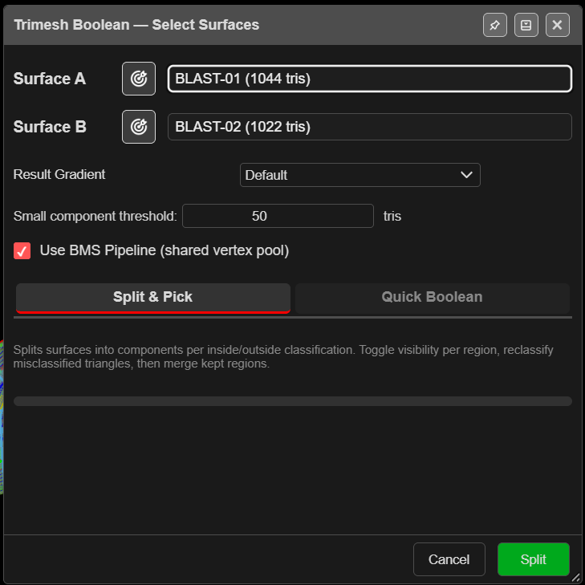

# Trimesh Boolean

Cuts two surfaces along the line where they cross, then lets you keep the pieces you want. It
works on open surfaces as well as solids, and on large meshes, because the heavy work runs in the
background. Use it for a design against topography, a pit shell against a pickup, or any pair the
[Solid Boolean](solid-boolean.md) cannot handle.

---

## Split the surfaces

1. Click **Trimesh Boolean** on the **Surface** toolbar. The view switches to 3D and **Trimesh
   Boolean — Select Surfaces** opens.
2. Choose **Surface A** and **Surface B**, or click the target buttons and click them in 3D.
3. Choose a tab:
   - **Split & Pick** — you choose which pieces to keep.
   - **Quick Boolean** — one click for **Union**, **Intersect**, **A − B** or **B − A**.
4. Click **Split**. A progress bar runs and the result opens in a second dialog.

To free memory, Kirra **hides every visible surface** during the split and shows only the split
pieces. Show them again from the tree when you are done.

| Field | Default | What it does |
|---|---|---|
| **Result Gradient** | **Default** | Colouring of the result |
| **Small component threshold:** | 50 tris | Pieces smaller than this join their nearest large neighbour. 0 turns it off |
| **Use BMS Pipeline (shared vertex pool)** | On | The more robust splitting method. Leave it on |

---

## Keep the pieces you want (Split & Pick)

**Trimesh Boolean — Pick Regions** lists every piece, each in its own colour in 3D, labelled by
surface and side — for example `SURF-A[in#1]` is a piece of A inside B. The yellow line is where
the surfaces cross.

1. Click the eye on a row to hide or show that piece. Every piece starts kept.
2. Use **Invert All** to swap kept and hidden, or **Hide Pick** to click pieces off in 3D.
3. Fix pieces that face the wrong way with the row's **Flip** or **Align** buttons.
4. Choose how to finish the join with **Close** (below).
5. Click **Apply** or **Apply & Close**. The kept pieces are joined into one surface.

After **Apply**, Kirra asks **Another Boolean Operation?** — **Yes, keep going** brings the
pieces back for another result from the same split; **No, done** leaves the new surface on
screen.

### Close and cleanup

| Field | Default | What it does |
|---|---|---|
| **Close** | **Close Solid** | **Close Solid** welds the seam and caps small pinholes only. **Clean & Weld** also tidies the seam and leaves the outer edges open. **Weld Only** just joins and welds |
| **Weld** | 0.001 m | Weld distance |
| **Remove Degenerate** | On | Removes triangles with no area |
| **Remove Slivers** | Off | Removes needle-thin triangles. Can punch holes in thin areas |
| **Clean Crossings** | Off | Fixes edges shared by three or more triangles |
| **Remove Overlapping** | Off | Removes internal walls and near-duplicates |

The result line reports whether the surface closed — *"Closed ✓ (0 open edges)"* or *"NOT
closed: … open edges"*.

### Reclassify

Sometimes a few triangles land on the wrong side. Turn on **Reclassify**, click the triangles
(**Shift** adds more), or use the polygon button to draw round a group, then **right-click** and
choose where they belong: **A-inside**, **A-outside**, **B-inside**, **B-outside** or **Misc**.
**Esc** clears the selection.

---

## Quick Boolean

**Trimesh Boolean — Quick Boolean** previews the result in blue as soon as it opens, starting with
**Union**.

| Button | Keeps |
|---|---|
| **Union** | Both, joined into one — the parts inside each other are dropped |
| **Intersect** | Only the overlap |
| **A − B** | A with B cut out |
| **B − A** | B with A cut out |

Choose the operation, check the preview, then click **Apply**. The same **Close**, **Weld**,
cleanup and **Reclassify** controls are here. **Adjust in Split & Pick →** switches to choosing
pieces by hand, with the same split.

---

## What you get

A new surface named `TRIM_` and four characters, in the **Booleans** layer. The inputs are not
changed, but stay hidden. It can be undone.

---

## Troubleshooting

| Symptom | Cause | Fix |
|---|---|---|
| *"No intersection found between the selected surfaces."* | They do not cross | Check both in 3D |
| My other surfaces disappeared | The split hides them to save memory | Show them again from the tree |
| *"NOT closed: … open edges"* | Gaps along the seam | Raise **Weld** a little, or repair in [Clean Mesh](clean-mesh.md) |
| A few triangles sit on the wrong side | Classification near the seam | Use **Reclassify** |
| *"No regions are visible."* | Every piece is hidden | Show at least one piece |

---

## Other ways to use it

| Method | Result |
|---|---|
| **Yes, keep going** after **Apply** | Several results from one split |
| **Adjust in Split & Pick →** | Start quick, finish by hand |
| Reclassify to **Misc** | Leaves triangles out of the result |

---

## Related

- [Solid Boolean](solid-boolean.md)
- [Which boolean?](boolean-csg.md)
- [Clean Mesh](clean-mesh.md)
- [Surfaces Toolbar](surfaces-toolbar.md)
