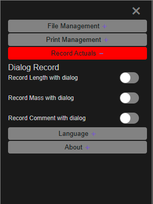

# After Drilling and Charging

Record what was actually drilled and loaded against the design, find the holes that differ,
re-fit their charging, and hand the as-built record back. Each step names the tool and links to
its guide.

---

## Before you start

- The designed blast in Kirra — see [Plan a Shot, Start to Finish](plan-a-shot.md).
- The field figures: dipped lengths, loaded masses and comments, either on paper or in a file.
  A downhole survey file, if the holes were surveyed.

---

## 1. Record the measured values

| You have | Do this | Guide |
|---|---|---|
| Figures to type in, hole by hole | Switch on **Record Length with dialog**, **Record Mass with dialog** or **Record Comment with dialog** in the side panel (☰), then click each hole in the **2D** view | [Record Actuals](../working-in-kirra/starting-and-saving.md#record-actuals) |
| A file of measured values | **Import** → **Kirra** tab → **Measured Data** | [Measured Data](../importing/csv-formats.md#measured-data) |

Each value is saved on the hole with the date and time. A Measured Data file matches rows to
holes by blast name and hole ID, and skips rows with no matching hole.

---

## 2. Bring in the drilled hole paths (optional)

A downhole survey — depth, heading and inclination — shows where each hole actually went.
**Import** → **Miscellaneous** tab → **Borehole Telemetry** turns it into one drawing line per
hole — see [Borehole Telemetry](../importing/other-formats.md#borehole-telemetry). Check the
burden on the drilled hole in the
[Hole Section View](../reference/section-views.md#hole-section-view).

---

## 3. See the measured values

- Show them as labels with the **Measured Length**, **Measured Mass** and **Comment** buttons on
  the [display toolbar](../working-in-kirra/display-options.md).
- Colour the blast by them: set the [Voronoi](../analysis/voronoi.md) to **Measured Length** or
  **Measured Mass**.
- Plot their spread in [Blast Quality](../analysis/blast-quality.md) — choose **Measured Length**
  or **Measured Mass** under **Chart**. Holes with no measurement are left off.

---

## 4. Fix the holes that differ

Kirra charges each hole to its **design** length. Recording a measured length does not change the
hole or its charging.

For a hole drilled short or long:

1. Right-click it and open **Edit Hole**. Change its **Subdrill (m)** or **Grade Z RL (m)** so the
   length matches what was drilled, and click **Apply** — see
   [Editing Holes](../blast-design/editing-holes.md).
2. Select the changed holes and click [Reapply Charging](../charging/reapply-charging.md) on the
   **Holes** toolbar. The decks are re-fitted to the new length, following each deck's scaling
   setting.

To load some holes with a **different** rule, apply that rule instead — see
[Deck Builder](../charging/deck-builder.md#applying-a-charge-design-to-holes).

---

## 5. Compare the loaded blast with the design

Set the Voronoi to **PF - Measured (mass/volume)** and then **PF - Designed** and compare — see
[Voronoi Cells](../analysis/voronoi.md). PF - Measured uses the measured mass; holes with none
have no value. Then re-run the checks you need from
[Check a Blast Before Firing](check-a-blast.md).

---

## 6. Hand back the as-built record

| To | Do this |
|---|---|
| Send the measured values to another system or project | **Export** → **Kirra** tab → **Measured Data** — see [CSV Export](../exporting/csv-export.md) |
| Keep the whole blast as built | Save a Kirra Application Project — see [Save a project](../working-in-kirra/starting-and-saving.md#save-a-project) |
| Print the as-built plan | Turn on the measured labels, then print — see [Print from Template (XLSX)](../printing/xlsx-templates.md) |

---

## 7. After the dig (optional)

When the blast has been dug and surveyed, colour the new pickup by its distance from the design
with [Compare Surfaces](../surfaces/compare-surfaces.md) on the **Analyse** toolbar — where the
wall is fat, and where it is overdug.

---

## Common problems

| Problem | Cause and fix |
|---|---|
| Clicking a hole does not record anything | Record Actuals works in the **2D** view, and hidden holes are skipped |
| Measured Data rows were ignored | The blast name or hole ID in the file does not match the holes in Kirra. Check both, including case |
| The charging did not follow the measured length | Charging follows the design length. Change the hole, then run [Reapply Charging](../charging/reapply-charging.md) |
| PF - Measured is blank | No measured mass recorded on those holes |
| Telemetry paths are missing for some holes | Their collars could not be found. The import report lists them |

---

## Related

- [Starting, Saving & Projects](../working-in-kirra/starting-and-saving.md)
- [Charging Overview](../charging/overview.md)
- [Check a Blast Before Firing](check-a-blast.md)
- [Plan a Shot, Start to Finish](plan-a-shot.md)
