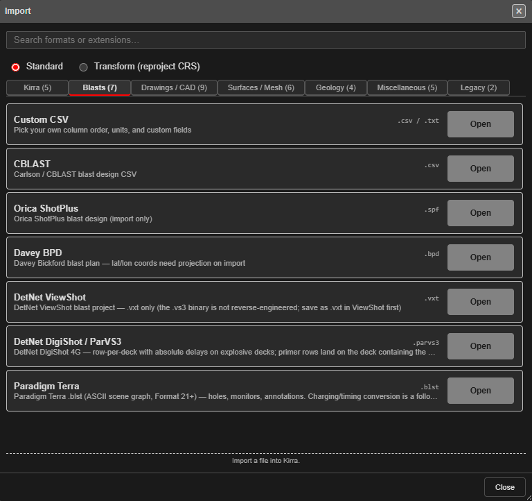

# Bring In a Design from Another System

Take a blast designed in other software — or a drill plan from a rig — into Kirra, check it,
fix its rows and numbering, and send it on. Each step names the tool and links to its guide.

---

## Before you start

- The design file, and the coordinate system it is in.
- A workspace to bring it into. A spare one keeps it apart from your own work while you check it
  — see [Workspaces](../working-in-kirra/workspaces.md).

---

## 1. Import the file

Open **Import Export Print** in the top bar and choose **Import** — see
[The Import Dialog](../importing/import-dialog.md).

| Your file | Where | Guide |
|---|---|---|
| CBLAST, Orica ShotPlus, DetNet ViewShot, DetNet DigiShot / ParVS3, Paradigm Terra and other blast formats | **Blasts** tab | [Blast Design Formats](../importing/blast-formats.md) |
| A hole CSV in any other column layout | **Blasts** tab → **Custom CSV** | [Custom CSV Import](../importing/csv-formats.md#custom-csv-import) |
| A Kirra hole CSV | **Kirra** tab → **Holes CSV / TXT (preset columns)** | [CSV Import](../importing/csv-formats.md) |
| An Epiroc IREDES drill plan | **Miscellaneous** tab → **Epiroc Surface Manager** → **IREDES Drill Plan** | [Other Formats](../importing/other-formats.md#epiroc-surface-manager) |
| Surpac string-file holes | **Drawings / CAD** tab → **Surpac** → **STR holes** | [Surpac DTM / STR](../importing/surpac-dtm-str.md) |

The formats bring in different things — some carry ties, timing and charging, some only hole
positions. The table on [Blast Design Formats](../importing/blast-formats.md) lists what each
brings.

If the file is in another coordinate system, choose **Transform (reproject CRS)** at the top of
the dialog — see [Transform (Reproject) Import](../importing/transform-import.md).

---

## 2. Answer the import checks

Kirra checks new holes before adding them — see
[Checks on import](../importing/import-dialog.md#checks-on-import):

| Kirra asks | Usually choose |
|---|---|
| **Coordinate System Mismatch** | **Cancel**, then import again with a Transform — unless you meant to bring in distant data |
| **Duplicate Hole Import Detected** | **Rename** the incoming blast, so it does not mix with one already loaded |
| **Hole Proximity Warning** | **Skip** holes that land on top of existing holes; **Ignore** if they are meant to be there |

---

## 3. Look at what came in

1. Find the blast in the [Data Explorer](../working-in-kirra/data-explorer.md). It is named after
   the file, or after the blast name the file carries. To change it, right-click it and choose
   **Rename**.
2. Right-click a few holes to check diameter, angle, length and subdrill in **Edit Hole** — see
   [Editing Holes](../blast-design/editing-holes.md).
3. Turn on the labels you need — hole ID, row and position, delay — from the
   [display toolbar](../working-in-kirra/display-options.md).

---

## 4. Fix rows and numbering

Other software numbers rows and holes its own way.

1. Open [Blast Quality](../analysis/blast-quality.md) and look for holes whose row disagrees with
   where they sit.
2. Rebuild the rows with [Reorder Rows](../blast-design/reorder-rows.md): click the first and last
   hole of one row, check the burden arrow, and apply. Tick **Renumber holes after reorder** to
   rename the holes to match.
3. Renumber a single run of holes with [Renumber Holes](../blast-design/renumber-holes.md).

> **Note:** Reorder Rows cannot be undone with Ctrl+Z. Lock any holes you want to keep as they
> are first.

---

## 5. Put it on the ground

Collar and grade heights from another system may not match your surfaces. Select the holes and use
[Assign Surface and Assign Grade](../kad/assign-surface-grade.md) — see also
[Prepare a Surface for Design](prepare-a-surface.md).

---

## 6. Fill in what the file did not carry

| Missing | Do this |
|---|---|
| Charging | Apply a charge rule — see [Plan a Shot](plan-a-shot.md) |
| Ties and timing | Tie the blast and add an initiation point — see [Connect Toolbar](../blast-design/connect-toolbar.md) |

Then run the checks in [Check a Blast Before Firing](check-a-blast.md).

---

## 7. Send it on

| To | Export |
|---|---|
| An Epiroc rig | **Miscellaneous** tab → **Epiroc Surface Manager** → **IREDES Drill Plan** → **Save** |
| Cat MineStar | **Blasts** tab → **Minestar AQM** → **Save** |
| Back to the other system | Its own row on the **Blasts** tab, or **Custom CSV** |
| CAD | DXF — see [DXF Export](../exporting/dxf-export.md) |

See [Other Formats](../exporting/other-formats.md) and [CSV Export](../exporting/csv-export.md).
The drill-rig and DXF exports write **visible** holes only — hide the other blasts first.

---

## Common problems

| Problem | Cause and fix |
|---|---|
| The holes are hundreds of kilometres away, or nowhere to be seen | The file is in another coordinate system. Import it again with a Transform |
| A DXF brought in drawings, not holes | Holes in a DXF come in as drawing entities. Bring the holes in from a blast format or CSV instead |
| Every hole is in one row, or rows are split | The rows were not in the file, or were worked out differently. Use [Reorder Rows](../blast-design/reorder-rows.md) |
| Two blasts' holes are mixed together | The blast name already existed. Import again and choose **Rename** |
| A CSV's columns came in wrong | Use **Custom CSV** and check the mapping in **Import CSV: Map Columns** |
| CBLAST holes have no subdrill | CBLAST files bring holes in with the grade at the toe. Set the grade with [Assign Grade](../kad/assign-surface-grade.md#assign-grade), mode **Assign GRADE (keep Toe, calc Subdrill)** |

---

## Related

- [The Import Dialog](../importing/import-dialog.md)
- [Supported File Formats](../reference/supported-formats.md)
- [Plan a Shot, Start to Finish](plan-a-shot.md)
