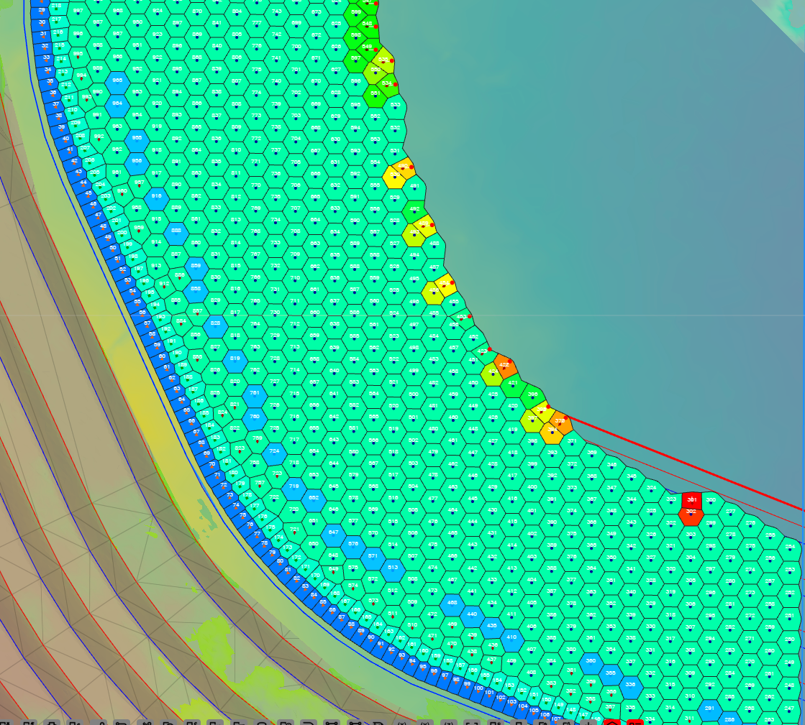

# Check a Blast Before Firing

A checklist for reviewing a designed, charged and timed blast before it is signed off: hole
positions, rows, timing, powder factor, vibration and flyrock. None of these checks changes the
design. Each one names the tool and links to its guide.

---

## Before you start

- A blast with holes, charging and timing — see [Plan a Shot, Start to Finish](plan-a-shot.md).
- For the vibration checks: monitors at the places you need to protect, with their site laws.
- Show only the blast you are checking. Several checks work on **visible** holes.

---

## 1. Hole positions and rows

| Check | Tool | What to look for |
|---|---|---|
| Holes too close to the last shot's holes, or inside a no-drill zone | [Coincident Holes Check](../blast-design/coincident-holes-check.md) on the **Holes** toolbar | Any hole listed in the result window |
| Holes filed in the wrong row | [Blast Quality](../analysis/blast-quality.md) | Holes listed under row contradictions, and red bars in the chart |
| Burden, spacing, length and diameter that vary when they should not | [Blast Quality](../analysis/blast-quality.md) | Peaks you did not design. Several peaks can be separate design zones |
| Front-row burden to the face | **Hole Section Tool** on the **Analyse** toolbar — see [Hole Section View](../reference/section-views.md#hole-section-view) | Burden too small at any depth |

Fix row numbers with [Reorder Rows](../blast-design/reorder-rows.md) and press **Refresh** in Blast
Quality to confirm.

---

## 2. Timing

1. Turn on **Hole Time** on the display toolbar. A hole with no time is not tied back to an
   initiation point — see [Checking Timing](../blast-design/timing-sequences.md#checking-timing).
2. Turn on **Contours** and **First Movement** to see that the blast fires and moves the way you
   meant — see [Timing Contours, First Movement and Relief](../blast-design/timing-contours.md).
3. Open **Time Window** on the **Analyse** toolbar. With the **Time Window** slider at 8 ms and
   **Chart Mode** on **Measured / Mass per Hole**, the tallest bar is the most explosive firing together — keep it
   under your site's limit. See [Time Window](../analysis/time-window.md).
4. Play it with **Blast Animation** on the **Analyse** toolbar — see
   [Blast Animation](../analysis/blast-animation.md).

---

## 3. Explosive distribution

Turn on **Voronoi** on the display toolbar and show **PF - Designed**. Light cells are holes with
less explosive for their ground; yellow to red are the heaviest. See
[Voronoi Cells](../analysis/voronoi.md).

To look inside a hole, open its charge column in the [Deck Builder](../charging/deck-builder.md).

---

## 4. Vibration

1. Add or check the monitors in the **Monitor Points Manager** on the **Analyse** toolbar — see
   [Monitor Points & Seed Library](../analysis/monitor-points.md).
2. No site law yet? Fit one from your monitoring records with
   [Site Law Regression](../analysis/site-law-regression.md).
3. Set the Voronoi to **PPV — Compliance (mode C)**: green holes are under every target, amber
   within 10 %, red over a target. **PPV — Dominant Hole (mode B)** finds the hole to redesign first. See
   [PPV Voronoi Modes (A – F)](../analysis/ppv-voronoi-modes.md).
4. To see a model across the ground rather than per hole, use the
   [Blast Analysis Shader](../analysis/overview.md).

---

## 5. Flyrock

Click **Flyrock Shroud Generator** on the **Analyse** toolbar to build a 3D envelope over the blast
— see [Flyrock Modelling](../analysis/flyrock.md).

> **Warning:** The four flyrock models do not agree, and a spread of about 2x between them is
> normal. Each gives an indicative envelope, not a prediction. Use of these models is your
> responsibility.

---

## 6. Keep a record

Print the plan with the views you checked switched on — the Voronoi cells and timing contours
print with it. See [Print from Template (XLSX)](../printing/xlsx-templates.md). Save a
Kirra Application Project of the blast as signed off — see
[Save a project](../working-in-kirra/starting-and-saving.md#save-a-project).

---

## Common problems

| Problem | Cause and fix |
|---|---|
| Voronoi powder factor is blank | The holes have no charging and no mass. Charge them — see [Plan a Shot, Start to Finish](plan-a-shot.md) |
| PPV modes B to F show nothing | No enabled monitor, or no site law on it. See [Monitor Points & Seed Library](../analysis/monitor-points.md) |
| Blast Animation plays nothing | The blast has no timing, or its holes are hidden |
| Time Window bars count holes, not kilograms | **Chart Mode** is on **Surface Hole Count**. Switch to **Measured / Mass per Hole** |
| The Blast Quality chart is empty for a charging attribute | The blast is not charged. Zero counts as no data and is left off the chart |

---

## Related

- [Analyse Toolbar](../analysis/analyse-toolbar.md)
- [Timing Sequences](../blast-design/timing-sequences.md)
- [Plan a Shot, Start to Finish](plan-a-shot.md)
- [After Drilling and Charging](after-drilling.md)
