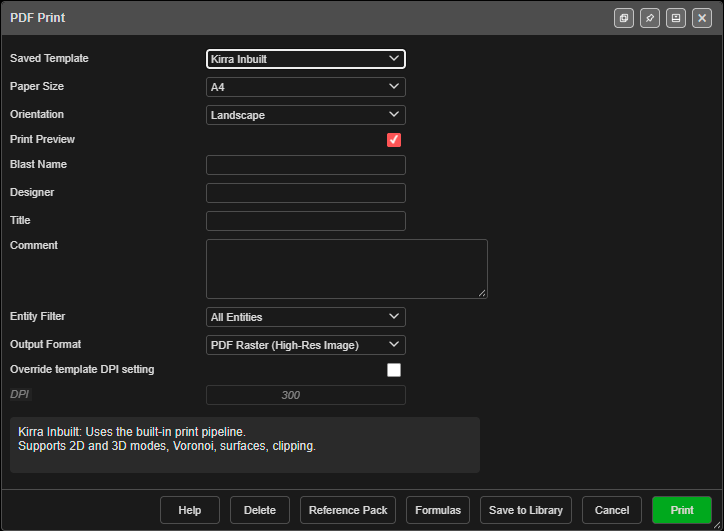

# Plan a Shot, Start to Finish

The route from an empty workspace to a printed, charged and timed blast plan. Each step names
the tool and links to its guide. For a click-by-click first run, follow
[Your First Blast](../getting-started/first-blast.md) instead.

---

## Before you start

- A workspace for the job — see [Workspaces](../working-in-kirra/workspaces.md). Kirra saves into
  it as you work.
- Your site's products, charge rules and pattern templates. If someone has them as a Kirra App
  Template (`.kat`), import it first — see
  [Back up and move your work](../working-in-kirra/starting-and-saving.md#back-up-and-move-your-work).
- The ground the blast sits on: a pickup surface, a design floor, or both. To get one ready, see
  [Prepare a Surface for Design](prepare-a-surface.md).

---

## 1. Set up a pattern template

A template holds the burden, spacing, diameter, angle, subdrill, colour, text and charge rule for
one kind of hole, so every hole you lay out starts right.

1. Open **Pattern Templates** on the **Holes** toolbar and add a template —
   see [Pattern Templates](../blast-design/pattern-templates.md).
2. On its **Charging** tab, tick **Charge Holes** and pick the rule, so new holes are charged as
   they are made — see [Charging Tab](../blast-design/pattern-templates.md#charging-tab).

> **Warning:** If the rule needs a product your Product Manager does not have, the holes are not
> charged at all. The line under **Charge Config** tells you before you start.

---

## 2. Lay out the holes

Pick the pattern tool that matches what you have — the
[Which pattern tool?](../blast-design/holes-toolbar.md#which-pattern-tool) table chooses for you:

| You have | Use |
|---|---|
| A blast boundary drawn as a polygon | [Pattern in Polygon](../blast-design/pattern-in-polygon.md) |
| A start point and a regular grid | [Add Pattern](../blast-design/add-pattern.md) |
| A single row (presplit, buffer, trim) | [Holes Along Line](../blast-design/holes-along-line.md) |
| A crest, toe or design line to follow | [Holes Along Polyline](../blast-design/holes-along-polyline.md) |

Pattern tools are **click-first**: you click on the canvas — the start point, or the polygon and
the row line — and then the dialog opens. Choose your template at the top of that dialog.

---

## 3. Put the holes on the ground

1. Select the holes.
2. **Assign Surface** on the **Modify** toolbar moves each collar onto the pickup.
3. **Assign Grade** sets the floor (or the toe) from a design surface or a typed elevation.

See [Assign Surface and Assign Grade](../kad/assign-surface-grade.md). Both keep each hole's angle
and bearing, and recalculate length and bench height.

---

## 4. Tidy the pattern

| Job | Tool |
|---|---|
| Change a hole, or many at once | Right-click → **Edit Hole** — see [Editing Holes](../blast-design/editing-holes.md) |
| Add a hole in a row | [Insert Holes](../blast-design/insert-holes.md) |
| Fix row and position numbers | [Reorder Rows](../blast-design/reorder-rows.md) |
| Renumber a run of holes | [Renumber Holes](../blast-design/renumber-holes.md) |
| Keep clear of the last shot's holes or a no-drill zone | [Coincident Holes Check](../blast-design/coincident-holes-check.md) |

---

## 5. Charge the holes

Skip this if the template charged them.

1. Check the products are in the [Product Manager](../charging/product-manager.md).
2. Select the holes, click **Charge Rule Builder** on the **Holes** toolbar, click
   **Apply Rule...**, choose the rule, then **Apply to Selected** — see
   [Applying a Charge Design to Holes](../charging/deck-builder.md#applying-a-charge-design-to-holes).
3. Changed hole lengths afterwards? Select them and click
   [Reapply Charging](../charging/reapply-charging.md).

---

## 6. Tie and time the blast

1. Set **Delay Amount**, colour and product on the **Connect** toolbar before you tie — see
   [Connector Settings](../blast-design/connector-settings.md).
2. Tie the holes with the tool that suits the layout — see
   [Which tie tool?](../blast-design/connect-toolbar.md#which-tie-tool).
3. Mark where the blast is lit from with **Self Connect Add IP** — see
   [Initiation Points](../blast-design/initiation-points.md). A blast with no initiation point has
   no firing times.
4. For electronic detonators, see
   [Electronic Timing Constructs](../blast-design/electronic-timing-constructs.md).

---

## 7. Check it

Turn on **Hole Time** and look for holes with no time — they are not tied back to an initiation
point. Then run the checks in [Check a Blast Before Firing](check-a-blast.md): timing, powder
factor, vibration and flyrock.

---

## 8. Print the plan

Open **Import Export Print** in the top bar and choose **Print**. The **PDF Print** dialog prints
with **Kirra Inbuilt** or your own XLSX template — see
[Print from Template (XLSX)](../printing/xlsx-templates.md).

---

## 9. Hand it over

| Who needs it | Export | Guide |
|---|---|---|
| The drill rig | **Miscellaneous** tab → **Epiroc Surface Manager** → **IREDES Drill Plan**, or **Blasts** tab → **Minestar AQM** | [Other Formats](../exporting/other-formats.md) |
| CAD or the mine planning package | DXF | [DXF Export](../exporting/dxf-export.md) |
| A spreadsheet or another system | Holes CSV, Custom CSV, Charging CSV | [CSV Export](../exporting/csv-export.md) |
| You, later — or a colleague | Kirra Application Project (`.kap`) | [Save a project](../working-in-kirra/starting-and-saving.md#save-a-project) |

> **Tip:** The drill-rig and DXF exports write **visible** holes only. Hide the blasts you do not
> want in the file first.

---

## Common problems

| Problem | Cause and fix |
|---|---|
| New holes are not charged | The template's rule needs a product you do not have, or **Charge Holes** is off. See the [Charging Tab](../blast-design/pattern-templates.md#charging-tab) |
| Holes have no firing time | Nothing upstream is an initiation point. Add one with [Initiation Points](../blast-design/initiation-points.md) |
| Charge columns no longer reach the toe after editing | Run [Reapply Charging](../charging/reapply-charging.md) on those holes |
| The export holds holes from another blast | Exports take what is visible. Hide the other blasts and export again |
| Row numbers are wrong on the print | Fix them with [Reorder Rows](../blast-design/reorder-rows.md) before printing |

---

## Related

- [Your First Blast](../getting-started/first-blast.md)
- [Prepare a Surface for Design](prepare-a-surface.md)
- [Check a Blast Before Firing](check-a-blast.md)
- [After Drilling and Charging](after-drilling.md)
