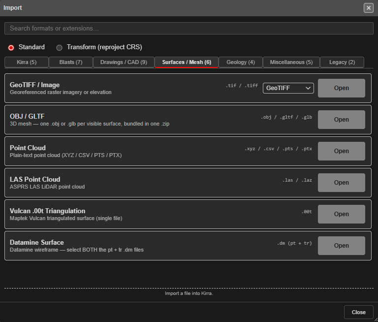

# Prepare a Surface for Design

Get a survey pickup or design surface ready to design on: bring it in, repair it, trim it to the
blast, and use it to set collar and grade heights. Each step names the tool and links to its
guide.

---

## Before you start

- The surface file, or the survey points and strings to build one from.
- The coordinate system it is in. If it differs from your project's — a drone survey in latitude
  and longitude, for example — you will use a Transform import in step 1.

---

## 1. Bring the surface in

Open **Import Export Print** in the top bar, choose **Import**, and find the format — see
[The Import Dialog](../importing/import-dialog.md).

| Your file | Tab | Guide |
|---|---|---|
| Elevation GeoTIFF, OBJ / GLTF, point cloud, LAS, Vulcan `.00t`, Datamine | **Surfaces / Mesh** | [Surfaces and Point Clouds](../importing/surfaces-and-point-clouds.md) |
| Surpac DTM / STR, DXF `3DFACE` | **Drawings / CAD** | [Surpac DTM / STR](../importing/surpac-dtm-str.md), [DXF Import](../importing/dxf.md) |
| Any of these in another coordinate system | Choose **Transform (reproject CRS)** at the top | [Transform (Reproject) Import](../importing/transform-import.md) |

If the new data is 100 km or more from what is already loaded, Kirra asks about a
**Coordinate System Mismatch** — see [Coordinate check](../importing/import-dialog.md#coordinate-check).

---

## 2. Or build one from points and strings

Show only the survey points, strings and holes you want in the surface, then click
**Triangulate** on the **Surface** toolbar — see [Triangulate](../surfaces/triangulate.md).
Triangulate uses **visible** data only, and lines and polygons become breaklines.

---

## 3. Check and repair it

Run [Clean Mesh](../surfaces/clean-mesh.md) on the **Surface** toolbar. It finds open edges,
crossing and overlapping triangles, unwelded points and mixed-up normals, and repairs each one
with a button. Do this before a volume, a boolean, a clip or a slice, and whenever a surface from
another package behaves oddly.

> **Warning:** On a surface of more than 500,000 triangles a Clean Mesh repair cannot be undone.
> Export a copy first.

---

## 4. Trim it to the area

Draw a KAD polygon around the area you need, then use [Clip Surface](../surfaces/clip-surface.md)
on the **Surface** toolbar with **Keep inside**. A smaller surface is quicker to draw and to work
with.

---

## 5. Read it

| To | Use |
|---|---|
| Colour it by elevation, hillshade or a colour map | Right-click the surface to open its properties, and set **Color Gradient** — see [Surface Gradients](../surfaces/gradients.md) |
| Draw contour lines, for example to check a floor | [Contour Surface](../surfaces/contours.md) |
| Cut a section through it | [Section Views](../reference/section-views.md) |

---

## 6. Drape design strings onto it

Crest, toe and boundary strings drawn flat can follow the ground with
[Snap Objects to Surface](../kad/snap-to-surface.md) on the **Modify** toolbar.

---

## 7. Set hole heights from it

1. Show the surface. Hide surfaces you do not want offered.
2. Select the holes.
3. Click **Assign Surface** (collars) or **Assign Grade** (floor or toe) on the **Modify** toolbar.

See [Assign Surface and Assign Grade](../kad/assign-surface-grade.md). With several surfaces
showing, Kirra asks which to use; with none, it asks for an elevation.

---

## Common problems

| Problem | Cause and fix |
|---|---|
| The surface is far away or not visible after import | It is in another coordinate system. Import it again with [Transform (Reproject) Import](../importing/transform-import.md) |
| **Triangulate** says *"No visible data found for triangulation"* | Nothing is showing. Show the points and strings you want in it |
| The surface has spikes or holes | Run [Clean Mesh](../surfaces/clean-mesh.md); for point clouds, check the import filters in [Surfaces and Point Clouds](../importing/surfaces-and-point-clouds.md) |
| Fewer holes were adjusted than you selected | Holes outside the surface's edge are left as they are. Extend the surface, or set those holes from an elevation |
| Assign Surface did not offer the surface | Only **visible** surfaces are offered. Show it in the [Data Explorer](../working-in-kirra/data-explorer.md) |

---

## Related

- [Importing Surfaces](../surfaces/importing-surfaces.md)
- [Surfaces Toolbar](../surfaces/surfaces-toolbar.md)
- [Compare Surfaces](../surfaces/compare-surfaces.md) — design against the as-built pickup
- [Plan a Shot, Start to Finish](plan-a-shot.md)
