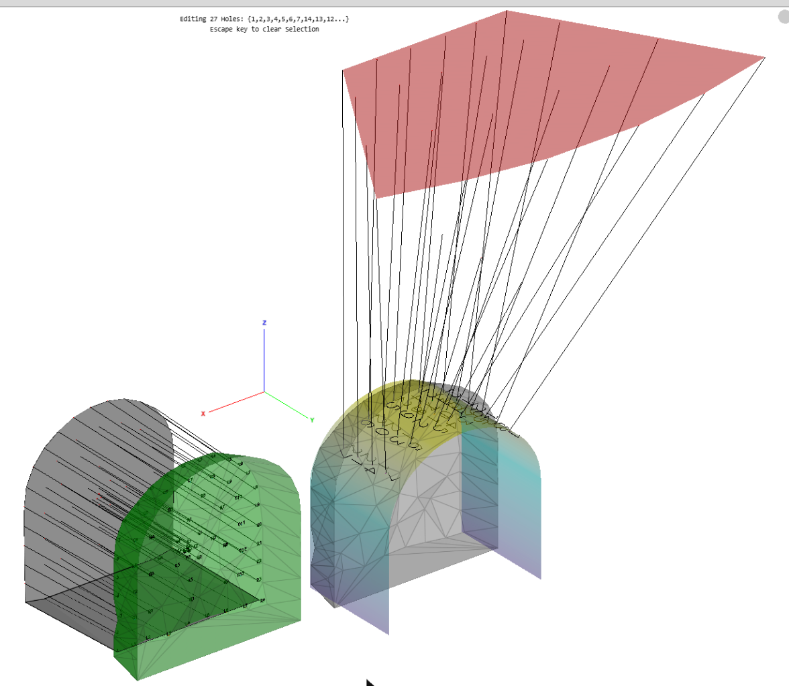
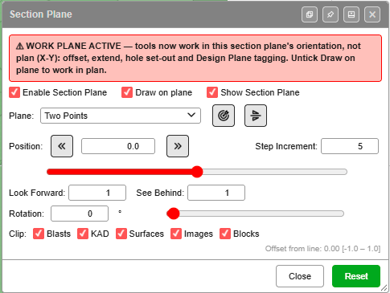
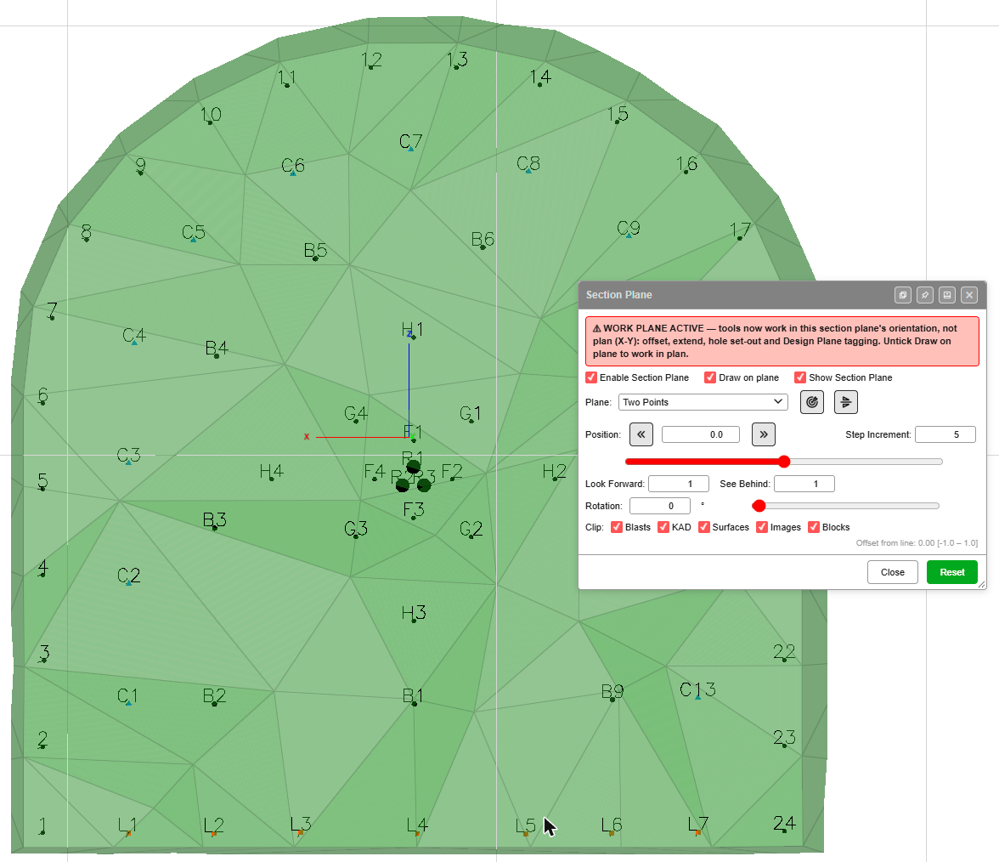
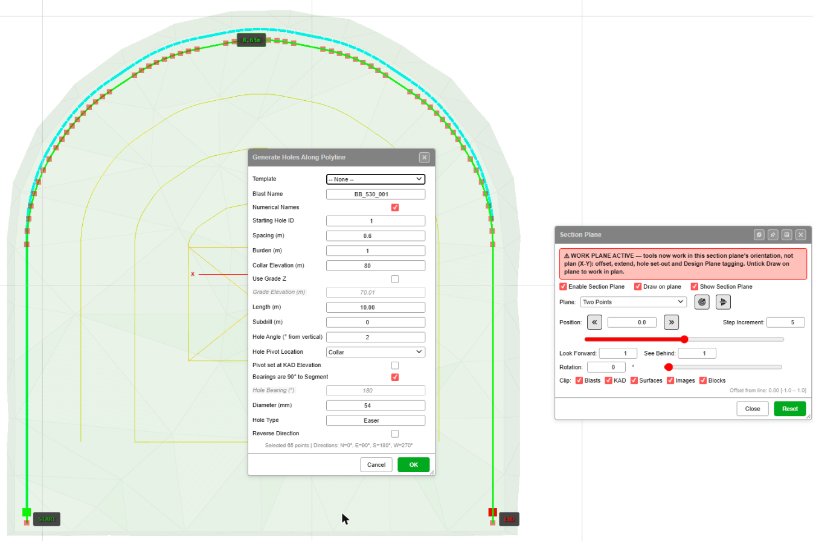
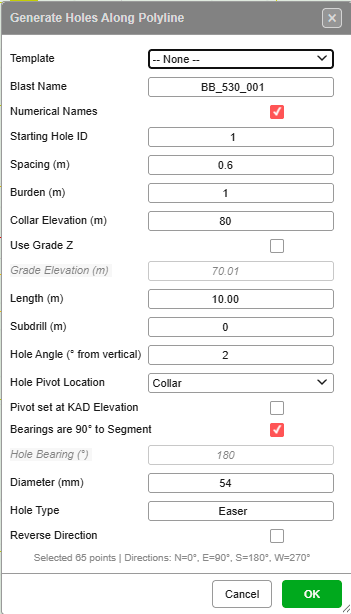
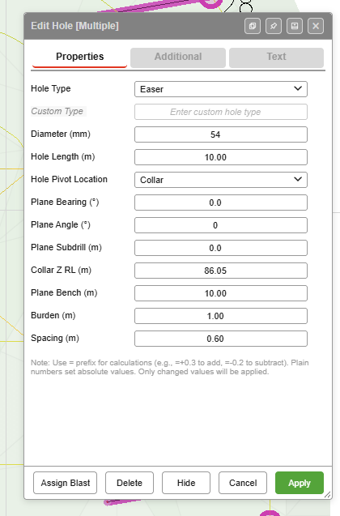
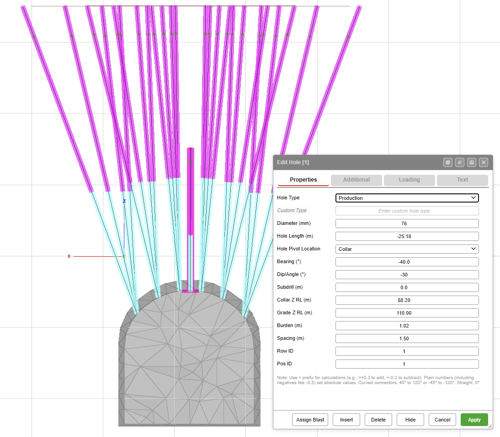
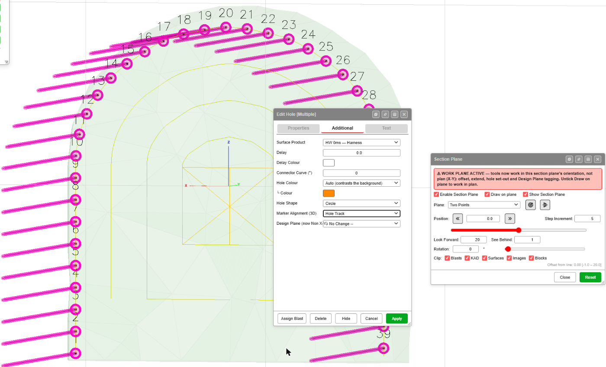
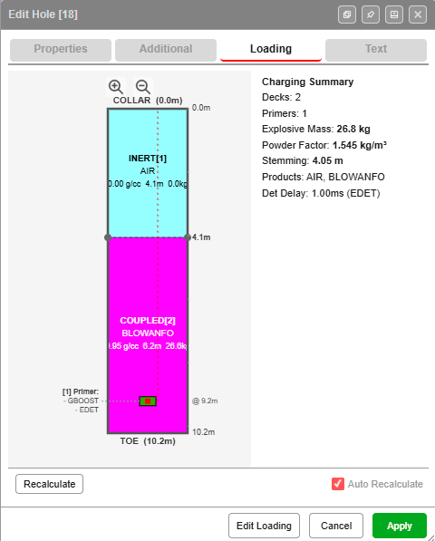
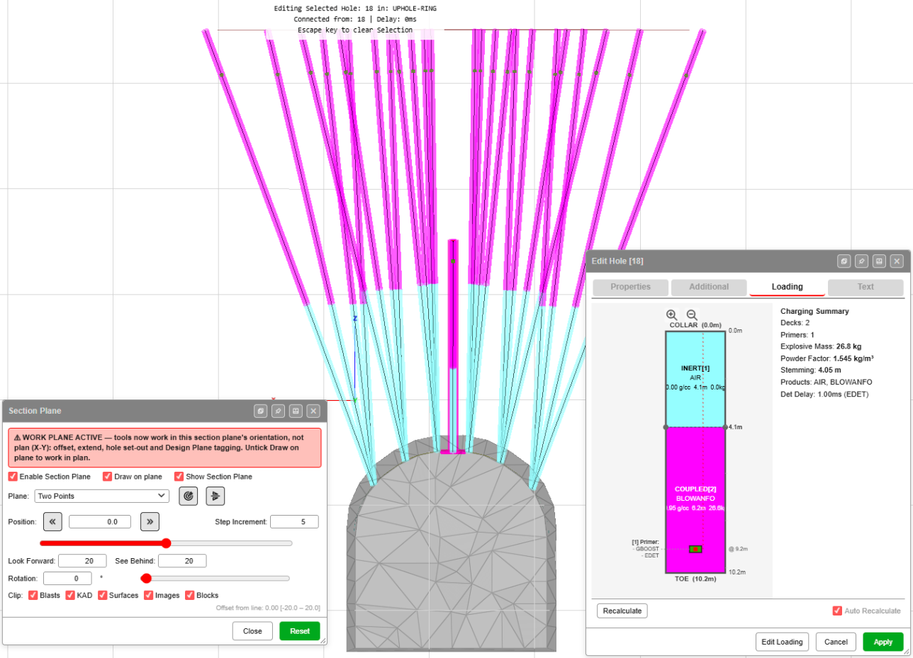

# Design Underground Rings and Drives on a Section Plane

Underground design in Kirra is design **on a section**. You take a section across the drive,
make it the plane the tools work in, and then draw, offset, triangulate and set out holes on it
the way you would in plan. This page walks through a development round on a drive face and an
uphole production ring above the drive, charged and checked.

*Left: a development round drilled into the face (green). Right: an uphole ring collared on the
drive back and fanned up to a target surface (red).*

**Kirra does not have a ring generator or a face (burn-cut) generator yet.** You set the holes out
with the drawing and hole tools below, and edit them in **Edit Hole**. Sections are not saved
either: Kirra remembers the thickness, step, rotation and clip settings, but not the section line,
and **Draw on plane** is off at the start of every session.

---

## Before you start

- The drive, as surfaces or as KAD lines you will draw — at least the profile where the face or
  ring sits.
- For a ring, the level or surface the toes reach, such as the stope back or a target surface.
- The **3D** view. A section is a 3D view; the Section Plane switches to it for you.

---

## 1. Take the section and work on it

1. Click **Section Plane** on the **Select** toolbar.
2. Tick **Enable Section Plane**.
3. Set **Plane** to **Two Points** and click two points **across** the drive where the face or the
   ring is to be. The view turns to look along the drive at the section. **Segment** does the same
   from a line you have already drawn.
4. Tick **Draw on plane**. The warning *WORK PLANE ACTIVE* appears across the top of the dialog:
   from now on drawing, offset, extend, triangulation and hole set-out work in the section, not in
   plan.
5. Tick **Show Section Plane** for a grid on the section. The grid spacing is the
   **Step Increment**.
6. Set the slice. **Look Forward** and **See Behind** of **1** show just the face; **20** shows a
   whole ring fan, as in [step 4](#4-design-an-uphole-ring).

*Looking along the drive at the face: perimeter holes 1–24, lifters L1–L7, and the cut in the
middle.*

To move to the next face or ring, step the section with the double-chevron buttons beside
**Position**, or **Page Up** / **Page Down**. The full list of controls is in
[Section Views](../reference/section-views.md#section-plane).

---

## 2. Draw the drive profile on the section

With **Draw on plane** ticked, KAD points, lines and polygons land on the section instead of in
plan — see [Drawing Tools](../kad/drawing-tools.md).

- **Profile.** Draw the drive outline as a KAD polygon or line on the section.
- **Rows inside the profile.** [Offset](../kad/offset.md) works in the section: offset the profile
  inwards for the perimeter, easer and other rows. Each offset is a new line you can set holes out
  along.
- **A face or back surface.** [Triangulate](../surfaces/triangulate.md) gains a **Triangulate In**
  field: choose **Section plane** to build a surface across the face. A face or a wall works; a
  whole tunnel does not.

---

## 3. Set out a development round on the face

*The perimeter line picked from START to END on the face, ready to set out holes along it.*

[Holes Along Polyline](../blast-design/holes-along-polyline.md) is the tool that sets holes out
**in** the section: collars along the line, drilled into the face.

1. With the section set up as in step 1, click **Holes Along PolyLine** on the **Holes** toolbar.
2. Click the line — for example the perimeter offset.
3. Click the vertex where the holes start, then the vertex where they end. The canvas labels them
   **START** and **END**, and the **Generate Holes Along Polyline** dialog opens.
4. Fill in the dialog and click **OK**.

On a section, some fields mean something different from plan:

| Field | On a section |
|---|---|
| **Collar Elevation (m)** | Ignored. The collars sit on the section, on the line you picked |
| **Hole Angle (° from vertical)** | The angle off **square to the face**. **0** drills straight into the face; a few degrees gives look-out. See [Known issues](#known-issues) |
| **Length (m)** | How far the holes drill into the face |
| **Bearings are 90° to Segment** | Each hole is set square to its own segment of the line |
| **Spacing (m)** | Distance between collars, measured along the line |
| **Hole Type** | Name the row, for example **Easer**, **Lifter** or **Cut** |

Run it once for each row line to build up the round: perimeter, easers, lifters, then the cut.

### Face holes are Non X-Y holes

Holes set out this way are **Non X-Y** holes: Kirra measures them against the section (their
**Design Plane**), not against plan. In **Edit Hole**, the **Properties** tab shows plane fields
in place of the plan ones.

| Field | Measured |
|---|---|
| **Plane Angle (°)** | From the Design Plane's normal: **0** = square into the plane. Change the look-out here after the holes are made |
| **Plane Bearing (°)** | Around the normal, looking into the plane: 0° = up, 90° = right, 180° = down, 270° = left |
| **Plane Subdrill (m)** | Drilled past the design depth, along the normal |
| **Plane Bench (m)** | Depth from the collar to the grade, along the normal |
| **Collar Z RL (m)** | The collar's elevation |

**Add Hole**, **Add Pattern**, **Pattern in Polygon** and **Holes Along Line** also click on the
section, but they drill by plan angle and bearing. To turn holes made with them into face holes,
select them, open **Edit Hole**, and on the **Additional** tab set **Design Plane** to
**Non X-Y hole — active section plane**. It needs **Draw on plane** ticked.
[Insert Holes](../blast-design/insert-holes.md) continues a row of face holes in their Design Plane.

---

## 4. Design an uphole ring

An uphole is an ordinary hole with a **negative Dip/Angle** and a **negative Hole Length**. The
toe is above the collar. Negate **both**: a negative angle with a positive length — or the other
way round — drills the hole the opposite way to its bearing.

*Ring hole 1: Dip/Angle −30, Hole Length −25.18, collar at RL 88.20, toe at RL 110.00.*

1. Draw a collar line along the arch of the drive back, on the section.
2. Set the collars out along it with **Holes Along PolyLine**, as in
   [step 3](#3-set-out-a-development-round-on-the-face). Its dialog only takes a positive angle
   and length, so the holes come out drilling down for now.
3. Select the holes of a row, right-click one, and in **Edit Hole** set:
   - **Dip/Angle (°)** — negative. **−30** is 30° off vertical, upward.
   - **Hole Length (m)** — negative.
   - **Bearing (°)** — fan the holes across the ring, for example from **−40** to **40**.
   - **Grade Z RL (m)** — the level the toes reach, for example **110**.
4. Repeat for the next row with its own angle. The example ring tilts its rows at **−30**, **−20**,
   **−10** and **−5**.

**Edit Hole** takes calculations for a whole selection: type `=+0.3` to add or `=-0.2` to subtract
from each hole's value — see [Editing Holes](../blast-design/editing-holes.md#bulk-edit).

If you place a single uphole with [Add Hole](../blast-design/adding-holes.md) instead, leave
**Use Grade Z** unticked and type the negative **Dip/Angle** and **Length** yourself. With
**Use Grade Z** ticked, Kirra works the length out as a positive number, and the hole drills the
opposite way.

---

## 5. Show the markers square to the hole

In plan, the collar, grade and toe markers and the hole text lie flat. For face holes and upholes,
turn them square to the hole so they read along the section.

1. Select the holes and right-click one to open **Edit Hole**.
2. On the **Additional** tab, set **Marker Alignment (3D)** to **Hole Track**.
3. Click **Apply**.

**Plan** puts them back flat.

---

## 6. Charge the upholes

Charge upholes in the [Deck Builder](../charging/deck-builder.md) or on the **Loading** tab of
**Edit Hole**, the same as any hole. Deck depths are metres **from the collar** for every hole —
for an uphole the collar is the **low** end, at the drive.

The Loading diagram always draws **COLLAR** at the top, even for an uphole. Read it from the
collar: in this hole the first 4.1 m above the drive is air, and the BLOWANFO runs from 4.1 m up
to the toe, with the primer at 9.2 m near the toe. The uncharged collar length is reported as
**Stemming**.

*The charged ring seen along the section: uncharged collars at the drive, explosive towards the
toes.*

---

## 7. Blast volume and powder factor

Kirra works out a volume for every blast, so you do not need a solid to design or charge a ring.
But a fan's volume is not burden × spacing × hole length, so to report the ring's volume and
powder factor correctly, give it a closed solid:

1. Build the solid with the surface tools — [Extrude KAD to Solid](../surfaces/extrude-kad-to-solid.md),
   [Triangulate](../surfaces/triangulate.md) and the [Booleans](../surfaces/boolean-csg.md). The
   example ring's solid is two surfaces joined with a union, with the sides then connected by hand.
2. In the [Data Explorer](../working-in-kirra/data-explorer.md), right-click the ring's blast and
   choose **Assign Volume…**.
3. Choose **Created solid (select below)** and pick the solid.

The blast's volume and powder factor then come from the solid — see
[Statistics](../analysis/statistics-voronoi.md). For a fan, report the **blast** powder factor;
per-hole powder factors are estimates.

---

## 8. Check the design

- **Step through it.** Step the section along the drive with **Page Up** / **Page Down** and look
  at each ring or face in turn. Widen **Look Forward** and **See Behind** to see a whole ring.
- **Check the toes.** In the example, the centre hole of each row stops at RL 100 while the rest
  reach RL 110, leaving a gap at the top of the ring. A section along the ring shows it straight
  away.
- **Coverage.** The [Analyse toolbar](../analysis/analyse-toolbar.md) shaders show the explosive
  distribution through the ring.

---

## Known issues

| Issue | What to do |
|---|---|
| **Hole Angle (° from vertical)** in Holes Along Polyline reads "from vertical", but on a section the angle is from square to the face. Kirra treats the section as if it were plan | Read it as "off square to the face": **0** drills straight in |
| **Collar Elevation (m)** in Holes Along Polyline does nothing on a section | Ignore it — the collars sit on the line you picked |
| On the **Additional** tab of **Edit Hole**, the **Design Plane (now Non X-Y)** label runs into its list | The list still works |
| The section line is not saved | Take the section again each session — **Two Points** across the drive at the same place |
| No export for underground drill rigs yet | See below |

### Exporting to an underground drill rig

Kirra has no export written for underground drill rigs or systems yet. Each one needs a real
example of the file the rig or system reads — IREDES, an XML or anything else — to build and
check against, and none has been provided so far. If you have one you can share, send it to
[blastingapps.xyz@gmail.com](mailto:blastingapps.xyz@gmail.com) with the rig or system it is for.

---

## Related

- [Section Views](../reference/section-views.md) — every Section Plane control
- [Holes Along Polyline](../blast-design/holes-along-polyline.md)
- [Editing Holes](../blast-design/editing-holes.md)
- [Offset](../kad/offset.md) and [Triangulate](../surfaces/triangulate.md) on a section
- [Deck Builder](../charging/deck-builder.md)
