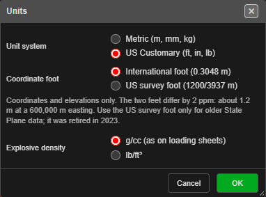
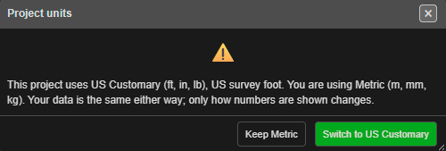

# Units — Metric or US Customary

Kirra can show its numbers in **Metric** or **US Customary** (also called imperial). Kirra
always stores metric. The choice changes only what you see and type, never your data.

Kirra starts in Metric. Nothing changes until you choose US Customary.

---

## Choose your units

1. Click **Units**: the ruler button in the top bar, beside **Help**.

   

2. Under **Unit system**, choose **Metric (m, mm, kg)** or **US Customary (ft, in, lb)**.
3. For US Customary, choose a **Coordinate foot**:
   - **International foot (0.3048 m)**;
   - **US survey foot (1200/3937 m)**.

   There is no default foot. Kirra won't accept US Customary until you pick one, and says
   *Choose a coordinate foot for US Customary.* See [Which foot?](#which-foot) below.
4. For US Customary, choose **Explosive density**: **g/cc (as on loading sheets)** or
   **lb/ft³**.
5. Click **OK**.

*US Customary with the international foot. The note under **Coordinate foot** says when each foot applies.*

Kirra remembers your choice in this browser, for every [workspace](workspaces.md).

---

## What US Customary shows

| Quantity | Metric | US Customary |
|---|---|---|
| Coordinates and elevations | m | ft, in the coordinate foot you chose |
| Lengths: burden, spacing, hole length, bench height, subdrill, stemming, decks | m | ft, always the international foot |
| Hole diameter | mm | in |
| Mass | kg | lb |
| Area | m² | ft² |
| Volume | m³ | yd³ |
| Powder factor | kg/m³ | lb/yd³ |
| Linear charge | kg/m | lb/ft |
| Explosive density | g/cc | g/cc or lb/ft³, as you chose |
| Rock density | kg/m³ | lb/ft³ |
| Peak particle velocity (PPV) | mm/s | in/s |
| Scaled distance | m/kg½ | ft/lb½ |
| Timing relief | ms/m | ms/ft |

Feet and inches show 2 decimals; pounds show 1.

When you type into a field in US Customary, you type in the units it shows. Kirra converts
the value to metric as it stores it.

**Formulas** work in metres and kilograms whichever units you show. To give a number in
feet or pounds, wrap it: `ft(10)`, `inch(18)`, `lb(250)`.

---

## Which foot?

The coordinate foot applies to **coordinates and elevations only**. Burden, spacing, hole
lengths and other lengths always use the international foot.

The two feet differ by 2 parts per million. Over a hole that's nothing; over a big
coordinate it isn't: about 1.2 m at an easting of 600,000 m. Use the **US survey foot**
only for older State Plane data. It was retired in 2023, but much existing survey data is
still in it. If you aren't sure, ask whoever supplied your coordinates.

---

## Opening a project in other units

A KAP project or KAT template remembers the units it was made in. When you open one whose
units differ from yours, **Project units** says, for example, *This project uses US
Customary (ft, in, lb), US survey foot. You are using Metric (m, mm, kg). Your data is the
same either way; only how numbers are shown changes.*

- **Switch to US Customary** shows the project in its units.
- **Keep Metric** leaves your units as they are.

Either way the data is identical. You can change units again at any time with **Units**.

---

## Files in feet

A file's units are its own. Kirra reads or writes a file in the units the file or its
dialog says, whatever units Kirra shows. A metric user can read a feet file, and a US user
can read a metres one.

- Formats that don't record their units ask, with a **Project units** or **File units**
  choice in their import or export.
- DXF files read their units from the file, and ask when an older DXF doesn't say.
- LAS / LAZ point clouds and shapefiles take their unit from the file's coordinate system,
  when it names one.
- Importing through a coordinate system measured in feet (US State Plane, for example)
  converts the coordinates to metres as they're read.
- A GeoTIFF exported in a coordinate system measured in feet is written in that system's
  feet.
- In a Surpac STR or ViewShot file in feet, hole diameter is in inches.

[Files in feet or yards](../reference/supported-formats.md#files-in-feet-or-yards) lists
every format and where its units are set.

---

## Troubleshooting

| Problem | Fix |
|---|---|
| **OK** won't accept US Customary | Choose a **Coordinate foot** |
| Coordinates are about a metre out on a large easting | The wrong foot. Check which foot your coordinates use, and pick it in **Units** |
| Numbers changed after opening a colleague's project | You chose **Switch to** in **Project units**. Use **Units** to change back; your data didn't change |
| A file in feet comes in far too small or too large | Set the file's own **File units** or **Project units** when you import it. The **Units** button doesn't change how files are read |

---

## Related

- [Settings](settings.md)
- [Starting, Saving & Projects](starting-and-saving.md)
- [Supported Formats: files in feet or yards](../reference/supported-formats.md#files-in-feet-or-yards)
- [CSV Formats: File units](../importing/csv-formats.md#file-units)
